# 이커머스 멀티모달 분석 · H&M 표본

H&M의 2020년 6~8월 거래를 바탕으로 고객이 얼마나 최근에, 자주, 많이 샀는지 분석한다. 거래에 상품 정보와 사진을 연결해 데이터의 분포를 살펴보고, 구매 패턴이 비슷한 고객을 묶어 그룹별 전략을 제안한다.

저장된 표·사진·차트는 [분석 노트북](notebooks/analysis_report.ipynb)에서 볼 수 있다. 직접 실행하려면 [환경과 실행](#환경과-실행)에서 시작한다. 구현 기준과 작업 기록은 [통합 계획](docs/a1_1_detailed_plan.md)과 [체크표](docs/a1_1_checklist.md)에 있다. [파일 안내](index.md) · [기능별 수정 위치](reverse_index.md) · [작업 규칙](AGENTS.md)

## 목차

**본문 (설명 순서)**

1. [미션 개요 및 목표](#미션-개요-및-목표) · [문서 지도](#문서-지도)
2. [입력과 계산 기준](#입력과-계산-기준) · [분석 흐름과 원본 보존](#분석-흐름과-원본-보존)
3. [실제 실행 결과와 기술통계](#실제-실행-결과와-기술통계) · [필수 시각화 6종](#필수-시각화-6종)
4. [실제 고객 그룹 요약](#실제-고객-그룹-요약) · [비즈니스 인사이트](#비즈니스-인사이트)
5. [보너스 3개 실제 구현 결과](#보너스-3개-실제-구현-결과) · [범위와 한계](#범위와-한계)

**부록 (실행·재현·코드 구조)**

6. [환경과 실행](#환경과-실행) · [비공개 데이터 준비](#비공개-데이터-준비)
7. [전체 분석과 검증](#전체-분석과-검증) · [검증을 직접 재현할 작은 입력](#검증을-직접-재현할-작은-입력) · [원본 실행 보고서와 다시 생성하는 방법](#원본-실행-보고서와-다시-생성하는-방법)
8. [소스 구조와 실행 흐름](#소스-구조와-실행-흐름) · [기능별 SRC](#기능별-src) · [기능 구현 요약](#기능-구현-요약) · [작업 체크표](docs/a1_1_checklist.md)

## 미션 개요 및 목표

미션은 주문 기록처럼 숫자와 날짜가 있는 표에 상품명과 사진처럼 형식이 다른 정보도 연결해 분석하는 과제다. 이 프로젝트는 같은 기간에 거래한 고객 중 1,000명을 골라, 그 고객들의 거래와 관련 상품 정보를 분석했다. 사진은 관련 상품 가운데 200장만 추출했다. [미션 원문](docs/a1_1_mission.md) · [H&M Kaggle 대회 데이터](https://www.kaggle.com/competitions/h-and-m-personalized-fashion-recommendations/data)

1. **거래와 상품 정보 연결.** 예를 들어 같은 셔츠를 산 거래가 여러 건이면, 상품 번호로 각 거래에 같은 상품명과 사진 요약값을 붙인다. 사진 자체를 거래마다 복제할 필요가 없고, 거래 행 수도 유지할 수 있다. 이 절차를 Python 클래스 `DataAnalyzer`로 묶어 다시 쓸 수 있게 했다. [분석 클래스](src/pipeline.py#L20)
2. **분포 확인.** 분석에 필요한 숫자나 항목을 **피처**라고 한다. 상품명은 글자 수와 단어 수로, 사진은 픽셀 평균과 표준편차로 바꾼다. 빠진 값과 유난히 큰 금액을 점검하고, 통계와 차트 6종으로 분포를 확인한다. 이 과정을 **탐색적 데이터 분석(EDA)**이라고 한다. [탐색적 데이터 분석 해설](docs/tech_study.md#eda탐색적-데이터-분석의-4단계-풀이와-코드-연결)
3. **고객별 구매 패턴 비교.** 최근성(Recency), 빈도(Frequency), 구매금액(Monetary)의 첫 글자를 따서 **RFM**이라고 한다. 세 지표로 표본 고객을 4개 그룹으로 나누고, 관측 수치를 근거로 그룹별 비즈니스 실험 3개를 제안했다. [고객 그룹 결과](#실제-고객-그룹-요약) · [비즈니스 인사이트](#비즈니스-인사이트)

### 문서 지도

읽는 목적에 따라 필요한 문서나 발표자료를 골라 볼 수 있다.

| 문서 | 언제 보는가 |
| --- | --- |
| 이 README | 데이터 → 분석 흐름 → 결과 → 전략 순서로 프로젝트 전체를 설명할 때 |
| [미션 원문과 구현 대조](docs/a1_1_mission.md) | 미션 요구사항 하나하나가 어디에 구현됐는지 확인할 때 |
| [평가 Q&A](docs/a1_1_evaluation_qa.md) | 평가 질문별 답변과 근거를 찾을 때 |
| 미션 설명 [PPTX](docs/presentation/a1_1_mission_explanation.pptx) · [PDF](docs/presentation/a1_1_mission_explanation.pdf) | 미션 요구사항·분석 흐름·실제 결과를 22장으로 설명할 때 |
| [tech_study.md](docs/tech_study.md) | IQR·RFM·벡터화 같은 개념을 공부하거나 설명할 때 |

## 입력과 계산 기준

CSV는 쉼표로 열을 구분한 표 파일이다. 거래 표 `data/raw/hm/transactions_sample.csv`의 한 행은 상품 하나의 구매 기록이고, 상품 표 `data/raw/hm/articles_sample.csv`의 한 행은 상품 하나의 정보다. 아래 표는 두 파일을 연결할 때 쓰는 열과 상품 사진에서 숫자를 만드는 방법을 정리한 것이다. [입력 열과 조인 코드](notebooks/analysis_report.ipynb?plain=1#L679) · [이미지 계산 코드](utils/image_features.py#L64)

| 입력 또는 처리 항목 | 의미 |
| --- | --- |
| `customer_id`, `article_id`, `sales_channel_id` | 고객·상품·판매 채널 식별자. 앞자리 0을 보존하기 위해 문자열로 읽는다. |
| `t_dat` | 상품을 구매한 날짜. 미션의 `order_date`에 해당한다. |
| `price` | 해당 구매 행에 기록된 금액. 표와 차트에 사용하는 금액은 모두 이 원본 단위다. |
| `prod_name`, `product_type_name` | 상품명·카테고리 |
| 이미지 | 선별된 상품 이미지만 빨강·초록·파랑(RGB) 값으로 표현한다. 픽셀 값의 범위를 0~1로 맞추고 32×32 픽셀의 배열로 줄여 계산한다. 수치 자료형은 [32비트 실수(float32)](docs/tech_study.md#4-numpy-배열벡터화메모리)다. |
| 이미지 통계 | 사진 여러 장을 한 묶음(배치)으로 쌓는다. 배열 `(N,H,W,C)`에서 N은 이미지 수, H·W는 높이·너비, C는 색상 채널이다. 이미지 한 장의 모든 픽셀·색상 값으로 평균과 표준편차를 구한다. 표준편차는 이미지 안의 값이 얼마나 퍼져 있는지를 나타낸다. |

### 표본 추출 기록과 분석 설정

- **표본 추출 기록(manifest)**은 표본을 뽑을 때 사용한 기간·채널·난수 시드와 RFM 기준일을 저장한 파일이다. Kaggle에서 `notebooks/prepare_hm_sample.ipynb`를 실행하면 표본 ZIP에 이 기록을 넣는다. 로컬에서 ZIP을 풀면 `data/raw/hm/sample_manifest.json`에 있다. [추출 기록 작성 코드](notebooks/prepare_hm_sample.ipynb?plain=1#L234) · [표본 복원 방법](#비공개-데이터-준비)
- **분석 설정(`SETTINGS`)**은 `notebooks/analysis_report.ipynb` 상단의 **설정** 코드 셀에서 항목 이름과 값을 짝지어 둔 Python 딕셔너리다. 분석을 시작할 때 시작일·종료일·시드·채널이 복원한 추출 기록과 일치하는지 확인한다. [설정 선언과 일치 검사](notebooks/analysis_report.ipynb?plain=1#L69)

아래 표는 이 README의 결과를 얻을 때 사용한 값이다. 같은 표본을 다시 만들거나 다른 설정으로 실행할 때 확인한다. `NB_FEATURES`는 상품 피처 계산, `NB_RFM`은 고객별 구매 지표 계산 단계다. 표의 링크를 열면 해당 코드 위치로 이동한다.

| 설정이 있는 파일과 항목 | 실행값 | 의미 |
| --- | --- | --- |
| `data/raw/hm/sample_manifest.json`과 [`notebooks/analysis_report.ipynb`의 `SETTINGS`](notebooks/analysis_report.ipynb?plain=1#L69) · `start_inclusive`, `end_exclusive`, `seed`, `sales_channel` | `2020-06-01`, `2020-09-01`, `42`, `None` | 시작일 포함, 종료일 제외. 난수 시드는 같은 표본을 다시 고르는 데 쓰는 시작값이다. 채널 값 `None`은 전체 채널을 뜻한다. |
| [`notebooks/analysis_report.ipynb`의 `SETTINGS`](notebooks/analysis_report.ipynb?plain=1#L69) · `image_size` | `32` | 계산에 사용할 사진 크기를 32×32 픽셀로 맞춘다. |
| [`notebooks/analysis_report.ipynb`의 `SETTINGS`](notebooks/analysis_report.ipynb?plain=1#L69) · `batch_size` | `32` | 한 번에 묶어 처리하는 상품 이미지의 최대 수다. |
| [`notebooks/analysis_report.ipynb`의 `SETTINGS`](notebooks/analysis_report.ipynb?plain=1#L69) · `iqr_threshold` | `1.5` | 거래 금액의 이상치 경계를 정할 때 사분위수 범위(IQR)에 곱할 배수다. |
| [`notebooks/analysis_report.ipynb`의 `NB_FEATURES` 호출](notebooks/analysis_report.ipynb?plain=1#L1036) · `histogram_bins` | `8` | 사진 속 픽셀의 밝기를 몇 구간으로 나눠 비율을 셀지 정한다. [이미지 함수의 인자](src/pipeline.py#L189-L191) |
| `data/raw/hm/sample_manifest.json` · `reference_date` | `2020-08-31` | 선택 기간·채널에서 고객 표본을 뽑기 전 마지막 유효 구매일이다. [노트북의 `NB_RFM`에서 기준일 전달](notebooks/analysis_report.ipynb?plain=1#L1491) |
| [`src/pipeline.py`의 `DataAnalyzer.calculate_rfm()`](src/pipeline.py#L162-L163) · `frequency_unit` | `purchase_day` | `NB_RFM` 호출에서 이 인자를 생략하므로 기본값이 적용된다. 같은 날 여러 번 구매해도 구매일은 하루로 센다. |

표본의 기간·시드·채널을 바꾸려면 [`notebooks/prepare_hm_sample.ipynb`의 추출 설정](notebooks/prepare_hm_sample.ipynb?plain=1#L43)을 바꿔 표본을 다시 만든 뒤, 분석 노트북의 `SETTINGS`를 새 추출 기록과 맞춘다.

### 거래 정제와 고객별 계산 기준

구매를 고객별로 집계할 수 있도록 고객 ID와 날짜가 있고 금액이 유한한 양수인 거래를 선택한다. 한 행에 여러 문제가 있으면 고객 ID, 날짜, 주문 모드의 주문 ID·취소 여부, 금액 순으로 먼저 확인한 사유 하나만 기록한다. H&M에는 주문 ID가 없어 고객·날짜·금액으로 검사하고, 날짜와 금액이 같은 거래도 각각 보존한다. 상품 정보나 사진이 없어도 거래가 유효하면 고객별 구매금액에 포함한다. [거래 정제 코드](utils/analytics.py#L7)

고객마다 다음 세 지표를 계산한다. 기준일은 위 표의 `2020-08-31`이다.

- **최근성(R, Recency)**은 마지막 구매일부터 기준일까지 지난 일수다. 기준일에 구매했으면 0일이다.
- **구매 빈도(F, Frequency)**는 구매한 날짜의 수다. 주문 ID가 있는 다른 데이터는 `frequency_unit="order"`와 주문 ID 열 이름(`order_col`)을 넘겨 주문 수를 셀 수 있다.
- **구매금액(M, Monetary)**은 유효 거래의 금액을 보정 없이 더한 값이다.

예를 들어 고객 A가 1월 1일에 10·20, 1월 3일에 30을 쓰고, 고객 B가 1월 2일에 5를 썼다면 기준일 1월 3일에 A는 **R=0일·F=2일·M=60**, B는 **R=1일·F=1일·M=5**다.

각 지표를 고객끼리 비교해 1~4점을 부여한다. R은 일수가 짧을수록, F와 M은 값이 클수록 높은 점수를 받는다. 동점에는 평균 순위를 적용한다. 순위 비율 `(평균 순위−0.5)/고객 수`가 0.25·0.50·0.75 이하인지에 따라 순서대로 1·2·3점을 주고, 그보다 크면 4점이다. 예를 들어 M이 `5, 20, 60, 100`이면 순위 비율은 0.125·0.375·0.625·0.875이고 점수는 1·2·3·4점이다. [RFM 점수 계산 코드](utils/analytics.py#L148-L152)

아래 표는 어떤 고객을 어느 그룹에 넣었는지 보여준다. 위에서부터 조건을 확인해 처음 맞는 그룹 하나만 적용한다. 반복 구매 조건에는 점수와 별도로 **실제 구매일 수**를 사용한다. [그룹 배정 코드](utils/analytics.py#L153-L164)

| 확인 순서 | 그룹 | 조건 |
| ---: | --- | --- |
| 1 | VIP | R·F·M 점수 모두 3점 이상이고 구매일이 2일 이상 |
| 2 | Loyal | R·F 점수 모두 3점 이상이고 구매일이 2일 이상 |
| 3 | New | R 점수 3점 이상이고 구매일이 1일 |
| 4 | Churned | R 점수 2점 이하로 마지막 구매가 상대적으로 오래됨 |
| 5 | Potential | 위 조건 어디에도 해당하지 않음 |

New와 Churned는 이 기간의 구매 기록으로 붙인 그룹 이름이다. 가입일과 실제 이탈 여부를 판단하려면 별도 데이터가 필요하다. [RFM 점수와 세분화 해설](docs/tech_study.md#9-rfm점수세분화)

## 분석 흐름과 원본 보존

위 기준을 적용한 다음, 분포를 그리는 데 쓸 보정값과 고객별 구매를 집계할 원금액을 각각 사용한다. 사진 요약값의 빈칸을 채우거나 극단값을 경계값으로 바꾸는 작업은 분포 비교용 사본에 적용한다.

1. 거래 파일을 읽고 고객·상품 ID와 날짜 형식을 맞춘다. 날짜 오류나 금액 오류 등 제외 사유별 건수를 기록한다. [거래 읽기와 정제(NB_LOAD)](notebooks/analysis_report.ipynb?plain=1#L679)
2. 거래 표를 기준으로 상품 ID가 맞는 상품 정보를 붙인다. 같은 상품을 여러 번 샀어도 각 거래를 유지한다. 연결 전후의 행 수·순서·금액 합계를 대조한다. [상품 연결(NB_LOAD)](notebooks/analysis_report.ipynb?plain=1#L691)
3. 상품명 길이·단어 수와 사진 평균·표준편차를 상품마다 한 번 계산하고, 필요한 값을 거래에 연결한다. [상품 피처(NB_FEATURES)](notebooks/analysis_report.ipynb?plain=1#L735)
4. 분포를 비교할 상품 사본에서 빠진 이미지 통계를 같은 상품 유형의 평균으로 채운다. 그 유형의 관측값이 없으면 채우기 전 전체 관측값의 평균을 쓴다. 사진 표본에 뽑히지 않은 상품은 비워 둔다. [결측 대치(NB_CLEAN)](notebooks/analysis_report.ipynb?plain=1#L1314)
5. 가운데 절반의 금액 폭을 사분위수 범위(IQR)라고 한다. 이 폭으로 정한 경계 밖 금액을 표시하고 분포 비교용 사본에만 경계값을 넣는다. [이상치 처리(NB_CLEAN)](notebooks/analysis_report.ipynb?plain=1#L1322)
6. 유효한 거래의 원금액을 고객별로 더하고 RFM과 그룹을 계산한다. 그룹을 합쳤을 때 고객 수와 원금액이 전체와 일치하는지 대조한다. [고객별 계산(NB_RFM)](notebooks/analysis_report.ipynb?plain=1#L1491)
7. 거래·상품·고객별로 기술통계와 상관관계를 계산한다. 다음 단계에서 원금액의 월별 합계와 차트 6종을 만든 뒤, 그룹 요약표를 바탕으로 비즈니스 전략을 적는다. [통계(NB_STATS)](notebooks/analysis_report.ipynb?plain=1#L1732) · [차트(NB_PLOTS)](notebooks/analysis_report.ipynb?plain=1#L1998) · [인사이트 작성](notebooks/analysis_report.ipynb?plain=1#L2165)

아래 표는 각 분석 단계가 어떤 입력을 받고 어떤 결과를 반환하는지 확인할 때 쓴다. 메서드는 클래스가 제공하는 함수다. `df`는 분석 중 보관하는 거래 표(DataFrame), Series는 금액처럼 한 열을 담는 자료형, `NaN`은 비어 있는 값이다. [DataAnalyzer 구현](src/pipeline.py#L20)

| 분석 메서드 | 입력 | 반환 | 저장하거나 갱신하는 값 | 노트북 확인 위치 |
| --- | --- | --- | --- | --- |
| `load_data()` | 거래 파일 경로·필수 열·자료형 | 읽어 온 거래 표 | `df`를 교체하고 이전 작업의 상품·검증 기록을 초기화 | `NB_LOAD`의 입력 미리보기. 같은 단계에서 정제와 조인을 이어 실행 |
| `handle_missing_values()` | 채우는 방법·상품 유형·대상 열·대상 행 | 대치한 DataFrame | `df`와 `missing_audit` 갱신 | `NB_CLEAN` 및 `[10, NaN, NaN]` → `[10, 10, NaN]` |
| `detect_outliers()` / `clip_outliers()` | 수치 열·IQR 배수 | 행별 경계 초과 여부 / 보정 금액 한 열 | `outlier_audit` 갱신, `df`의 원금액 보존 | `NB_CLEAN` 및 `[1,2,3,4,100]`의 경계 −1·7, 100만 탐지 |
| `calculate_rfm()` | 고객·날짜·금액·기준일·빈도 단위 | 고객별 RFM 표 | `rfm_audit` 갱신, 거래 `df` 보존 | `NB_RFM`의 실제 1,000명과 손계산 A `(0,2,60)`, B `(1,1,5)` |

## 실제 실행 결과와 기술통계

먼저 분석에 실제로 들어간 데이터의 규모를 확인한다. **유효 거래 8,084행과 조인 직후 9열**은 미션의 최소 1,000행·8열 기준을 충족한다. 고객과 상품은 ID가 서로 다른 개체의 수이고, 이미지 상태는 상품 4,705개마다 하나씩 집계했다. 아래 값은 2026-11-07~08 검증 당시의 표본 결과다. [미션의 데이터 조건](docs/a1_1_mission.md#4-1--데이터-로드-및-기본-탐색) · [조인 결과와 열 자료형(NB_LOAD)](notebooks/analysis_report.ipynb?plain=1#L702) · [집계 기록](docs/results/analysis_aggregates.json)

| 확인 항목 | 결과 |
| --- | ---: |
| 유효 거래 상품 행 | 8,084 |
| 고객 | 1,000 |
| 상품 | 4,705 |
| 상품 조인 직후 열 | 9 |
| 이미지 읽기 성공 | 200 |
| 이미지 표본 미포함 | 4,496 |
| 원본 이미지 누락 | 9 |

거래 표의 열에는 날짜형 1개(구매일), 수치형 1개(금액), 참·거짓형 2개(원본 이미지 유무와 표본에 포함됐는지), 문자열 계열 5개(ID·상품명·상품 유형)가 있다. 사진에서 계산한 값은 이후 단계에서 추가한다. 이미지 미포함 4,496개는 원본 사진이 있으나 이번 표본에 넣지 않은 상품이고, 나머지 9개에는 원본 사진이 없다. [거래 미리보기와 열 자료형](notebooks/analysis_report.ipynb?plain=1#L698) · [이미지 상태 처리](utils/image_features.py#L96-L105)

다음 표는 거래 행을 기준으로 금액과 구매 상품명의 길이·단어 수가 어떻게 분포하는지 보여준다. 중앙값은 값을 작은 순으로 놓았을 때 가운데에 해당하는 값이다. Q1과 Q3는 아래에서 각각 25%, 75%에 해당하는 지점으로, 다음 절의 이상치 경계 계산에 사용한다. [기술통계 계산(NB_STATS)](notebooks/analysis_report.ipynb?plain=1#L1732)

| 변수 | 평균 | 중앙값 | 표준편차 | Q1 | Q3 |
| --- | ---: | ---: | ---: | ---: | ---: |
| price | 0.025014 | 0.022017 | 0.014912 | 0.015237 | 0.033881 |
| prod_name_length | 16.088570 | 16.000000 | 6.207140 | 11.000000 | 21.000000 |
| prod_name_word_count | 2.840673 | 3.000000 | 1.105405 | 2.000000 | 4.000000 |

금액 평균(0.025014)은 중앙값(0.022017)보다 높다. 뒤의 히스토그램을 함께 보면 높은 금액들이 평균을 끌어올리는 모습을 볼 수 있다. 이 표에는 표본 표준편차(`ddof=1`)를 쓴다. 사진 피처의 표준편차는 이미지 한 장의 픽셀 전체를 대상으로 계산한다(`ddof=0`). [표본과 픽셀의 표준편차 계산 차이](docs/tech_study.md#7-통계이상치상관)

두 변수가 함께 움직이는 정도는 피어슨 상관계수(Pearson r)로 요약했다. 값이 +1에 가까우면 같은 방향으로, −1에 가까우면 반대 방향으로 움직이는 경향이 강하다. 아래 표는 사진을 실제로 읽은 상품 200개와 고객 1,000명을 각각 한 번씩 세어서, 거래가 많은 상품이나 고객을 같은 분석 안에서 여러 번 세지 않는다. [상관계수 계산(NB_STATS)](notebooks/analysis_report.ipynb?plain=1#L1733)

| 분석 단위·상관 쌍 | 유효 쌍 수 | Pearson r | 해석 |
| --- | ---: | ---: | --- |
| 상품: image_mean–image_std | 200 | -0.9435 | 평균이 높은 관측 이미지에서 픽셀 퍼짐이 낮아지는 경향. 밝은 배경·촬영 조건 등을 고려하며 질감을 직접 설명하지 않는다. |
| 고객: Frequency–Monetary | 1,000 | 0.6397 | 구매일이 많은 고객의 관측 금액도 큰 경향. 같은 거래에서 집계되는 구조를 고려하며 인과로 해석하지 않는다. |

빠진 이미지 통계 9건을 그룹 평균으로 채운 사본에서는 이미지 평균의 분산이 0.010424에서 0.010130으로 줄었다. 평균으로 채운 값은 그 그룹의 가운데에 모이기 때문이다. 그래서 위 이미지 상관에는 사본의 대치값을 섞지 않고, 실제로 읽은 사진의 값만 썼다. [결측 대치 전후 기록(NB_CLEAN)](notebooks/analysis_report.ipynb?plain=1#L1320)

### IQR의 통계적 필요성과 한계

`IQR = Q3 − Q1`은 가운데 50%의 퍼짐이다. 사분위수는 극단값이 더 커져도 평균과 표준편차보다 영향을 덜 받으므로, 오염이 섞인 자료에서 중심부를 기준으로 먼 값을 찾는 데 유용하다. `iqr_limits()`는 정규성 가정 없이 `Q1 − 1.5×IQR`, `Q3 + 1.5×IQR`을 계산하고 `detect_outliers()`는 경계 밖을 표시한다. `clip_outliers()`는 같은 경계로 EDA 사본만 보정한다. [경계 계산](utils/analytics.py) · [탐지와 보정](src/pipeline.py) · [IQR 상세 해설](docs/tech_study.md#사분위수quartile와-iqr-기반-이상치-탐지-및-클리핑)

**작은 예** — `[1, 2, 3, 4, 100]`에서 Q1 = 2, Q3 = 4, IQR = 2이므로 경계는 2 − 3 = −1, 4 + 3 = 7이다. 7을 넘는 100만 이상치다. 100을 10,000으로 바꿔도 Q1·Q3와 경계는 그대로지만 평균은 22에서 2,002로 바뀐다. 이것이 평균·표준편차 대신 사분위수를 쓰는 이유다.

실제 표본에서는 같은 거래 8,084행을 두고, 아래 표에서 경계 밖 행 수·중앙값·분산을 각각 비교했다. 행 수를 맞춰 두면 경계값 보정으로 분포가 얼마나 달라졌는지 볼 수 있다. [보정 전후 표(NB_CLEAN)](notebooks/analysis_report.ipynb?plain=1#L1276)

| 동일한 유효 거래 8,084행 | 원금액 | EDA 보정 사본 |
| --- | ---: | ---: |
| 원래 경계 −0.012729 / 0.061847 밖 | 하한 미만 0행 · 상한 초과 212행(2.62%) | 0행 |
| 중앙값 | 0.022017 | 0.022017 |
| 표본분산 (`ddof=1`) | 0.000222373 | 0.000184101 (−17.21%) |

왜도 `+1.554`는 원금액 분포가 큰 금액 쪽으로 길게 늘어났다는 뜻이다. 경계를 넘은 212행에는 유효한 고액 구매도 포함될 수 있다. 보정 뒤 중앙값은 그대로이고 분산은 17.21% 줄었다. 고객 RFM과 월별 집계에는 원금액 합계 202.212746을 사용한다. 다음 절의 첫 두 그림에서 원금액의 분포와 보정 효과를 각각 볼 수 있다.

## 필수 시각화 6종

그림 1·2는 거래 한 줄의 금액 분포를, 그림 3·4는 고객을 한 명씩 세어 계산한 그룹 규모와 RFM 지표의 상관을 보여준다. 그림 5의 점 하나는 상품 사진 한 장, 그림 6의 점 하나는 한 달의 원금액 합계다. 무엇을 한 건으로 세는지 알면 거래가 많은 고객과 고객 수가 많은 그룹을 구분할 수 있다. 그림 아래에 축 이름과 단위를 적었다. [차트 생성 코드](utils/reporting.py#L35) · [노트북에서 차트 만들기(NB_PLOTS)](notebooks/analysis_report.ipynb?plain=1#L1998)

**1. 거래금액 히스토그램:** 값이 집중된 구간과 긴 꼬리를 본다. 원본 금액을 사용하며, 금액이 낮은 쪽에 거래가 몰리고 높은 쪽으로 길게 늘어지는 모습을 볼 수 있다. 따라서 평균과 중앙값을 함께 읽는다.

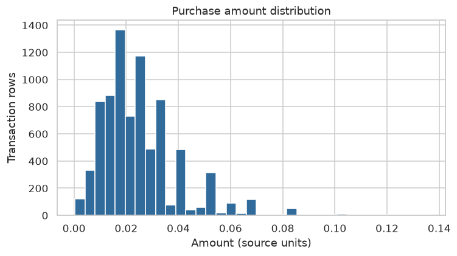  
*▲ 그림 1. 거래금액 히스토그램 (`01_histogram.png`)*  
*X축: `Amount (source units)`(거래금액 원값 구간) · Y축: `Transaction rows`(거래 상품 행 건수)*

**2. IQR 전후 박스플롯.** 상자의 가운데 선은 중앙값이고 상자 전체는 가운데 절반의 금액 범위다. 왼쪽 원금액과 오른쪽 보정 사본을 같은 금액 축에 놓아, 경계 밖 212행을 보정했을 때 큰 값이 줄어든 모습을 비교한다.

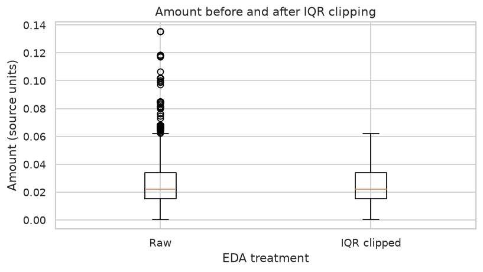  
*▲ 그림 2. IQR 보정 전후 박스플롯 (`02_boxplot.png`)*  
*X축: `EDA treatment`(`Raw` 원금액 vs `IQR clipped` 사본) · Y축: `Amount (source units)`(동일 금액 축)*

**3. 세그먼트 막대그래프:** 원금액으로 RFM을 계산한 고객 1,000명이 어느 그룹에 얼마씩 속하는지 보여준다. 고객마다 막대 하나에 한 번씩 집계된다.

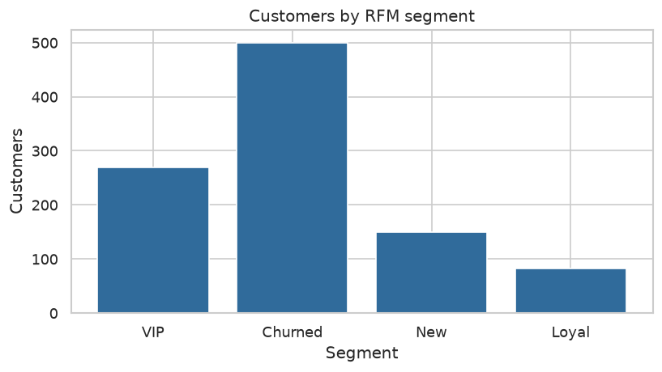  
*▲ 그림 3. 고객 세그먼트별 인원 막대그래프 (`03_bar.png`)*  
*X축: `Segment`(RFM 세그먼트) · Y축: `Customers`(고객 인원수)*

**4. RFM 상관 히트맵:** 고객 1,000명의 RFM 지표 중 두 개를 골랐을 때 얼마나 함께 움직이는지 칸별로 보여준다. 구매일 수와 구매금액이 만나는 칸은 `0.64`로, 구매일이 많은 고객일수록 대체로 금액도 높았다.

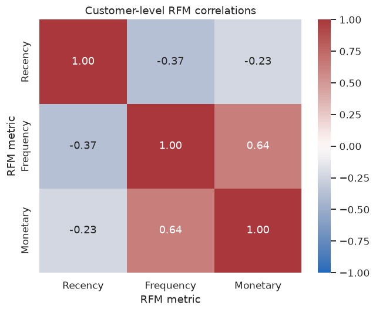  
*▲ 그림 4. 고객 RFM 상관 히트맵 (`04_heatmap.png`)*  
*X·Y축: `RFM metric`(`Recency`, `Frequency`, `Monetary` 지표 쌍)*

**5. 이미지 통계 산점도:** 점을 찍은 상품은 사진 읽기와 픽셀 검사를 통과한 200개다. 점 하나가 상품 하나의 평균 밝기와 픽셀 값의 퍼짐을 나타낸다. 밝은 배경이나 촬영 조건도 이 두 값에 영향을 준다. [이미지 읽기와 상태 기록](utils/image_features.py#L114-L128)

  
*▲ 그림 5. 관측 상품 이미지 통계 산점도 (`05_scatter.png`)*  
*X축: `Pixel mean (0–1)`(평균 밝기) · Y축: `Pixel standard deviation (0–1)`(픽셀 표준편차·대비)*

**6. 월별 금액 라인차트:** 6월부터 8월까지 달의 첫날부터 마지막 날까지 들어 있는 세 달을 비교한다. 각 점은 선택 고객 1,000명이 그달에 구매한 금액의 합계다.

  
*▲ 그림 6. 월별 구매금액 합계 라인차트 (`06_line.png`)*  
*X축: `Complete month`(완전한 연-월) · Y축: `Amount (source units)`(월별 구매금액 합계)*

아래 표는 그림 6의 각 점에 해당하는 값이다. 세 달을 더한 값이 고객별 RFM 계산에 넣은 거래 원금액 202.212746과 일치하는지 대조해, 월별 집계에서 금액 차이가 생겼는지 확인한다. [월별 합계 CSV](docs/results/monthly_amount.csv) · [월별 집계 코드](utils/reporting.py#L19)

| 월 | 구매금액 합계·원본 단위 |
| --- | ---: |
| 2020-06 | 80.766000 |
| 2020-07 | 62.779373 |
| 2020-08 | 58.667373 |

선택 고객의 8월 구매금액은 6월보다 27.4% 적었다. 같은 고객 표본의 세 달을 비교한 값으로, 회사 전체의 매출 변화를 보려면 표본 밖 거래도 포함해야 한다.

## 실제 고객 그룹 요약

그림 3에서 확인한 고객 수에 최근성·구매일 수·금액을 더해 각 그룹의 특성을 비교한다. **고객 비중**의 분모는 전체 1,000명이고 **금액 비중**의 분모는 이들의 전체 구매금액이다. 두 비중을 함께 보면 고객 수가 비슷해도 구매금액에 기여하는 정도가 다른지 알 수 있다. Recency 중앙값은 마지막 구매 후 지난 일수, Frequency 중앙값은 서로 다른 구매일 수, 평균 Monetary는 고객별 구매금액의 그룹 평균이다. [그룹 배정 기준](#거래-정제와-고객별-계산-기준) · [그룹별 집계 CSV](docs/results/segment_profile.csv) · [노트북 집계(NB_RFM)](notebooks/analysis_report.ipynb?plain=1#L1492)

| 그룹 | 고객 수 | 고객 비중 | Recency 중앙값(일) | Frequency 중앙값(구매일) | 고객당 평균 Monetary | 금액 비중 |
| --- | ---: | ---: | ---: | ---: | ---: | ---: |
| VIP | 270 | 27.0% | 12.5 | 3.0 | 0.391468 | 52.3% |
| Churned | 499 | 49.9% | 60.0 | 1.0 | 0.149389 | 36.9% |
| New | 149 | 14.9% | 18.0 | 1.0 | 0.101617 | 7.5% |
| Loyal | 82 | 8.2% | 16.0 | 2.0 | 0.083296 | 3.4% |

## 비즈니스 인사이트

예를 들어 VIP는 고객의 27.0%에 해당하지만 구매금액의 52.3%를 차지한다. 이 차이를 근거로 VIP 유지 실험을 제안했다. 세 제안은 위 표에서 읽은 **근거**, 고객에게 할 **실행**, 효과를 확인할 **검증** 순서로 적었다. 발송 여부를 무작위로 나눠 같은 기간을 비교하면 평소에 다시 살 가능성과 안내의 추가 효과를 구분할 수 있다. [실제 표본 기반 인사이트](docs/results/analysis_report.md) · [인사이트 작성 코드](utils/reporting.py#L73) · [사업 해석과 검증](docs/tech_study.md#10-사업-해석과-검증)

### 1. VIP 유지 실험

- **근거:** VIP는 고객의 27.0%이며 관측 구매금액의 52.3%를 차지한다. 고액·반복 구매 그룹의 유지 성과를 따로 관찰할 이유가 있다.
- **실행:** VIP에 재입고·신상품 우선 알림을 시험하고, 불필요한 상시 할인 없이 재구매를 유지할 수 있는지 확인한다. 효과는 가설이다.
- **검증:** 발송군과 무작위 미발송군의 이후 구매율·고객당 마진을 비교한다. 후속 구매 기록과 상품 마진이 필요하다. 구매율과 수익성이 함께 개선되는지 보고 대상을 늘릴지 판단한다.

### 2. 최근 1개 구매일 고객의 다음 구매 유도

- **근거:** New 그룹은 고객의 14.9%이고 고유 구매일 수 중앙값은 1일이다. 관찰 기간 내 한 구매일만 확인된 그룹이며 실제 신규 가입 고객을 뜻하지 않는다.
- **실행:** 이 그룹에 구매 상품군을 고려한 후속 안내를 시험해 두 번째 구매일이 생기는 비율을 높이는 것을 목표로 한다.
- **검증:** 미발송군 대비 30일 내 추가 구매일 발생률과 마진을 비교한다. 연락 동의·상품 반응·향후 거래가 필요하며 자연 재구매와 계절성의 영향을 통제한다.

### 3. 오래 구매하지 않은 그룹의 재구매 유도

- **근거:** Churned는 고객의 49.9%이고 최근 구매 이후 일수 중앙값은 60일이다. 이 그룹은 관찰 기간에 마지막 구매가 상대적으로 오래됐다. 실제로 이탈했는지는 이후 구매를 확인해야 알 수 있다.
- **실행:** 이 그룹의 과거 반복 구매 여부를 나눠 재입고 안내나 제한된 혜택을 소규모로 실험한다. 재활성화 효과와 비용을 함께 확인한다.
- **검증:** 무작위 대조군과 순증 구매율·혜택 비용 차감 후 마진을 비교한다. 비용·상품 재고·후속 거래가 필요하며 수익이 늘지 않으면 확대하지 않는다.

위 구매 기록은 누구에게 실험을 제안할지 고르는 근거다. 캠페인 우선순위와 투자 대비 수익률(ROI)은 이후 구매와 마진·실행 비용을 비교한 뒤 판단한다. [실험 효과 해석](docs/tech_study.md#10-사업-해석과-검증)

## 보너스 3개 실제 구현 결과

같은 이미지·거래·고객별 구매 결과를 이용해 세 가지를 더 구현했다. 사진의 평균 밝기만으로는 놓치기 쉬운 밝기 분포를 요약하고, 첫 관찰 구매월이 같은 고객이 이후 달에도 구매하는지 본다. 마지막으로 고객별 RFM을 화면에서 직접 돌려 보고 그룹을 골라 볼 수 있게 했다. [보너스 계산 기준](docs/tech_study.md#15-실제-보너스-구현의-계산-기준)

### 이미지 히스토그램·엣지 피처

기본 이미지 피처의 평균은 사진이 전반적으로 얼마나 밝은지 한 숫자로 보여준다. **밝기 히스토그램**은 픽셀을 8개 밝기 구간에 나눠 각 비율을 저장한다. 그래서 평균이 비슷해도 밝은 부분과 어두운 부분이 섞인 사진을 구분할 수 있다. **윤곽 강도(엣지)**는 가로·세로로 인접한 픽셀이 얼마나 달라지는지 절대차를 평균 낸 값이다.

`NB_FEATURES`에서 고급 피처를 켜고(`advanced=True`) 밝기 구간 수를 8로 지정한다(`histogram_bins=8`). 빨강·초록·파랑 값을 `0.2126R+0.7152G+0.0722B`로 합쳐 밝기를 근사하고, 0~1 구간을 8등분해 `image_hist_0`~`image_hist_7`을 만든다. 마지막 구간에는 밝기 1을 포함한다. `NB_BONUS_IMAGES`에서는 실제로 읽은 상품 200개 모두 밝기 비율의 합이 1인지 확인했다. 상품별 윤곽 강도의 평균은 **0.045633**, 범위는 **0.004035~0.162338**이다. 그림은 200개 상품의 구간별 비율을 평균 낸 것이다. [피처 계산 호출](notebooks/analysis_report.ipynb?plain=1#L1036) · [보너스 결과 확인](notebooks/analysis_report.ipynb?plain=1#L2215)

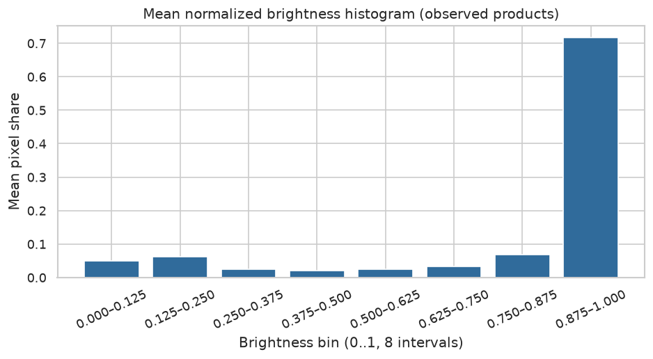

### 첫 관찰 구매월 코호트

**코호트**는 같은 기준으로 묶은 고객 집단이다. 여기서는 가입일 대신 **관찰 기간 내 첫 구매월**이 같은 사람을 묶는다. 이렇게 하면 6월·7월·8월에 처음 관측된 집단이 각각 구매 후 몇 달째에 다시 구매했는지 비교할 수 있다.

표의 **M0**는 그 그룹의 첫 구매월, **M1**은 그다음 달, **M2**는 두 달 뒤다. 각 칸은 그달에 한 번이라도 구매한 고객 수를 그룹 전체 인원으로 나눈 비율이다. 예를 들어 6월 그룹의 M1은 7월에 구매한 224명을 550명으로 나눈 **40.7%**다. 기간 안에 구매가 없으면 0으로, 관찰 기간을 넘어선 달은 미관측으로 표시한다. [코호트 계산(NB_BONUS_COHORT)](notebooks/analysis_report.ipynb?plain=1#L2797) · [고객 수 CSV](docs/results/bonus/cohort_counts.csv) · [비율 CSV](docs/results/bonus/cohort_retention.csv)

| 첫 관찰 구매월 | 고객 수·분모 | M0 | M1 | M2 |
| --- | ---: | ---: | ---: | ---: |
| 2020-06 | 550 | 100.0% | 40.7% (224명) | 38.7% (213명) |
| 2020-07 | 288 | 100.0% | 28.5% (82명) | 미관측 |
| 2020-08 | 162 | 100.0% | 미관측 | 미관측 |


표의 비율은 해당 월에 구매한 고객을 센다. 중간 달에 구매가 없어도 다음 달에 구매하면 그달에 포함한다. 6월 이전과 8월 이후의 이력은 이 자료의 관찰 범위 밖이다. 그룹끼리 비교할 때는 양쪽에 관측값이 있는 경과월을 사용한다. [그룹별 전체 인원 CSV](docs/results/bonus/cohort_sizes.csv)

### Plotly 인터랙티브 RFM

[인터랙티브 RFM HTML](docs/results/bonus/rfm_interactive.html)을 **내려받거나 로컬 파일로 브라우저에서 연다**. GitHub 파일 미리보기는 JavaScript 실행을 지원하지 않는다. 고객 **1,000명·4개 그룹**의 실제 Recency·Frequency·Monetary와 원본 고객 ID를 유지한다. 마우스 드래그로 3D 회전, 스크롤로 확대, 점에 마우스를 올려 고객 ID·지표 확인, 범례로 그룹 선택을 할 수 있다. Plotly JS를 내장해 별도 [CDN (Content Delivery Network · 콘텐츠 전송 네트워크)](docs/tech_study.md#14-선택-보너스예측-확장-용어) 연결이 필요 없다.

실제 브라우저에서 네트워크를 차단한 채 전체 점 1,000개·범례 필터·3D 카메라 조작을 확인했다. 화면에서 그룹을 선택해도 원본 관측을 삭제하지 않는다. 이미지·코호트·인터랙티브 결과는 [원본 실행 보고서와 다시 생성하는 방법](#원본-실행-보고서와-다시-생성하는-방법)의 명령으로 갱신된다. SRC: [이미지 배치](utils/image_features.py), [보너스 함수](utils/bonus.py), [검증 입력](tests/test_bonus.py), [실행 노트북](notebooks/analysis_report.ipynb).

파일 탐색기에서 HTML 파일을 두 번 클릭하거나, 저장소의 최상위 폴더(`A1_1/`)에서 아래 명령을 실행한다.

macOS

```bash
open docs/results/bonus/rfm_interactive.html
```

Windows PowerShell

```powershell
Invoke-Item .\docs\results\bonus\rfm_interactive.html
```

### 실제 실행 화면과 기능 확인

아래는 실제 고객 1,000명을 표시한 Plotly 화면이다. 이어지는 표는 보너스 결과와 저장된 실행본을 열었을 때 어떤 값을 확인할 수 있는지 정리한 것이다.

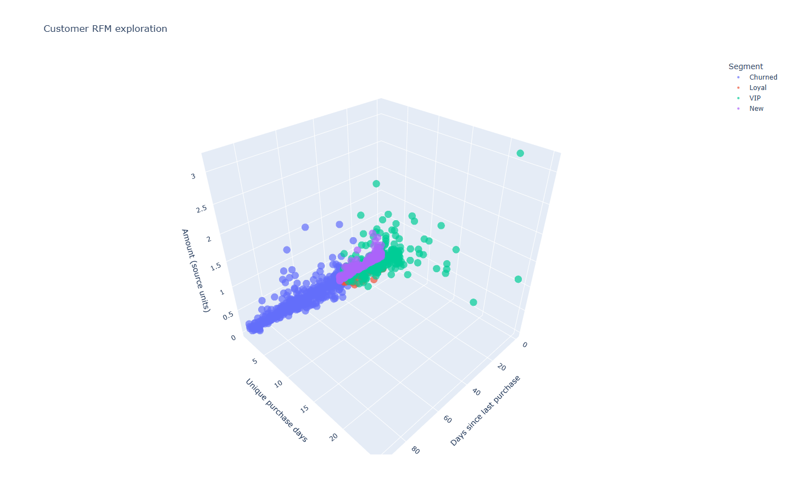

| 구현 기능 | 실행 화면에서 확인할 내용 | 구현 위치 |
| --- | --- | --- |
| 이미지 고급 피처 | 관측 상품 200개의 밝기 구간별 비율과 윤곽 강도 | [이미지 계산 함수](utils/image_features.py#L38) · [노트북 결과](notebooks/analysis_report.ipynb?plain=1#L2215) |
| 코호트 활동 비율 | 첫 관찰 구매월별 인원 550·288·162명과 월별 활동 비율 | [코호트 계산 함수](utils/bonus.py#L9) · [노트북 계산](notebooks/analysis_report.ipynb?plain=1#L2797) |
| 인터랙티브 RFM | 회전·확대·그룹 선택과 점 위 고객 정보 | [Plotly 생성 함수](utils/bonus.py#L59) · [실행 HTML](docs/results/bonus/rfm_interactive.html) |
| 원본 결과 보존 | 실제 표·ID·사진·분석 출력을 함께 가진 노트북 | [실행 노트북](notebooks/analysis_report.ipynb) · [실행 결과 복사 코드](utils/publish_report.py#L17) |

보너스를 처음 검증한 2026-11-07에는 테스트 20개·새 커널 코드 셀 12개, 시간 측정 셀을 추가한 2026-11-08에는 테스트 22개·코드 셀 13개를 통과했다. 새 복제본에서도 보너스 집계가 포함된 검증 기록의 모든 항목이 기준 실행과 일치했다. 직접 파일을 갱신하는 명령은 부록에서 확인할 수 있다. [최종 검증 기록](docs/a1_1_checklist.md#최종-권고와-자체-점검) · [실행 보고서 다시 만들기](#원본-실행-보고서와-다시-생성하는-방법)

## 범위와 한계

이 보고서는 2020년 6~8월의 선택 고객 1,000명과 상품 사진 200장을 대상으로 한다. 전체 회사의 매출 변화, 실제 고객 이탈, 신규 가입 여부를 판단하려면 관찰 기간과 데이터 범위를 넓혀야 한다.

- 주문 수나 주문당 금액을 구하려면 주문 ID가 필요하다. 고객 생애 가치(LTV)나 수익성을 추정하려면 더 긴 구매 이력, 마진, 비용이 필요하다. [사업 지표 해설](docs/tech_study.md#16-핵심-약자수식비즈니스-맥락-보충)
- 사진 피처는 픽셀 밝기·대비와 촬영 조건을 수치로 요약한다. 상품의 질감이나 고객 선호를 설명하려면 그에 맞는 정보가 추가로 필요하다.
- 코호트는 관찰 기간의 첫 구매월을 사용한다. 가입일 또는 생애 첫 구매 기준으로 분석하려면 그 날짜가 포함된 데이터가 필요하다.

---

**부록.** 직접 분석하려면 환경 설치 → 표본 복원 → 노트북 실행 순서로 진행한다. 계산 구현과 소스 파일 위치는 뒤의 [소스 구조](#소스-구조와-실행-흐름)에서 확인할 수 있다.

## 환경과 실행

아래 명령은 저장소의 최상위 폴더인 `A1_1/`에서 실행한다. 처음 받는 경우 `git clone https://github.com/ntt65/A1_1.git`를 실행하고 `cd A1_1`로 들어간다. 이미 받은 저장소에서는 해당 폴더를 열면 된다.

검증한 Python은 3.11.4다. 아래 명령은 프로젝트 전용 가상환경 `.venv`를 만들고, 세 파일에 적힌 버전으로 분석·노트북 실행·보너스 패키지를 설치한다. 마지막 줄은 작은 가상 입력으로 기존 기능이 동작하는지 확인하는 회귀 테스트다. [분석 패키지](requirements.txt) · [실행 도구](requirements-notebook.txt) · [보너스 패키지](requirements-bonus.txt)

macOS·Linux(bash/zsh)

```bash
python3.11 -m venv .venv
.venv/bin/python -m pip install -r requirements.txt -r requirements-notebook.txt -r requirements-bonus.txt
.venv/bin/python -B -m utils.run_checks
```

Windows PowerShell. 이 README의 실행 기록을 확인한 환경이다. 부록의 다른 Bash 예제를 PowerShell에서 실행할 때도 Python 경로는 `.venv\Scripts\python.exe`를 쓴다.

```powershell
py -3.11 -m venv .venv
.venv\Scripts\python.exe -m pip install -r requirements.txt -r requirements-notebook.txt -r requirements-bonus.txt
.venv\Scripts\python.exe -B -m utils.run_checks
```

아래 표는 방금 실행한 테스트 명령의 각 부분과 실제 표본 실행을 추가하는 방법을 설명한다. 앞의 설치 확인은 표본 없이도 가능하다. [테스트 실행과 옵션 처리](utils/run_checks.py#L55)

| 명령의 일부 | 하는 일 |
| --- | --- |
| `.venv/bin/python` 또는 `.venv\Scripts\python.exe` | 방금 만든 가상환경의 Python으로 실행 |
| `-B` | `__pycache__`(`.pyc` 캐시 파일)를 만들지 않음 |
| `-m utils.run_checks` | `tests/` 폴더의 전체 단위 테스트(`unittest discover -s tests -v`) 실행 |
| `--with-sample` (선택) | 테스트 통과 후 실제 `data/raw/hm/` 표본으로 `analysis_report.ipynb`를 새 Python 프로세스(노트북 커널)에서 처음부터 실행하고 `data/processed/analysis_report.executed.ipynb`에 저장 |


검증한 분석 패키지: NumPy 2.4.6, Pandas 3.1.1, Matplotlib 3.11.2, Seaborn 0.13.2. 보너스는 Plotly 7.1.0·narwhals 2.28.0·packaging 26.3을 별도 `requirements-bonus.txt`에 고정했다. Plotly는 인터랙티브 보너스에서만 사용한다. 실행 도구는 Notebook 7.6.4, ipykernel 7.4.0, nbclient 0.11.0, nbformat 5.11.1이다. Python 3.11 환경에서 설치·실행을 확인했다.

테스트가 끝났다면 실제 분석에서 읽을 거래·상품·사진 파일을 아래 절차로 준비한다.

## 비공개 데이터 준비

실제 분석에는 표본 ZIP 하나가 필요하다. 보관해 둔 Drive 표본 `A1_1_hm_sample.zip`이 있으면 그 파일을 사용한다. 새로 만들려면 Kaggle에 로그인해 H&M 대회 규정에 동의하고, 다음 절의 추출 절차를 따른다. 추출은 Kaggle에서 진행하고 로컬에는 표본 ZIP을 내려받는다. [H&M 대회 데이터](https://www.kaggle.com/competitions/h-and-m-personalized-fashion-recommendations/data) · [Kaggle 표본 추출 노트북](https://www.kaggle.com/code/ntt6551/a1-1-h-m-sample-extractor/notebook) · [저장소의 추출 노트북](notebooks/prepare_hm_sample.ipynb)

Kaggle에서 받은 `hm_sample.zip`이 `Downloads`에 있다면 아래 명령으로 복원한다. Drive에서 받은 경우 마지막 파일 이름을 `A1_1_hm_sample.zip`으로 바꾼다.

macOS·Linux

```bash
.venv/bin/python scripts/restore_hm_sample.py --archive "$HOME/Downloads/hm_sample.zip"
```

Windows PowerShell

```powershell
.venv\Scripts\python.exe scripts/restore_hm_sample.py --archive "$HOME\Downloads\hm_sample.zip"
```

복원 도구는 ZIP 파일 목록과 추출 기록을 검사한 뒤 거래 표 `data/raw/hm/transactions_sample.csv`, 상품 표 `data/raw/hm/articles_sample.csv`, 추출 기록 `data/raw/hm/sample_manifest.json`, 상품 사진 `data/raw/hm/images/<ID 앞 3자리>/<ID>.jpg`를 풀어 준다. 기존 파일이 있으면 내용이 같은지도 확인한다. 개인 Drive 설정에 SHA-256 체크섬이 있으면 ZIP 내용의 지문이 기대값과 같은지 확인한다. [표본 복원 코드](scripts/restore_hm_sample.py#L30) · [ZIP 경로와 체크섬 옵션](scripts/restore_hm_sample.py#L75)

### Kaggle에서 `hm_sample.zip` 추출·다운로드 절차

1. 원본 H&M 데이터가 연결된 [Kaggle 표본 추출 노트북](https://www.kaggle.com/code/ntt6551/a1-1-h-m-sample-extractor/notebook)을 열고 오른쪽 사이드바에서 **Session options**를 연다.

   

2. **Internet** 토글을 **Internet on**으로 확인한다.

   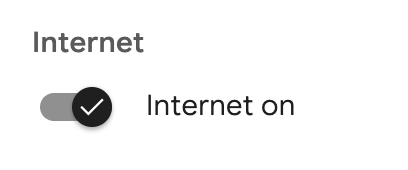

3. 상단 툴바의 **Run All**을 눌러 전체 셀을 실행한다.

   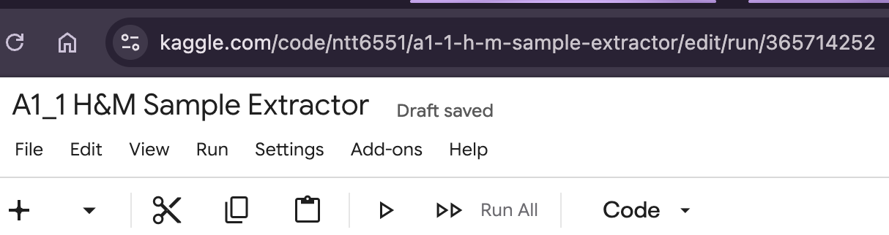

4. 오른쪽 **Output** 패널의 `/kaggle/working` 아래에 `hm_sample.zip`이 생성되었는지 확인한다(안 보이면 새로고침 아이콘 클릭).

   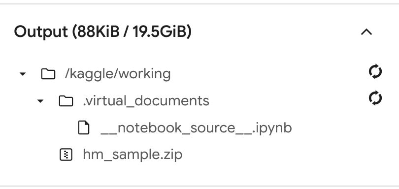

5. `hm_sample.zip`의 메뉴에서 **Download**를 눌러 로컬 `Downloads` 폴더로 내려받은 뒤 위의 `restore_hm_sample.py` 명령으로 복원한다.

   

같은 표본으로 여러 번 실행하거나 새 환경 재현을 할 때는 ZIP을 `data/raw/hm/hm_sample.zip`에 보관한다. 그 위치에 파일이 있으면 `--archive` 없이 복원 명령을 실행할 수 있다.

```bash
.venv/bin/python scripts/restore_hm_sample.py
```

## 전체 분석과 검증

표본을 복원했다면 `--with-sample`을 붙여 가상 입력 테스트와 실제 노트북 분석을 이어서 실행한다. 테스트를 통과하면 새 노트북 커널이 기존 변수 없이 시작하고, 실행 결과를 `data/processed/`에 저장한다.

```bash
.venv/bin/python -B -m utils.run_checks --with-sample
```

노트북을 실행한 뒤 아래 파일을 확인한다. 실행본은 표·사진·차트를 보는 데 쓰고, 검증 기록은 같은 표본과 설정에서 결과가 일치하는지 비교하는 데 쓴다. [노트북 실행 도구](utils/run_checks.py#L17) · [재현 기록 저장(NB_REPRO)](notebooks/analysis_report.ipynb?plain=1#L4826)

- `data/processed/analysis_report.executed.ipynb`에는 실행된 표·사진·차트가 있다.
- `data/processed/analysis_verification.json`에는 입력 파일의 체크섬, 실행 환경, 설정과 주요 집계가 있다.
- `data/processed/figures/`에는 차트 파일이 있다.
- `data/processed/insights.md`에는 집계에 근거한 전략 제안, `data/processed/segment_profile.csv`에는 고객 그룹별 요약이 있다.

실행본을 Jupyter로 열려면 다음 명령을 사용한다.

```bash
.venv/bin/python -m notebook data/processed/analysis_report.executed.ipynb
```

**새 환경에서도 같은 결과가 나오는지 확인하려면** 기준 분석을 한 번 실행해 `data/processed/analysis_verification.json`을 만들고, 같은 표본 ZIP을 `data/raw/hm/hm_sample.zip`에 둔다. 아래 명령이 현재 Git 커밋의 새 복제본과 가상환경을 만들어 의존성을 설치하고, 이 ZIP으로 표본을 복원해 분석을 다시 실행한다. 의존성 설치에는 네트워크 접근이 필요하다. 일치 여부는 `data/processed/reproduction_verification.json`에서 볼 수 있다. [재현 비교 코드](utils/reproducibility.py#L25)

```bash
.venv/bin/python -B -m utils.reproducibility
```

## 검증을 직접 재현할 작은 입력

실제 표본은 분석 전체를 확인하는 데 쓰고, 아래처럼 결과를 손으로 계산할 수 있는 입력은 개별 처리 규칙을 점검하는 데 쓴다. `utils.run_checks`를 옵션 없이 실행해 이 검증을 재현할 수 있다. [정제와 RFM 테스트](tests/test_analytics.py) · [이미지와 텍스트 테스트](tests/test_pipeline.py) · [통계와 월별 집계 테스트](tests/test_reporting.py)

- 텍스트 `Blue cotton shirt` → 17자·3단어.
- 픽셀 절반 0·절반 1 → 이미지 평균·표준편차 각각 0.5.
- 그룹 A에 10·30·빈 값이 있으면 빈 값을 그룹 평균 20으로 채운다. 그룹을 확인할 수 없는 행의 빈 값은 관측값 10·30·50의 전체 평균인 30으로 채우고 이미 관측된 50은 보존한다.
- `[1, 2, 3, 4, 100]`에서 IQR 경계는 −1과 7이다. 100을 경계 밖으로 표시한다. `[−2, 1, 2, 3, 6]`의 양 끝값은 경계와 같아서 범위 안에 들어간다.
- 1월 3일을 기준으로 [앞의 두 고객 예](#거래-정제와-고객별-계산-기준)를 계산해 A는 R=0·F=2·M=60, B는 R=1·F=1·M=5, 두 고객의 금액 합계는 65인지 확인한다.
- 동일 지표의 점수가 같고 입력 순서를 바꿔도 RFM이 동일함. 고객당 단일 그룹, 네 그룹 이상과 금액 합계도 확인함.
- 월 누락·상수 상관·원본 필드와 실행본 바이트 보존도 가상 입력 테스트로 확인함.

## 원본 실행 보고서와 다시 생성하는 방법

저장소의 미션 제출본은 [notebooks/analysis_report.ipynb](notebooks/analysis_report.ipynb)다. 표본을 복원하지 않아도 저장된 원본 행·상품 사진 예시·계산 결과를 열어 볼 수 있다. 실제 분석을 다시 실행하면 새 실행본은 먼저 `data/processed/analysis_report.executed.ipynb`에 생긴다.

제출본을 새 실행으로 갱신할 때는 전체 노트북을 실행한 뒤 `utils.publish_report`를 실행하고 저장소를 검사한다. 게시 도구는 로컬 실행본을 그대로 복사하고 집계와 이미지 파일도 갱신한다. 제출본에 저장된 원본 행·고객 ID·상품 사진과 실행 결과가 함께 보존된다.

```bash
.venv/bin/python -B -m utils.run_checks --with-sample
.venv/bin/python -B -m utils.publish_report
.venv/bin/python -B -m utils.repository_checks
```

보조 집계는 [전체 집계 JSON](docs/results/analysis_aggregates.json), [그룹 표 CSV](docs/results/segment_profile.csv), [월별 합계 CSV](docs/results/monthly_amount.csv), [결과 요약](docs/results/analysis_report.md)에 저장된다. `preserve_execution()`은 모든 코드 셀이 성공한 노트북만 제출 위치에 복사한다. 마지막 검사는 제출 파일과 문서 링크가 유효하고, 원본 CSV·ZIP·전체 이미지와 개인 설정이 Git 추적에서 제외되었는지 확인한다. [게시 코드](utils/publish_report.py#L17) · [저장소 검사](utils/repository_checks.py#L39)

## 소스 구조와 실행 흐름

분석은 노트북이 단계를 지시하고, `DataAnalyzer`가 거래·상품 표와 검증 기록을 보관하며, `utils/` 함수가 계산을 맡는 흐름으로 진행된다. 아래 파일 목록과 그림을 따라가면 궁금한 계산이나 출력이 어느 코드에서 만들어졌는지 찾을 수 있다.

### 1. SRC 파일 트리 개요

`src/`에는 분석 상태를 관리하는 `pipeline.py`가 있다. 공용 계산은 `utils/`, 분석 호출과 설명은 `notebooks/`, 표본 복원은 `scripts/`가 담당한다.

```text
A1_1/
├── src/
│   └── pipeline.py                 # DataAnalyzer 클래스와 명령줄에서 표를 읽고 연결하는 기능
├── utils/
│   ├── __init__.py                  # 공용 도구 패키지
│   ├── bonus.py                     # 첫 관찰 구매월 코호트·Plotly 보너스
│   ├── analytics.py                 # 거래 정제·결측 대치·IQR·RFM·그룹 프로파일
│   ├── image_features.py            # 이미지 정규화·축소·배치 mean/std
│   ├── reporting.py                 # 통계 상관·월별 집계·6종 차트·인사이트
│   ├── run_checks.py                # 회귀 테스트와 선택적 새 커널 실행
│   ├── reproducibility.py           # 새 복제본·새 환경의 전체 결과 대조
│   ├── publish_report.py            # 원본 실행본·차트 보존과 보조 집계 생성
│   └── repository_checks.py         # 제출 파일·링크·실행 오류·Git 제외 검사
├── notebooks/
│   ├── prepare_hm_sample.ipynb       # Kaggle 원격 환경에서 필요한 표본 추출
│   └── analysis_report.ipynb         # 분석 단계·해석과 실제 실행 출력
├── scripts/
│   └── restore_hm_sample.py         # ZIP 검사와 로컬 표본 복원
├── tests/
│   ├── test_pipeline.py             # 로드·상품 조인·이미지·텍스트
│   ├── test_bonus.py                # 히스토그램·엣지·코호트·Plotly
│   ├── test_analytics.py            # 정제·대치·IQR·RFM
│   ├── test_reporting.py            # 상관·월별 합계 경계
│   ├── test_publication.py          # 원본 필드·실행본 보존
│   └── test_repository_checks.py   # 인용 코드·실제 상대 링크 구분
└── docs/
    └── results/                    # 실제 차트·집계·보너스·실행 상태
```

`data/raw/hm/`은 재실행용 표본, `data/processed/`는 실행 중 생성하는 결과의 로컬 경로다. 파일별 자세한 위치는 [index.md](index.md), 기능을 바꿀 때 함께 확인할 위치는 [reverse_index.md](reverse_index.md)에 있다.

### 2. 클래스와 모듈 연결 구조

노트북에서 `DataAnalyzer`의 메서드를 호출하면 클래스는 거래와 상품 표를 보관하면서 `utils/analytics.py`나 `utils/image_features.py`의 계산 함수를 사용한다. 터미널에서 표를 읽고 상품을 연결하는 명령(CLI)도 같은 클래스를 쓴다. 그림 속 화살표는 **호출하는 쪽에서 호출되는 쪽**으로 향한다.

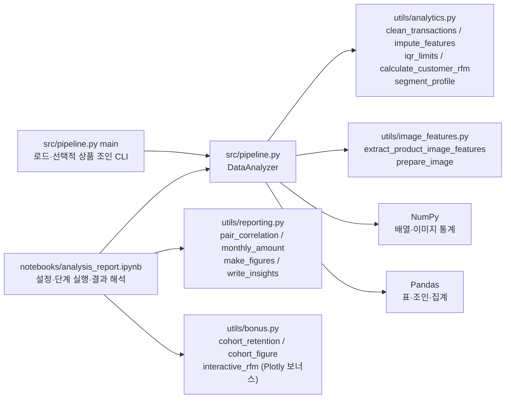

전체 분석의 진입점은 노트북이다. `python src/pipeline.py --data ... --products ...`는 CSV 로드와 선택적 상품 조인을 확인하는 [CLI (Command-Line Interface · 명령줄 인터페이스)](docs/tech_study.md#12-pythonoop라이브러리와-실행)다. SRC: [src/pipeline.py](src/pipeline.py), [utils/analytics.py](utils/analytics.py), [utils/image_features.py](utils/image_features.py), [utils/reporting.py](utils/reporting.py).

### 3. DataAnalyzer 클래스 구조도

속성은 클래스가 기억해 둘 값이다. 예를 들어 `df`에 거래 표, `products`에 상품 표, 이름이 `_audit`로 끝나는 속성에 단계별 검사 결과를 저장한다. 메서드는 데이터를 읽거나 계산하는 함수다. 그림에서 `+`는 외부에서 호출하는 메서드, `-`는 내부에서 쓰는 메서드, `$`는 클래스에 보관한 상태를 사용하지 않고 전달받은 값으로 동작하는 정적 메서드를 표시한다.

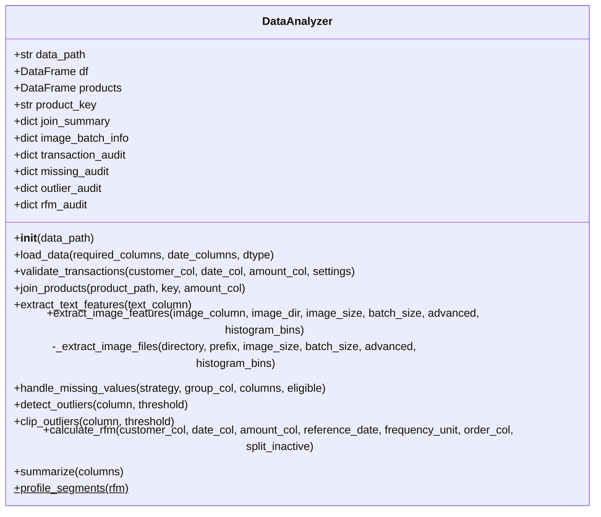

`load_data()`는 분석 상태를 초기화하고, `validate_transactions()`·`join_products()`·피처/대치 메서드는 자신의 인스턴스 표를 갱신한다. `clip_outliers()`는 보정된 별도 Series를, `calculate_rfm()`는 고객별 별도 DataFrame을 반환하므로 거래 원금액은 유지된다. `profile_segments()`는 전달받은 RFM 표를 요약하는 정적 메서드다. 실제 타입·기본값·키워드 전용 인자는 [클래스 원문](src/pipeline.py)에서 확인한다.

### 4. 노트북 분석 실행 차트

실선은 분석 노트북의 실행 순서, 점선은 앞 단계에서 만든 값이 다른 단계로 전달되는 경로다. `NB_CLEAN`의 사본은 분포 비교에 쓰고, 고객별 RFM과 월별 합계는 유효 거래의 원금액으로 계산한다.

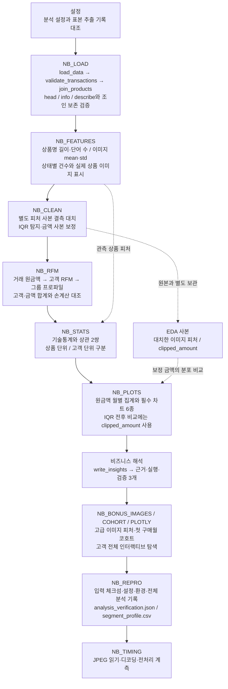

마지막 두 단계의 역할도 다르다. `NB_REPRO`는 입력과 결과를 나중에 대조할 기록을 저장하고, `NB_TIMING`은 같은 사진을 읽고 압축을 풀고 전처리하는 데 걸린 시간을 표시한다. [실행 노트북](notebooks/analysis_report.ipynb) · [분석 클래스](src/pipeline.py) · [보고서 공용 함수](utils/reporting.py)

사진 처리에서 `batch_size=32`는 한 번에 확인할 상품 행의 상한이다. 그 안에서 읽기에 성공한 사진만 배열에 추가한다. 표본에서 가장 큰 실제 묶음은 `(5, 32, 32, 3)`이고, 32비트 값 하나가 4바이트이므로 픽셀 배열은 61,440바이트(60 KiB)다. 축소 사진을 32장 채우면 384 KiB, 1024×1024의 64비트 RGB 사진 한 장은 24 MiB다. 파일을 풀 때 생기는 배열과 중간 계산에도 메모리가 따로 든다. [성공한 사진을 묶는 코드](utils/image_features.py#L96-L128) · [실제 최대 묶음 출력](notebooks/analysis_report.ipynb?plain=1#L903)

### 5. 검증·제출 실행 차트

실선은 표본 복원에서 제출본 확인까지의 순서다. 새 환경 재현은 기존 분석 기록을 기준으로 비교하는 별도 경로이며, 그림에서 점선으로 표시했다.

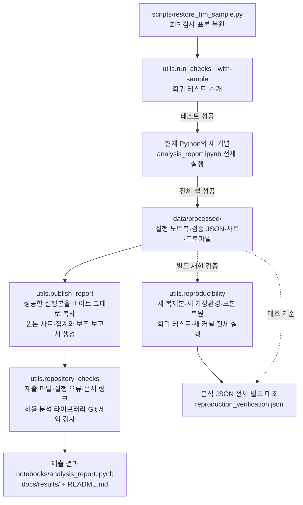

실제 분석을 실행하는 명령과 제출본을 갱신하는 명령은 위 절에서 확인할 수 있다. 새 실행의 수치가 바뀌면 README의 표와 해석도 결과 파일을 보고 대조한다. [전체 분석과 검증](#전체-분석과-검증) · [제출본 갱신](#원본-실행-보고서와-다시-생성하는-방법)

SRC: [표본 복원](scripts/restore_hm_sample.py) → [검증 실행](utils/run_checks.py) → [원본 결과 보존](utils/publish_report.py) → [저장소 검사](utils/repository_checks.py). 독립 검증: [새 환경 재현](utils/reproducibility.py).

## 기능별 SRC

SRC는 구현 코드를 뜻한다. 앞의 분석 흐름에서 원리를 확인하고, 아래 표에서 각 단계에 해당하는 파일을 연다. 이어지는 기능 요약에는 개별 메서드와 계산 함수의 줄 링크가 있다.

| 소스 코드 경로 | 주요 함수·책임 |
| --- | --- |
| [src/pipeline.py](src/pipeline.py) | DataAnalyzer의 load_data·join_products·validate_transactions·handle_missing_values·detect_outliers·calculate_rfm·summarize |
| [utils/analytics.py](utils/analytics.py) | clean_transactions·impute_features·iqr_limits·calculate_customer_rfm·segment_profile |
| [utils/image_features.py](utils/image_features.py) | `prepare_image`·`extract_product_image_features`로 픽셀 통계를 계산하고 `profile_jpeg_stages`로 읽기·디코딩·전처리를 계측 |
| [utils/bonus.py](utils/bonus.py) | cohort_retention·cohort_figure·interactive_rfm. 코호트와 Plotly 보너스 |
| [utils/reporting.py](utils/reporting.py) | pair_correlation·monthly_amount·make_figures·write_insights |
| [utils/run_checks.py](utils/run_checks.py) | 가상 테스트와 현재 Python의 새 커널 실행 |
| [utils/reproducibility.py](utils/reproducibility.py) | 새 복제본·새 환경·표본 복원과 결과 전체 대조 |
| [utils/publish_report.py](utils/publish_report.py) | 원본 실행본·차트·집계 보존과 보조 보고서 생성 |
| [utils/repository_checks.py](utils/repository_checks.py) | 제출 파일·링크·분석 import·데이터 제외·공개 보고서 검사 |
| [scripts/restore_hm_sample.py](scripts/restore_hm_sample.py) | ZIP 구성·기록·경로·충돌·선택적 체크섬 확인 |
| [notebooks/analysis_report.ipynb](notebooks/analysis_report.ipynb) | NB_LOAD~NB_TIMING 실행·해석 |
| [tests/test_pipeline.py](tests/test_pipeline.py) · [tests/test_analytics.py](tests/test_analytics.py) · [tests/test_reporting.py](tests/test_reporting.py) · [tests/test_publication.py](tests/test_publication.py) · [tests/test_bonus.py](tests/test_bonus.py) · [tests/test_repository_checks.py](tests/test_repository_checks.py) | 로드·조인·이미지·정제·대치·IQR·RFM·월·상관·원본 출력 보존·보너스·문서 링크 검증 (22개) |

### 기능 구현 요약

아래 목록은 미션 과제별로 구현을 확인할 때 사용한다. 객체지향 프로그래밍(OOP)은 이 프로젝트에서 자료와 처리 메서드를 `DataAnalyzer`에 묶는 방식이다. 멀티모달 피처는 상품명과 사진처럼 형식이 다른 자료에서 만든 분석용 값이다. [Python·OOP 해설](docs/tech_study.md#12-pythonoop라이브러리와-실행)

#### 과제 1. OOP 파이프라인 구축 & 멀티모달 피처 통합

- **데이터 로드**: ID 문자열(`string`) 선행 `0` 보존 및 날짜 파싱 — [`DataAnalyzer.load_data`](src/pipeline.py#L36)
- **거래 정제 (파이프라인)**: 유효 거래 필터링 및 `transaction_audit` 상태 갱신 — [`DataAnalyzer.validate_transactions`](src/pipeline.py#L121)
- **거래 정제 (공용 함수)**: 고객 누락·날짜 오류·주문·금액 오류 상호 배타 집계 — [`clean_transactions`](utils/analytics.py#L7)
- **상품 다대일 조인**: 같은 상품을 산 여러 거래 행에 상품 정보 한 건을 연결하고, 거래 행 수와 금액 합계를 대조 — [`DataAnalyzer.join_products`](src/pipeline.py#L71)
- **텍스트 피처 추출**: 상품명 원문 보존 및 글자 수·단어 수 파생 열 생성 — [`DataAnalyzer.extract_text_features`](src/pipeline.py#L236)
- **이미지 피처 추출 (진입점)**: 인메모리 배열 또는 디스크 이미지 폴더 분기 처리 — [`DataAnalyzer.extract_image_features`](src/pipeline.py#L189)
- **이미지 피처 매핑 (내부)**: 상품 단위 이미지 피처를 거래 표에 매핑 — [`DataAnalyzer._extract_image_files`](src/pipeline.py#L220)
- **이미지 리사이즈·정규화**: 32×32 [RGB (Red-Green-Blue · 적녹청 색상 채널)](docs/tech_study.md#5-이미지와-텍스트-피처) `float32` (`0~1`) 변환 — [`prepare_image`](utils/image_features.py#L11)
- **이미지 배치 통계 계산**: 상품 이미지를 한 번씩 읽고 여러 장을 묶어 이미지마다 평균과 표준편차 계산 — [`extract_product_image_features`](utils/image_features.py#L64)

#### 과제 2. 탐색적 데이터 분석 (결측 대치 · IQR · 통계 · 시각화 6종)

- **결측치 대치 (파이프라인)**: 분석용 사본에서 빠진 값을 채우고 결과를 `missing_audit`에 기록 — [`DataAnalyzer.handle_missing_values`](src/pipeline.py#L129)
- **결측치 대치 (공용 함수)**: 같은 상품 유형(`product_type_name`)의 평균으로 채우고, 그룹 평균을 구할 수 없으면 전체 평균 사용 — [`impute_features`](utils/analytics.py#L71)
- **이상치 경계 계산**: 금액 분포의 25% 지점(`Q1`)과 75% 지점(`Q3`)에서 `1.5×IQR`만큼 바깥에 하한과 상한을 설정 — [`iqr_limits`](utils/analytics.py#L117)
- **이상치 탐지**: 원금액을 보존하고 거래마다 경계 밖인지 참·거짓으로 표시 — [`DataAnalyzer.detect_outliers`](src/pipeline.py#L145)
- **이상치 보정**: 분포를 비교할 수 있도록 경계 밖 금액을 가장 가까운 경계값으로 바꾼 사본 반환 — [`DataAnalyzer.clip_outliers`](src/pipeline.py#L156)
- **기술통계 요약**: 주요 수치 열 건수·평균·중앙값·표준편차·사분위수 요약 — [`DataAnalyzer.summarize`](src/pipeline.py#L177)
- **상관관계 계산**: 상품·고객 분석 단위별 완전 관측 쌍 Pearson 상관 산출 — [`pair_correlation`](utils/reporting.py#L8)
- **월별 매출 집계**: 관찰 기간 내 완전한 월별 원금액 합계 산출 — [`monthly_amount`](utils/reporting.py#L19)
- **필수 차트 6종 생성**: 히스토그램·박스플롯·막대·히트맵·산점도·라인차트 생성 — [`make_figures`](utils/reporting.py#L35)

#### 과제 3. RFM 고객 세분화 · 비즈니스 인사이트

- **RFM 계산 (파이프라인)**: 원금액 기준 고객 RFM 호출 및 `rfm_audit` 기록 — [`DataAnalyzer.calculate_rfm`](src/pipeline.py#L162)
- **RFM 계산 (공용 함수)**: 평균 순위 기반 R·F·M 1~4점 및 세그먼트 분류(규칙 5개, 실제 관측 4개 · Potential 0명) — [`calculate_customer_rfm`](utils/analytics.py#L128)
- **세그먼트 요약 (파이프라인)**: 고객 RFM 표 요약 정적 메서드 — [`DataAnalyzer.profile_segments`](src/pipeline.py#L184)
- **세그먼트 요약 (공용 함수)**: 그룹별 고객 수·비중·중앙값·금액 비중 집계 — [`segment_profile`](utils/analytics.py#L171)
- **비즈니스 인사이트 작성**: `(근거)-(실행)-(검증)` 구조의 대조 실험 가설 3건 생성 — [`write_insights`](utils/reporting.py#L73)

#### 보너스. 선택 과제 3종

- **보너스 ① 이미지 고급 피처**: 8구간 정규화 밝기 히스토그램 및 평균 엣지 강도 계산 — [`advanced_image_statistics`](utils/image_features.py#L38)
- **보너스 ② 코호트 집계**: 첫 관찰 구매월 기준 월별 활동 고객 수·비율 산출 — [`cohort_retention`](utils/bonus.py#L9)
- **보너스 ② 코호트 히트맵**: 코호트 활동 비율 시각화 차트 생성 — [`cohort_figure`](utils/bonus.py#L44)
- **보너스 ③ 인터랙티브 RFM**: 고객 1,000명 3D RFM Plotly 독립 HTML 생성 — [`interactive_rfm`](utils/bonus.py#L59)

용어와 계산 예제는 [기술 학습 문서](docs/tech_study.md)에서 확인할 수 있다.
