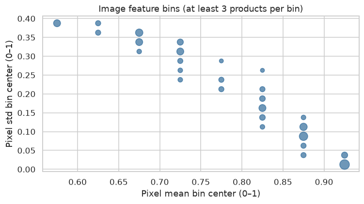
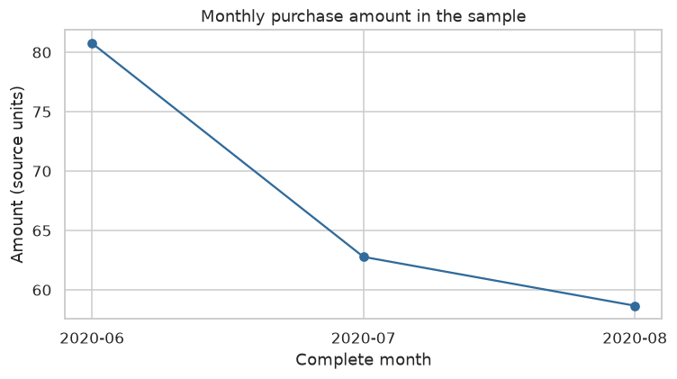
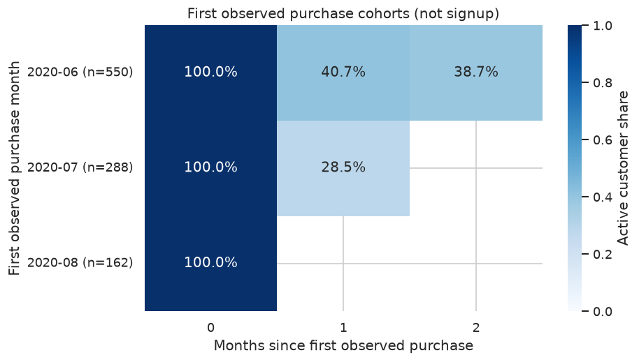
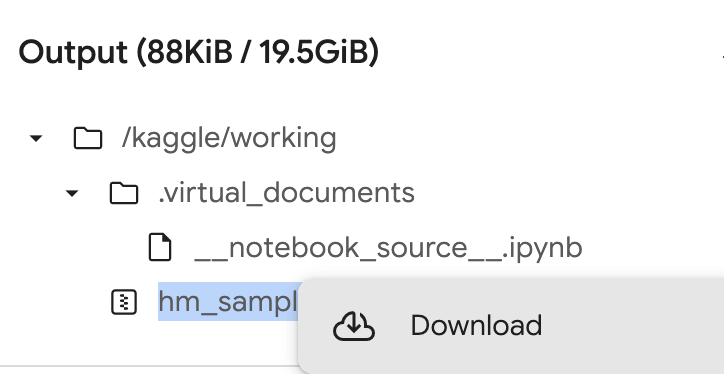
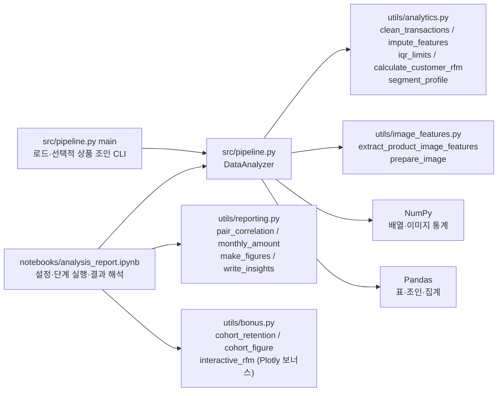
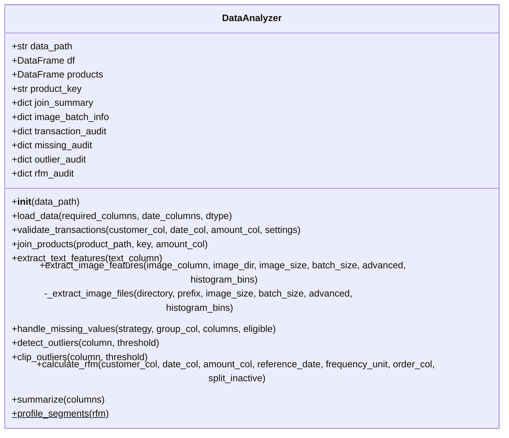
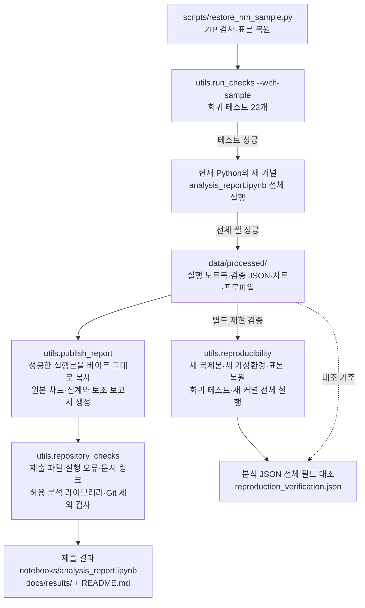

# 이커머스 멀티모달 분석 · H&M 표본

실제 거래와 상품·이미지·텍스트를 연결하고 정제, [IQR (Interquartile Range · 사분위수 범위)](docs/tech_study.md#7-통계이상치상관), 통계, 필수 차트 6종과 [RFM (Recency, Frequency, Monetary · 최근성·빈도·금액)](docs/tech_study.md#9-rfm점수세분화) 고객 세분화를 수행한다. 구현 기준은 [통합 계획](docs/a1_1_detailed_plan.md), 완료 증거는 [체크표](docs/a1_1_checklist.md)다. [파일 안내](index.md) · [기능별 수정 위치](reverse_index.md) · [작업 규칙](AGENTS.md)

## 목차

**본문 (설명 순서)**

1. [미션 개요 및 목표](#미션-개요-및-목표) · [문서 지도](#문서-지도) · [기능 구현 요약](#기능-구현-요약)
2. [입력과 계산 기준](#입력과-계산-기준) · [분석 흐름과 원본 보존](#분석-흐름과-원본-보존)
3. [실제 실행 결과와 기술통계](#실제-실행-결과와-기술통계) · [필수 시각화 6종](#필수-시각화-6종)
4. [실제 고객 그룹 요약](#실제-고객-그룹-요약) · [비즈니스 인사이트](#비즈니스-인사이트)
5. [보너스 3개 실제 구현 결과](#보너스-3개-실제-구현-결과) · [범위와 한계](#범위와-한계)

**부록 (실행·재현·코드 구조)**

6. [환경과 실행](#환경과-실행) · [비공개 데이터 준비](#비공개-데이터-준비)
7. [전체 분석과 검증](#전체-분석과-검증) · [검증을 직접 재현할 작은 입력](#검증을-직접-재현할-작은-입력) · [원본 실행 보고서와 다시 생성하는 방법](#원본-실행-보고서와-다시-생성하는-방법)
8. [소스 구조와 실행 흐름](#소스-구조와-실행-흐름) · [기능별 SRC](#기능별-src) · [작업 체크표](docs/a1_1_checklist.md)

## 미션 개요 및 목표

> **한 줄 요약:** *"쇼핑몰에서 누가 자주 오고 많이 사는지 분석해서 단골 찾기"* ([미션 원문](docs/a1_1_mission.md))

- **사용 데이터:** 미션은 이커머스 상품명(텍스트), 가격(수치), 카테고리(범주), 구매일(날짜), 상품 이미지(배열) 같은 [**멀티모달 데이터**](docs/tech_study.md#1-미션-전체의-구조)를 함께 분석하는 과제다. 이 저장소는 패션 기업 H&M의 [Kaggle 대회 데이터](https://www.kaggle.com/competitions/h-and-m-personalized-fashion-recommendations/data)에서 2020년 6~8월 고객 1,000명의 거래·상품 정보·상품 사진을 표본으로 뽑아 전체 파이프라인을 구현하고 검증했다.
- **핵심 과제 3가지:**
  1. **[OOP (Object-Oriented Programming · 객체지향 프로그래밍)](docs/tech_study.md#12-pythonoop라이브러리와-실행) 파이프라인**
     - [멀티모달 데이터](docs/tech_study.md#1-미션-전체의-구조)(수치 + 텍스트 + 이미지 배열)를 [NumPy 벡터 연산](docs/tech_study.md#4-numpy-배열벡터화메모리)으로 통합 처리
     - [`DataAnalyzer`](src/pipeline.py#L20) 클래스 구축 ([소스 구조](#소스-구조와-실행-흐름))
  2. [**완전한 EDA**](docs/tech_study.md#eda탐색적-데이터-분석의-4단계-풀이와-코드-연결) ([실행 노트북](notebooks/analysis_report.ipynb))
     - [IQR 이상치 탐지](#iqr의-통계적-필요성과-한계)
     - [그룹별 결측치 대치](utils/analytics.py#L71)
     - [기술통계·상관 분석](#실제-실행-결과와-기술통계)
     - [필수 차트 6종 시각화](#필수-시각화-6종)
  3. [**RFM 세분화 및 전략**](docs/tech_study.md#9-rfm점수세분화) ([실행 노트북](notebooks/analysis_report.ipynb))
     - [RFM 분석·고객 그룹](#실제-고객-그룹-요약)으로 고객을 4개 이상 세그먼트로 분류
     - 데이터 근거 기반의 [비즈니스 인사이트 3건 이상](#비즈니스-인사이트) 제안
- **학습·달성 목표 5가지:** NumPy 반복문 없는 벡터 연산 설명, 이미지 평균·표준편차 수치 피처 변환 원리 이해, IQR 이상치 탐지 구현·설명, RFM 기반 고객 세분화 및 전략 제안, `Class` 기반 재사용 파이프라인 설계.

### 문서 지도

| 문서 | 언제 보는가 |
| --- | --- |
| 이 README | 데이터 → 분석 흐름 → 결과 → 전략 순서로 프로젝트 전체를 설명할 때 |
| [미션 원문과 구현 대조](docs/a1_1_mission.md) | 미션 요구사항 하나하나가 어디에 구현됐는지 확인할 때 |
| [평가 Q&A](docs/a1_1_evaluation_qa.md) | 평가 질문별 답변과 근거를 찾을 때 |
| 미션 설명 [PPTX](docs/presentation/a1_1_mission_explanation.pptx) · [PDF](docs/presentation/a1_1_mission_explanation.pdf) | 미션 요구사항·분석 흐름·실제 결과를 22장으로 설명할 때 |
| [tech_study.md](docs/tech_study.md) | IQR·RFM·벡터화 같은 개념을 공부하거나 설명할 때 |

### 기능 구현 요약

#### 과제 1. OOP 파이프라인 구축 & 멀티모달 피처 통합

- **데이터 로드**: ID 문자열(`string`) 선행 `0` 보존 및 날짜 파싱 — [`DataAnalyzer.load_data`](src/pipeline.py#L36)
- **거래 정제 (파이프라인)**: 유효 거래 필터링 및 `transaction_audit` 상태 갱신 — [`DataAnalyzer.validate_transactions`](src/pipeline.py#L121)
- **거래 정제 (공용 함수)**: 고객 누락·날짜 오류·주문·금액 오류 상호 배타 집계 — [`clean_transactions`](utils/analytics.py#L7)
- **상품 다대일 조인**: null·중복 키 검증 및 조인 전후 거래 행 수·금액 합계 보존 — [`DataAnalyzer.join_products`](src/pipeline.py#L71)
- **텍스트 피처 추출**: 상품명 원문 보존 및 글자 수·단어 수 파생 열 생성 — [`DataAnalyzer.extract_text_features`](src/pipeline.py#L236)
- **이미지 피처 추출 (진입점)**: 인메모리 배열 또는 디스크 이미지 폴더 분기 처리 — [`DataAnalyzer.extract_image_features`](src/pipeline.py#L189)
- **이미지 피처 매핑 (내부)**: 상품 단위 이미지 피처를 거래 표에 매핑 — [`DataAnalyzer._extract_image_files`](src/pipeline.py#L220)
- **이미지 리사이즈·정규화**: 32×32 [RGB (Red-Green-Blue · 적녹청 색상 채널)](docs/tech_study.md#5-이미지와-텍스트-피처) `float32` (`0~1`) 변환 — [`prepare_image`](utils/image_features.py#L11)
- **이미지 배치 통계 계산**: 상품별 1회 읽기 및 배치 `(N,H,W,C)` `mean`/`std` 산출 — [`extract_product_image_features`](utils/image_features.py#L64)

#### 과제 2. 완전한 EDA (결측 대치 · IQR · 통계 · 시각화 6종)

- **결측치 대치 (파이프라인)**: [EDA (Exploratory Data Analysis · 탐색적 데이터 분석)](docs/tech_study.md#eda탐색적-데이터-분석의-4단계-풀이와-코드-연결) 사본 대치 및 `missing_audit` 갱신 — [`DataAnalyzer.handle_missing_values`](src/pipeline.py#L129)
- **결측치 대치 (공용 함수)**: `product_type_name` 그룹 평균 → 전체 평균 fallback 대치 — [`impute_features`](utils/analytics.py#L71)
- **이상치 경계 계산**: 사분위수(`Q1`, `Q3`) 기반 `1.5×IQR` 하한·상한 산출 — [`iqr_limits`](utils/analytics.py#L117)
- **이상치 탐지**: 원금액 보존하며 IQR 경계 밖 불리언 마스크 반환 — [`DataAnalyzer.detect_outliers`](src/pipeline.py#L145)
- **이상치 보정**: 분포 비교용 EDA 사본 `Series` 클리핑 반환 — [`DataAnalyzer.clip_outliers`](src/pipeline.py#L156)
- **기술통계 요약**: 주요 수치 열 건수·평균·중앙값·표준편차·사분위수 요약 — [`DataAnalyzer.summarize`](src/pipeline.py#L177)
- **상관관계 계산**: 상품·고객 분석 단위별 완전 관측 쌍 Pearson 상관 산출 — [`pair_correlation`](utils/reporting.py#L8)
- **월별 매출 집계**: 관찰 기간 내 완전한 월별 원금액 합계 산출 — [`monthly_amount`](utils/reporting.py#L19)
- **필수 차트 6종 생성**: 히스토그램·박스플롯·막대·히트맵·산점도·라인차트 생성 — [`make_figures`](utils/reporting.py#L35)

#### 과제 3. RFM 고객 세분화 · 비즈니스 인사이트

- **RFM 계산 (파이프라인)**: 원금액 기준 고객 RFM 호출 및 `rfm_audit` 기록 — [`DataAnalyzer.calculate_rfm`](src/pipeline.py#L162)
- **RFM 계산 (공용 함수)**: 평균 순위 기반 R·F·M 1~4점 및 세그먼트 분류(규칙 5개, 실제 관측 4개 · Potential 0명) — [`calculate_customer_rfm`](utils/analytics.py#L128)
- **세그먼트 요약 (파이프라인)**: 고객 RFM 표 요약 정적 메서드 — [`DataAnalyzer.profile_segments`](src/pipeline.py#L184)
- **세그먼트 요약 (공용 함수)**: 그룹별 고객 수·비중·중앙값·금액 비중 집계 — [`segment_profile`](utils/analytics.py#L171)
- **비즈니스 인사이트 작성**: `(근거)-(실행)-(검증)` 구조의 대조 실험 가설 3건 생성 — [`write_insights`](utils/reporting.py#L73)

#### 보너스. 선택 과제 3종

- **보너스 ① 이미지 고급 피처**: 8구간 정규화 밝기 히스토그램 및 평균 엣지 강도 계산 — [`advanced_image_statistics`](utils/image_features.py#L38)
- **보너스 ② 코호트 집계**: 첫 관찰 구매월 기준 월별 활동 고객 수·비율 산출 — [`cohort_retention`](utils/bonus.py#L9)
- **보너스 ② 코호트 히트맵**: 코호트 활동 비율 시각화 차트 생성 — [`cohort_figure`](utils/bonus.py#L44)
- **보너스 ③ 인터랙티브 RFM**: 고객 1,000명 3D RFM Plotly 독립 HTML 생성 — [`interactive_rfm`](utils/bonus.py#L59)

## 입력과 계산 기준

분석에 쓰는 컬럼, 관찰 기간, RFM 기준일, 주요 설정값을 먼저 정한다. 뒤의 모든 결과는 이 기준 위에서 계산된다.

> **처음 읽는다면** — 아래 표는 "어떤 열을 무슨 뜻으로 쓰는가"와 "바꿀 수 있는 설정값"이다. 이어지는 RFM 규칙은 고객을 세 숫자로 요약하는 방법이다. R은 마지막 구매 후 며칠 지났는지(작을수록 최근), F는 구매한 날이 며칠인지, M은 구매금액 합계다.

| 입력/설정 | 의미 |
| --- | --- |
| `customer_id`, `article_id`, `sales_channel_id` | 문자열 ID. 선행 0 보존 |
| `t_dat` | 구매일. 분석 설명의 order_date에 대응 |
| `price` | 거래 상품 행의 금액 원값. 통화·환율을 추정하지 않음 |
| `prod_name`, `product_type_name` | 상품명·카테고리 |
| 이미지 | 선별된 상품 이미지만 RGB·0~1·32×32·[float32 (32비트 부동소수점)](docs/tech_study.md#4-numpy-배열벡터화메모리)로 처리. 기본 최대 배치 32 |
| 이미지 통계 | 상품별 한 번 계산. `(N,H,W,C)`의 `axis=(1,2,3)`, 표준편차 `ddof=0` |

| 설정 위치·이름 | 실행값 |
| --- | --- |
| 표본 manifest와 노트북 `SETTINGS`의 `start_inclusive`, `end_exclusive`, `seed`, `sales_channel` | `2020-06-01`, `2020-09-01`, `42`, `None` |
| `SETTINGS["image_size"]` | `32` |
| `SETTINGS["batch_size"]` | `32` |
| `SETTINGS["iqr_threshold"]` | `1.5` |
| 이미지 호출의 `histogram_bins` | `8` |
| manifest의 `reference_date`, RFM의 `frequency_unit` | `2020-08-31`, `purchase_day` |

표본 추출 기간·시드·채널을 바꾸려면 표본을 다시 추출하고 manifest와 노트북 설정을 맞춘다. 채널 값 `None`은 전체 판매 채널을 뜻한다. RFM 기준일은 해당 기간·채널의 표본 추출 전 마지막 유효 구매일이다.

거래는 고객 누락→날짜 오류→주문 모드의 주문 오류·취소→금액 오류 순으로 정제한다. 금액이 유한한 양수여야 한다. H&M에는 주문/취소 ID가 없어 고객·날짜·금액 기준을 적용하고 동일 값의 구매 행도 유지한다. 이미지나 상품 미매칭을 거래 무효로 처리하지 않는다. 그룹 평균 대치는 지정된 분석용 피처 사본에만 적용하고, 표본 미포함 이미지와 기존 관측값을 보존한다. IQR 보정도 EDA 사본에만 적용한다.

R은 기준일−최종 구매일(기준일 구매=0일), F는 고유 구매일 수, M은 유효 금액 원값 합계다. 주문 ID가 있는 다른 데이터는 주문 수 모드를 선택할 수 있다. R은 내림차순, F·M은 오름차순 평균 순위로 점수를 부여한다. `(평균 순위−0.5)/고객 수`가 0.25/0.50/0.75 이하인지에 따라 1/2/3점, 나머지는 4점이다. 같은 값은 같은 점수를 받는다.

**작은 예** — 고객 A가 1/1에 10·20, 1/3에 30을 사고, 고객 B가 1/2에 5를 샀다. 기준일 1/3에서 A는 R=0일·F=2일(같은 날 두 번은 하루)·M=60, B는 R=1일·F=1일·M=5다. 점수는 크기가 아니라 순서로 매긴다. M이 `5, 20, 60, 100`인 고객 4명은 순위 비율 0.125·0.375·0.625·0.875에 따라 1·2·3·4점을 받는다.

VIP(R·F·M≥3, F원값≥2) → Loyal(R·F≥3, F원값≥2) → New(R≥3, F원값=1) → Churned(R≤2) → Potential 순으로 배정한다. New는 신규 가입을, Churned는 실제 이탈 확정을 의미하지 않는다.

[RFM 점수와 세분화 해설](docs/tech_study.md#9-rfm점수세분화)

## 분석 흐름과 원본 보존

앞 절의 기준으로 노트북이 어떤 순서로 계산하는지, 그 과정에서 원본 데이터를 어떻게 보존하는지 보여준다.

> **처음 읽는다면** — 핵심은 "원본은 그대로 두고, 고친 값은 사본에만 쓴다"는 원칙이다. 결측을 채운 값과 이상치를 깎은 금액은 그림·비교용 사본에만 있고, 고객별 구매액(RFM)과 월별 매출은 원래 금액으로 계산한다.

1. 거래 CSV를 읽고 ID·날짜 자료형을 맞춘다. 고객·날짜·주문 모드·금액의 대표 제외 사유를 중복 없이 센다. [NB_LOAD · `1196c1cf`](notebooks/analysis_report.ipynb?plain=1#L93)
2. 상품 ID의 다대일 왼쪽 조인을 검증하고 거래 행·순서·금액을 대조한다. [NB_LOAD · `1196c1cf`](notebooks/analysis_report.ipynb?plain=1#L93)
3. 상품별 이미지 mean/std와 상품명 길이·단어 수를 계산해 거래에 연결한다. 원본 이미지 배열을 거래마다 복제하지 않는다. [NB_FEATURES · `936e811c`](notebooks/analysis_report.ipynb?plain=1#L735)
4. `handle_missing_values()`로 이미지 통계의 EDA 사본에만 그룹 평균→대치 전 전체 평균을 적용한다. 미표본 이미지·원래 관측값·원문을 보존한다. [NB_CLEAN · `a32f822f`](notebooks/analysis_report.ipynb?plain=1#L1101)
5. `Q1−1.5×IQR`, `Q3+1.5×IQR` 밖을 탐지하고 금액의 EDA 사본만 clip한다. 경계값은 정상 범위에 포함한다. [NB_CLEAN · `a32f822f`](notebooks/analysis_report.ipynb?plain=1#L1101)
6. 원금액으로 RFM과 완전한 월별 합계를 계산하고 그룹 고객·금액 합계를 대조한다. [NB_RFM · `b4769e15`](notebooks/analysis_report.ipynb?plain=1#L1363)
7. 분석 단위를 구분한 통계·상관·6종 차트를 만들고 근거·실행·검증 인사이트를 작성한다. [NB_STATS · `333254fa`](notebooks/analysis_report.ipynb?plain=1#L1521) · [NB_PLOTS · `87a953b4`](notebooks/analysis_report.ipynb?plain=1#L1766)

[SRC (Source Code · 소스 코드)](docs/tech_study.md#12-pythonoop라이브러리와-실행): `src/pipeline.py`가 분석 상태·메서드를, `utils/analytics.py`가 공통 정제·RFM 계산을, `utils/image_features.py`가 이미지 통계를, `utils/reporting.py`가 상관·차트·인사이트를 담당한다.

| 필수 메서드 | 입력 | 반환 | 상태 변화 | 기존 시연 |
| --- | --- | --- | --- | --- |
| `load_data()` | 인스턴스의 CSV 경로·필수 열·자료형 | 거래 DataFrame | 성공 시 `df` 교체, 이전 상품·검증 상태 초기화 | `NB_LOAD`의 실제 8,084행 조인 결과 |
| `handle_missing_values()` | 대치 전략·그룹·대상 피처·행 마스크 | 대치한 DataFrame | `df`와 `missing_audit` 갱신 | `NB_CLEAN` 및 `[10, NaN, NaN]` → `[10, 10, NaN]` |
| `detect_outliers()` / `clip_outliers()` | 수치 열·IQR 배수 | 탐지 마스크 / 보정 Series | `outlier_audit` 갱신, `df`의 원금액 보존 | `NB_CLEAN` 및 `[1,2,3,4,100]`의 경계 −1·7, 100만 탐지 |
| `calculate_rfm()` | 고객·날짜·금액·기준일·빈도 단위 | 고객별 RFM 표 | `rfm_audit` 갱신, 거래 `df` 보존 | `NB_RFM`의 실제 1,000명과 손계산 A `(0,2,60)`, B `(1,1,5)` |

## 실제 실행 결과와 기술통계

분석 흐름을 실제 표본에 실행한 결과다. 데이터 규모 → 기술통계 → 상관 → IQR 이상치 순으로 본다.

> **처음 읽는다면** — 중앙값은 크기순으로 세웠을 때 한가운데 값이다. 평균이 중앙값보다 크면 큰 값 몇 개가 평균을 끌어올린 분포다. 예를 들어 `1, 2, 3, 4, 100`은 평균 22, 중앙값 3이다. 상관계수 r은 −1~1 사이로, 1에 가까우면 함께 커지고 −1에 가까우면 반대로 움직인다. [통계·이상치·상관](docs/tech_study.md#7-통계이상치상관)

검증일: 2026-11-07 (통계·이미지 계측 실행. 새 커널 전체 실행 기록은 2026-11-08). 필수 조건은 실제 표본의 유효 거래·상품 조인 후 확인했다. 아래는 비식별 집계이며 전체 H&M 고객·매출을 대표하는 수치가 아니다.

| 확인 항목 | 결과 |
| --- | ---: |
| 유효 거래 상품 행 | 8,084 |
| 고객 | 1,000 |
| 상품 | 4,705 |
| 상품 조인 직후 열 | 9 |
| 이미지 읽기 성공 | 200 |
| 이미지 표본 미포함 | 4,496 |
| 원본 이미지 누락 | 9 |

`NB_LOAD`의 실제 `info()`는 `bool(2)`, `datetime64[us](1)`, `float64(1)`, `str(2)`, `string(3)`을 표시한다. 같은 셀의 `head()`에서 원본 행과 조인 결과를 볼 수 있다. 이미지 배열은 상품 배치에서 처리하며 거래에는 숫자 피처를 연결한다. [열별 dtype 출력 코드](notebooks/analysis_report.ipynb?plain=1#L702)

`NB_FEATURES`의 실제 최대 배치 `(5, 32, 32, 3)`는 `float32`이며 픽셀 버퍼가 61,440 B(60 KiB)다. 설정 상한 32장으로 모두 채우면 384 KiB이고, `1024×1024` RGB `float64`는 한 장에 24 MiB다. 모두 `N×H×W×C×dtype 바이트`로 계산한 픽셀 버퍼 크기다. 디코딩·리사이즈·중간 배열의 메모리는 별도다.

| 변수 | 평균 | 중앙값 | 표준편차 | Q1 | Q3 |
| --- | ---: | ---: | ---: | ---: | ---: |
| price | 0.025014 | 0.022017 | 0.014912 | 0.015237 | 0.033881 |
| prod_name_length | 16.088570 | 16.000000 | 6.207140 | 11.000000 | 21.000000 |
| prod_name_word_count | 2.840673 | 3.000000 | 1.105405 | 2.000000 | 4.000000 |

거래금액 평균과 중앙값의 차이·꼬리를 함께 보며 평균 하나로 전형적인 구매를 대표하지 않는다. 기술통계의 표준편차는 Pandas 기본 표본 기준이고 이미지 자체 피처는 [ddof (Delta Degrees of Freedom · 자유도 보정)](docs/tech_study.md#7-통계이상치상관)=0이다. 이미지 대치가 분산을 축소할 수 있어 이미지 상관에는 원래 관측값만 사용한다.

| 분석 단위·상관 쌍 | 유효 쌍 수 | Pearson r | 해석 |
| --- | ---: | ---: | --- |
| 상품: image_mean–image_std | 200 | -0.9435 | 평균이 높은 관측 이미지에서 픽셀 퍼짐이 낮아지는 경향. 밝은 배경·촬영 조건 등을 고려하며 질감을 직접 설명하지 않는다. |
| 고객: Frequency–Monetary | 1,000 | 0.6397 | 구매일이 많은 고객의 관측 금액도 큰 경향. 같은 거래에서 집계되는 구조를 고려하며 인과로 해석하지 않는다. |

`NB_CLEAN`의 `missing_audit`에서 이미지 평균의 분산은 0.010424 → 0.010130으로 줄었다. 누락 9건을 그룹 평균으로 채웠고 실제 이미지를 추출하지 않은 4,496개 상품은 결측으로 남겼다. 상관계수 두 쌍의 원본 표와 해석은 `NB_STATS`에 있다.

### IQR의 통계적 필요성과 한계

`IQR = Q3 − Q1`은 가운데 50%의 퍼짐이다. 사분위수는 극단값이 더 커져도 평균과 표준편차보다 영향을 덜 받으므로, 오염이 섞인 자료에서 중심부를 기준으로 먼 값을 찾는 데 유용하다. `iqr_limits()`는 정규성 가정 없이 `Q1 − 1.5×IQR`, `Q3 + 1.5×IQR`을 계산하고 `detect_outliers()`는 경계 밖을 표시한다. `clip_outliers()`는 같은 경계로 EDA 사본만 보정한다. [경계 계산](utils/analytics.py) · [탐지와 보정](src/pipeline.py) · [IQR 상세 해설](docs/tech_study.md#사분위수quartile와-iqr-기반-이상치-탐지-및-클리핑)

**작은 예** — `[1, 2, 3, 4, 100]`에서 Q1 = 2, Q3 = 4, IQR = 2이므로 경계는 2 − 3 = −1, 4 + 3 = 7이다. 7을 넘는 100만 이상치다. 100을 10,000으로 바꿔도 Q1·Q3와 경계는 그대로지만 평균은 22에서 2,002로 바뀐다. 이것이 평균·표준편차 대신 사분위수를 쓰는 이유다.

| 동일한 유효 거래 8,084행 | 원금액 | EDA 보정 사본 |
| --- | ---: | ---: |
| 원래 경계 −0.012729 / 0.061847 밖 | 하한 미만 0행 · 상한 초과 212행(2.62%) | 0행 |
| 중앙값 | 0.022017 | 0.022017 |
| 표본분산 (`ddof=1`) | 0.000222373 | 0.000184101 (−17.21%) |

원금액 왜도 `+1.554`와 상한 초과 건수는 오른쪽 꼬리를 보여준다. 보정은 같은 행의 꼬리와 분산을 줄였고, 거래 원금액 합계 `202.212746`은 RFM·월별 집계에 보존했다. `NB_CLEAN`에서 표를 계산하고 `NB_PLOTS`에서 원금액 히스토그램과 같은 금액 축의 전후 박스플롯을 확인한다. [히스토그램](docs/results/figures/01_histogram.png) · [전후 박스플롯](docs/results/figures/02_boxplot.png)

## 필수 시각화 6종

앞 절의 수치를 미션이 요구한 6종 차트로 확인한다.

> **처음 읽는다면** — 차트마다 세는 단위가 다르다. 히스토그램·박스플롯은 거래, 막대그래프·히트맵은 고객, 산점도는 상품, 라인차트는 월이다. 각 그림 아래에 X축·Y축이 무엇인지 적었다. [시각화 6종 읽기](docs/tech_study.md#8-시각화-6종-읽기)

아래 그림은 같은 실제 표본에서 만든 원본 분석 결과이다. 실제 거래금액의 이상치 점과 관측 상품별 산점도를 그대로 표시한다. 모든 그림에 제목·축·단위를 표시한다.

`NB_PLOTS`의 `utils/reporting.py::make_figures`가 그림을 출력한다. 입력 단위는 `01_histogram.png`·`02_boxplot.png`가 거래 상품 행, `03_bar.png`·`04_heatmap.png`가 고객, `05_scatter.png`가 이미지 관측 상품, `06_line.png`가 달이다. 박스플롯의 원금액과 EDA 사본은 `NB_CLEAN`의 `DataAnalyzer.clip_outliers()`에서 준비한다.

**1. 거래금액 히스토그램:** 값이 집중된 구간과 긴 꼬리를 본다. 원본 금액을 사용하며, 오른쪽으로 긴 비대칭 분포(왜도 `+1.554`)를 눈으로 확인해 평균과 중앙값을 함께 보고 IQR 기준을 선택하는 출발점으로 삼는다.

  
*▲ 그림 1. 거래금액 히스토그램 (`01_histogram.png`)*  
*X축: `Amount (source units)`(거래금액 원값 구간) · Y축: `Transaction rows`(거래 상품 행 건수)*

**2. IQR 전후 박스플롯.** 원래 IQR 경계 밖 212행을 EDA 사본에서 보정했다. 원금액과 보정 사본에 동일한 금액 축을 적용했다. 클리핑 값을 매출·RFM에 쓰면 실제 소비가 왜곡되므로, 여기서는 사본의 분포·분산 안정화(`−17.21%`) 효과를 비교하는 용도로만 사용한다.

  
*▲ 그림 2. IQR 보정 전후 박스플롯 (`02_boxplot.png`)*  
*X축: `EDA treatment`(`Raw` 원금액 vs `IQR clipped` 사본) · Y축: `Amount (source units)`(동일 금액 축)*

**3. 세그먼트 막대그래프:** 클리핑 사본이 아닌 **원금액(`Raw`)**으로 RFM을 계산한 고객 1,000명 단위 그룹 규모다. 상품 구매 행 수와 구분한다.

  
*▲ 그림 3. 고객 세그먼트별 인원 막대그래프 (`03_bar.png`)*  
*X축: `Segment`(RFM 세그먼트) · Y축: `Customers`(고객 인원수)*

**4. RFM 상관 히트맵:** 고객 1,000명의 `Recency`, `Frequency`, `Monetary` 지표 간 선형 상관 행렬(`−1~1`)을 본다. `Frequency`–`Monetary`(`0.64`) 등 동반 경향을 요약하며 캠페인 효과·인과를 증명하지 않는다.

  
*▲ 그림 4. 고객 RFM 상관 히트맵 (`04_heatmap.png`)*  
*X·Y축: `RFM metric`(`Recency`, `Frequency`, `Monetary` 지표 쌍)*

**5. 이미지 통계 산점도:** 이미지를 실제로 읽은 200개 상품 각각의 평균·표준편차를 점으로 표시한다. `(0, 0)`이나 `(1, 0)`에 뚝 튀는 깨진/빈 이미지 없이 매끈한 곡선을 이루어 정상 추출을 확인할 수 있다. 밝은 배경·촬영 조건을 반영한 요약이므로 상품 질감이나 매출 원인으로 해석하지 않고, 표본에 없는 상품으로 일반화하지 않는다.

  
*▲ 그림 5. 관측 상품 이미지 통계 산점도 (`05_scatter.png`)*  
*X축: `Pixel mean (0–1)`(평균 밝기) · Y축: `Pixel standard deviation (0–1)`(픽셀 표준편차·대비)*

**6. 월별 금액 라인차트:** 관측 범위의 완전한 세 달을 표시하고 거래·RFM 합계(`202.212746`)와 일치하는지 교차 검증한다. 선택 고객 1,000명의 기간 내 관측이므로 전체 회사 매출 추이로 일반화하지 않고 표본 선택·계절성 한계를 함께 확인한다.

  
*▲ 그림 6. 월별 구매금액 합계 라인차트 (`06_line.png`)*  
*X축: `Complete month`(완전한 연-월) · Y축: `Amount (source units)`(월별 구매금액 합계)*

| 월 | 구매금액 합계·원본 단위 |
| --- | ---: |
| 2020-06 | 80.766000 |
| 2020-07 | 62.779373 |
| 2020-08 | 58.667373 |

첫 달 대비 마지막 달의 표본 금액은 -27.4% 변화했다. 선택 고객의 기간 내 관측이며 계절성·표본 선택의 영향을 검토해야 한다. 월별 합계 202.212746는 RFM 입력 원금액 합계와 일치한다.

## 실제 고객 그룹 요약

여기서부터 분석 단위가 거래에서 고객으로 바뀐다. RFM 규칙으로 고객 1,000명을 4개 그룹으로 나눈 결과다.

선택 표본의 그룹 집계다. 금액은 통화를 확인하지 않은 원본 단위다. Frequency는 고유 구매일 수다.

> **표 읽는 법** — "고객 비중"은 전체 1,000명 중 몇 %인지, "금액 비중"은 전체 구매금액 중 몇 %를 그 그룹이 샀는지다. VIP는 고객의 27.0%인데 금액의 52.3%를 차지한다. 고객 수에 비해 금액 기여가 큰 그룹이라는 뜻이다. 그룹을 나누는 규칙은 [입력과 계산 기준](#입력과-계산-기준)에 있다.

| 그룹 | 고객 수 | 고객 비중 | Recency 중앙값(일) | Frequency 중앙값(구매일) | 고객당 평균 Monetary | 금액 비중 |
| --- | ---: | ---: | ---: | ---: | ---: | ---: |
| VIP | 270 | 27.0% | 12.5 | 3.0 | 0.391468 | 52.3% |
| Churned | 499 | 49.9% | 60.0 | 1.0 | 0.149389 | 36.9% |
| New | 149 | 14.9% | 18.0 | 1.0 | 0.101617 | 7.5% |
| Loyal | 82 | 8.2% | 16.0 | 2.0 | 0.083296 | 3.4% |

## 비즈니스 인사이트

각 인사이트는 그룹별 관측 수치를 **근거**로 제안한 **실행**과 무작위 미발송군을 활용한 **검증** 방법을 담고 있다. [사업 해석과 검증](docs/tech_study.md#10-사업-해석과-검증)

기준일 2020-08-31. 2020년 6~8월의 선택 고객·전체 판매 채널 표본에 한정한 관측이다. 금액은 H&M 원본 단위다. 세 인사이트의 근거는 `NB_RFM`의 VIP·New·Churned 프로파일 행이다. `03_bar.png`는 그룹별 인원, 프로파일 표는 금액 비중과 RFM 중앙값을 보여준다.

### 1. VIP 유지 실험

- **근거:** VIP는 고객의 27.0%이며 관측 구매금액의 52.3%를 차지한다. 고액·반복 구매 그룹의 유지 성과를 따로 관찰할 이유가 있다.
- **실행:** VIP에 재입고·신상품 우선 알림을 시험하고, 불필요한 상시 할인 없이 재구매를 유지할 수 있는지 확인한다. 효과는 가설이다.
- **검증:** 발송군과 무작위 미발송군의 이후 구매율·고객당 마진을 비교한다. 반응 이력·마진·추가 관찰 기간이 필요하며 차이가 없으면 가설을 기각한다.

### 2. 최근 1개 구매일 고객의 다음 구매 유도

- **근거:** New 그룹은 고객의 14.9%이고 고유 구매일 수 중앙값은 1일이다. 관찰 기간 내 한 구매일만 확인된 그룹이며 실제 신규 가입 고객을 뜻하지 않는다.
- **실행:** 이 그룹에 구매 상품군을 고려한 후속 안내를 시험해 두 번째 구매일이 생기는 비율을 높이는 것을 목표로 한다.
- **검증:** 미발송군 대비 30일 내 추가 구매일 발생률과 마진을 비교한다. 연락 동의·상품 반응·향후 거래가 필요하며 자연 재구매와 계절성의 영향을 통제한다.

### 3. 낮은 최근성 그룹의 재활성화 타당성 확인

- **근거:** Churned는 고객의 49.9%이고 최근 구매 이후 일수 중앙값은 60일이다. 표본 내 상대적으로 낮은 최근성 그룹이며 실제 이탈 확정값은 아니다.
- **실행:** 이 그룹의 과거 반복 구매 여부를 나눠 재입고 안내나 제한된 혜택을 소규모로 실험한다. 재활성화 효과와 비용을 함께 확인한다.
- **검증:** 무작위 대조군과 순증 구매율·혜택 비용 차감 후 마진을 비교한다. 비용·상품 재고·후속 거래가 필요하며 수익이 늘지 않으면 확대하지 않는다.

세 인사이트의 우선순위와 [ROI (Return on Investment · 투자 대비 수익률)](docs/tech_study.md#10-사업-해석과-검증)는 현재 데이터만으로 확정하지 않는다. 이미지 평균·표준편차는 밝기·배경·색상 요약이며 상품 패턴이나 구매 원인을 직접 설명하지 않는다.

## 보너스 3개 실제 구현 결과

필수 과제 외에 선택 과제 3개를 같은 표본으로 구현했다.

> **처음 읽는다면** — 이미지 피처는 사진을 밝기 8구간 비율과 윤곽 강도로 더 자세히 수치화한 것이다. 코호트는 처음 산 달이 같은 고객 묶음의 재구매율이다. 인터랙티브 RFM은 고객 1,000명을 마우스로 돌려 볼 수 있는 3D 그림이다. [보너스 구현의 계산 기준](docs/tech_study.md#15-실제-보너스-구현의-계산-기준)

이슈 #18에서 구현·검증했다. 노트북의 `NB_BONUS_IMAGES`·`NB_BONUS_COHORT`·`NB_BONUS_PLOTLY`에 실제 코드와 출력이 있으며, 보너스를 포함한 코드 셀 13개(마지막 `NB_TIMING` 포함)가 새 커널에서 모두 실행된다.

### 이미지 히스토그램·엣지 피처

`advanced=True, histogram_bins=8`을 지정하면 이미 읽은 상품 이미지 배치에서 8개 정규화 히스토그램 열 `image_hist_0`~`image_hist_7`과 `image_edge_mean`을 추가한다. 가중 밝기 근사는 `0.2126R+0.7152G+0.0722B`이며 sRGB 선형화나 물리적 휘도 측정을 수행하지 않는다. 히스토그램은 0~1을 8등분하고 마지막 구간에 1을 포함하며, 각 이미지에서 합이 1이다. 엣지는 수평·수직 인접 픽셀 절대차의 평균이다.

실제 관측 상품 200개의 합1·상품/거래 매핑을 확인했다. 평균 엣지 값은 **0.045633**, 범위는 **0.004035~0.162338**이다. 실패·미표본 이미지는 피처를 결측으로 유지하며, 기존 mean/std·원본 이미지·거래금액을 바꾸지 않는다. 밝은 배경·리사이즈의 영향을 받으므로 상품 의미나 정교한 질감 검출로 단정하지 않는다.


### 첫 관찰 구매월 코호트

가입일이 없어 **관찰 기간 내 첫 구매월**을 기준으로 사용한다. 분모는 각 코호트의 M0 고유 고객 수, 분자는 해당 월에 구매한 코호트 고유 고객 수다. 동일 월의 반복 거래는 한 고객으로 센다. 연속 생존율이 아니라 월별 활동 비율이며, 관측 무구매는 0·미래 미관측은 빈칸/[NaN (Not a Number · 결측 수치)](docs/tech_study.md#6-정제와-결측-대치)으로 표시한다.

| 첫 관찰 구매월 | 고객 수·분모 | M0 | M1 | M2 |
| --- | ---: | ---: | ---: | ---: |
| 2020-06 | 550 | 100.0% | 40.7% (224명) | 38.7% (213명) |
| 2020-07 | 288 | 100.0% | 28.5% (82명) | 미관측 |
| 2020-08 | 162 | 100.0% | 미관측 | 미관측 |



6월 이전 구매 이력을 알 수 없어 실제 신규 가입이나 생애 첫 구매 코호트로 해석하지 않는다. 관찰 길이가 다른 코호트의 미관측 칸을 0으로 채우거나 동기간 없이 직접 비교하지 않는다. 원수·분모·비율 CSV는 `docs/results/bonus/`에 있다.

### Plotly 인터랙티브 RFM

[인터랙티브 RFM HTML](docs/results/bonus/rfm_interactive.html)을 **내려받거나 로컬 파일로 브라우저에서 연다**. GitHub 파일 미리보기는 JavaScript 실행을 지원하지 않는다. 고객 **1,000명·4개 그룹**의 실제 Recency·Frequency·Monetary와 원본 고객 ID를 유지한다. 마우스 드래그로 3D 회전, 스크롤로 확대, 점의 hover로 고객 ID·지표 확인, 범례로 그룹 선택을 할 수 있다. Plotly JS를 내장해 별도 [CDN (Content Delivery Network · 콘텐츠 전송 네트워크)](docs/tech_study.md#14-선택-보너스예측-확장-용어) 연결이 필요 없다.

실제 브라우저에서 네트워크를 차단한 채 전체 점 1,000개·범례 필터·3D 카메라 조작을 확인했다. 화면에서 그룹을 선택해도 원본 관측을 삭제하지 않는다. 이미지·코호트·인터랙티브 결과는 [원본 실행 보고서와 다시 생성하는 방법](#원본-실행-보고서와-다시-생성하는-방법)의 명령으로 갱신된다. SRC: [이미지 배치](utils/image_features.py), [보너스 함수](utils/bonus.py), [검증 입력](tests/test_bonus.py), [실행 노트북](notebooks/analysis_report.ipynb).

저장소 루트(`A1_1/`)에서 아래 명령을 실행하면 macOS 브라우저에서 바로 열 수 있다(하위 폴더인 `utils/` 등에서는 `open ../docs/results/bonus/rfm_interactive.html` 사용).

```bash
open docs/results/bonus/rfm_interactive.html
```

### 실제 실행 화면과 기능 확인

아래는 실제 고객 1,000명으로 실행한 Plotly 화면이다. 위의 히스토그램·코호트 화면과 앞 절의 필수 차트 6종도 실제 분석 결과다.


| 구현 기능 | 실행 화면에서 확인할 내용 | 구현 위치 |
| --- | --- | --- |
| 이미지 고급 피처 | 8구간 비중·합1·평균 엣지, 관측200상품의 피처 표 | `utils/image_features.py::advanced_image_statistics`, NB_BONUS_IMAGES |
| 코호트 활동 비율 | 첫 구매월별 분모550/288/162, 관측 비율과 미래 빈칸 | `utils/bonus.py::cohort_retention/cohort_figure`, NB_BONUS_COHORT |
| 인터랙티브 RFM | 드래그 회전·스크롤 확대·범례 선택·고객ID hover | `utils/bonus.py::interactive_rfm`, NB_BONUS_PLOTLY |
| 원본 결과 보존 | 실제 표·ID·사진·분석 출력을 함께 가진 노트북 | `utils/publish_report.py::preserve_execution` |

아래 명령은 저장소 루트에서 실행한다. 마지막 명령은 macOS에서 실제 HTML 화면을 연다. 원본 거래 표·상품 사진·정제·통계·RFM 결과는 실행 노트북에서도 함께 확인할 수 있다.

```bash
.venv/bin/python -B -m utils.run_checks --with-sample
.venv/bin/python -B -m utils.publish_report
.venv/bin/python -B -m utils.repository_checks
open docs/results/bonus/rfm_interactive.html
```

보너스 포함 검증 결과: 보너스 구현 시점(2026-11-07)에 테스트 20개 통과·새 커널 코드 12셀 전체 성공, 계측 셀을 추가한 현재(2026-11-08)는 테스트 22개·13셀 성공, 독립 새 복제본·새 가상환경에서도 보너스를 포함한 분석 [JSON (JavaScript Object Notation · 데이터 교환 형식)](docs/tech_study.md#2-표와-자료형) 전체 항목 일치. 실제 브라우저에서는 네트워크를 차단하고 점수·필터·카메라 조작을 확인했다.

## 범위와 한계

위 결과를 해석할 때 넘지 말아야 할 범위다.

- 현재 관측 기간과 선택 고객·이미지를 전체 고객·상품의 특성으로 일반화하지 않는다.
- 신규 가입·실제 이탈·주문당 객단가·마진·[LTV (Lifetime Value · 고객 생애 가치)](docs/tech_study.md#16-핵심-약자수식비즈니스-맥락-보충)를 추정 없이 단정하지 않는다.
- 이미지 통계는 촬영 조건을 함께 요약한다. 의미·질감·선호의 직접 측정값이 아니다.
- 저장된 실행 출력과 집계는 README에서 연결한 노트북과 결과 파일에 있다. 재실행에는 표본 ZIP이 필요하다.
- 이미지 고급 피처·첫 관찰 구매월 코호트·Plotly 보너스는 실제 구현했다. 가입일 코호트와 실제 모델 학습은 현재 범위에 포함되지 않는다.

---

**부록.** 여기부터는 직접 실행하거나 재현할 때, 코드 구조를 확인할 때 보는 자료다.

## 환경과 실행

저장소 루트에서 실행한다. 검증한 Python은 3.11.4다. 새 환경은 `git clone https://github.com/ntt65/A1_1.git` 후 `cd A1_1`에서 시작한다. 현재 PC의 기존 저장소에서는 복제·환경 생성을 반복하지 않아도 된다. 분석 패키지 버전은 `requirements.txt`, 노트북 실행 도구는 `requirements-notebook.txt`에 고정했다.

macOS·Linux (bash/zsh):

```bash
python3.11 -m venv .venv
.venv/bin/python -m pip install -r requirements.txt -r requirements-notebook.txt -r requirements-bonus.txt
.venv/bin/python -B -m utils.run_checks
```

Windows (PowerShell). 이 README의 실행 기록은 이 환경에서 확인했다. 아래 절의 bash 명령은 `.venv/bin/python`을 `.venv\Scripts\python.exe`로 바꿔 실행한다.

```powershell
py -3.11 -m venv .venv
.venv\Scripts\python.exe -m pip install -r requirements.txt -r requirements-notebook.txt -r requirements-bonus.txt
.venv\Scripts\python.exe -B -m utils.run_checks
```

마지막 명령은 `utils/run_checks.py`로 회귀 테스트(단위 테스트)를 실행한다.

| 부분 | 의미 |
| --- | --- |
| `.venv/bin/python` | 가상환경(`.venv`)에 설치된 Python 실행 |
| `-B` | `__pycache__`(`.pyc` 캐시 파일)를 만들지 않음 |
| `-m utils.run_checks` | `tests/` 폴더의 전체 단위 테스트(`unittest discover -s tests -v`) 실행 |
| `--with-sample` (선택) | 테스트 통과 후 실제 `data/raw/hm/` 표본으로 `analysis_report.ipynb`를 새 커널에서 전체 실행해 `data/processed/analysis_report.executed.ipynb`로 저장 |

옵션 없이 실행하면 가상 입력만 쓰므로 `data/raw/hm/` 표본이 없어도 된다.

검증한 분석 패키지: NumPy 2.4.6, Pandas 3.1.1, Matplotlib 3.11.2, Seaborn 0.13.2. 보너스는 Plotly 7.1.0·narwhals 2.28.0·packaging 26.3을 별도 `requirements-bonus.txt`에 고정했다. Plotly는 인터랙티브 보너스에서만 사용한다. 실행 도구는 Notebook 7.6.4, ipykernel 7.4.0, nbclient 0.11.0, nbformat 5.11.1이다. Python 3.11 환경에서 설치·실행을 확인했다.

표본 데이터 재실행이 필요하면 Kaggle 로그인 후 [H&M 대회](https://www.kaggle.com/competitions/h-and-m-personalized-fashion-recommendations/data) 규정에 동의하고 [Kaggle 표본 추출 노트북](https://www.kaggle.com/code/ntt6551/a1-1-h-m-sample-extractor/notebook)([로컬 노트북](notebooks/prepare_hm_sample.ipynb))으로 표본 ZIP을 준비한다(자세한 복원 방법은 아래 [비공개 데이터 준비](#비공개-데이터-준비) 참고).

## 비공개 데이터 준비

[H&M 대회](https://www.kaggle.com/competitions/h-and-m-personalized-fashion-recommendations/data)의 규정에 동의한 계정으로 표본을 준비한다. 기존 작업자는 본인만 접근하는 Drive의 `A1_1_hm_sample.zip`을 사용한다. 새 표본은 [Kaggle 추출 노트북](notebooks/prepare_hm_sample.ipynb)에서 기간·고객·이미지만 선별해 만든다. 전체 대회 ZIP이나 전체 거래 [CSV (Comma-Separated Values · 쉼표 구분 표 파일)](docs/tech_study.md#2-표와-자료형)는 로컬로 받지 않는다.

```bash
.venv/bin/python scripts/restore_hm_sample.py --archive "$HOME/Downloads/A1_1_hm_sample.zip"
```

파일은 `data/raw/hm/transactions_sample.csv`, `articles_sample.csv`, `sample_manifest.json`, `images/<ID 앞 3자리>/<ID>.jpg`에 복원된다. `data/raw/hm/hm_sample.zip`을 보관하면 `--archive`를 생략할 수 있다. 복원은 구성·추출 기록과 기존 파일 충돌을 검증한다. 개인 Drive 설정이 있으면 [SHA-256 (256비트 암호화 해시 체크섬)](docs/tech_study.md#13-테스트재현git-작업-흐름)도 대조한다. 새 환경에는 개인 설정이나 인증 정보를 복사할 필요가 없다.

데이터 출처는 [H&M 대회](https://www.kaggle.com/competitions/h-and-m-personalized-fashion-recommendations/data)다. 분석 노트북 `notebooks/analysis_report.ipynb`에는 원본 행·고객/상품 ID·원본 이미지 예시와 실행 결과를 숨기거나 치환하지 않고 저장했다. CSV·전체 이미지·ZIP 자체는 기존 Drive·로컬 보관 방식을 유지한다. 표본 ZIP이 없으면 아래 절차로 Kaggle에서 새로 만들고, 실행본은 [원본 실행 보고서와 다시 생성하는 방법](#원본-실행-보고서와-다시-생성하는-방법)의 명령으로 다시 만든다.

### Kaggle에서 `hm_sample.zip` 추출·다운로드 절차

1. Kaggle 노트북 오른쪽 사이드바에서 **Session options**를 연다.

   

2. **Internet** 토글을 **Internet on**으로 확인한다.

   

3. 상단 툴바의 **Run All**을 눌러 전체 셀을 실행한다.

   

4. 오른쪽 **Output** 패널의 `/kaggle/working` 아래에 `hm_sample.zip`이 생성되었는지 확인한다(안 보이면 새로고침 아이콘 클릭).

   

5. `hm_sample.zip`의 메뉴에서 **Download**를 눌러 로컬 `Downloads` 폴더로 내려받은 뒤 위의 `restore_hm_sample.py` 명령으로 복원한다.

   

기존 PC처럼 ZIP이 `data/raw/hm/hm_sample.zip`에 있으면 아래 명령으로 재검증·복원한다. 동일 파일 재실행은 허용하고 다른 내용의 기존 파일은 덮어쓰지 않는다.

```bash
.venv/bin/python scripts/restore_hm_sample.py
```

## 전체 분석과 검증

```bash
.venv/bin/python -B -m utils.run_checks --with-sample
.venv/bin/python -B -m utils.repository_checks
```

새 커널의 실행 결과는 다음 로컬 파일에서 확인한다.

- `data/processed/analysis_report.executed.ipynb`: 실행된 전체 보고서
- `data/processed/analysis_verification.json`: 입력 체크섬·환경·정제·피처·RFM·월별 합계
- `data/processed/figures/`: 히스토그램·박스플롯·막대·히트맵·산점도·라인차트
- `data/processed/insights.md`, `segment_profile.csv`: 실제 집계 기반 해석과 그룹 표

```bash
.venv/bin/python -m notebook data/processed/analysis_report.executed.ipynb
```

새 복제본·새 가상환경·새 커널에서 비교하려면 기준 실행 후 다음을 실행한다. 고정 의존성을 설치하기 위한 네트워크 접근과 원본 표본 ZIP이 필요하다. 새 복제본에는 원본 데이터나 개인 Drive 설정이 들어 있지 않으며 ZIP을 검증해 복원한다.

```bash
.venv/bin/python -B -m utils.reproducibility
```

비교 결과는 `data/processed/reproduction_verification.json`에 저장한다. 자료형·동점·순서·대치·IQR·월 누락 등의 작은 입력 검증과 실제 조인·금액 대조를 함께 수행한다.

## 검증을 직접 재현할 작은 입력

- 텍스트 `Blue cotton shirt` → 17자·3단어.
- 픽셀 절반 0·절반 1 → 이미지 평균·표준편차 각각 0.5.
- 그룹 A의 10·30·결측 → 결측20, 그룹 누락 행의 관측50 보존, 전체 관측 평균 fallback30.
- `[1,2,3,4,100]` → IQR 경계−1·7, 100만 탐지. `[-2,1,2,3,6]`의 경계값은 탐지하지 않음.
- A 고객이 1/1에 10·20, 1/3에30, B가1/2에5 구매 → 기준일1/3에서 A=R0/F2/M60, B=R1/F1/M5, 합계65.
- 동일 지표의 점수가 같고 입력 순서를 바꿔도 RFM이 동일함. 고객당 단일 그룹, 네 그룹 이상과 금액 합계도 확인함.
- 월 누락·상수 상관·원본 필드와 실행본 바이트 보존도 가상 입력 테스트로 확인함.

## 원본 실행 보고서와 다시 생성하는 방법

미션의 분석 보고서는 [notebooks/analysis_report.ipynb](notebooks/analysis_report.ipynb)이다. 코드와 실행 결과가 함께 저장되어 있어 원본 행·고객 ID·상품 이미지 예시·피처·통계·RFM·차트를 바로 볼 수 있다. 대화나 게시 과정에서 값을 마스킹하거나 출력을 비우지 않았다. 전체 실행본은 `data/processed/analysis_report.executed.ipynb`와 바이트 단위로 동일하게 보존한다.

보조 집계 자료는 `docs/results/analysis_aggregates.json`, `segment_profile.csv`, `monthly_amount.csv`, `analysis_report.md`다. 그림은 원본 분석에서 생성한 PNG를 그대로 복사한다. 원본 CSV·ZIP·전체 JPG 묶음과 개인 인증 설정은 Git에 넣지 않는다.

```bash
.venv/bin/python -B -m utils.run_checks --with-sample
.venv/bin/python -B -m utils.publish_report
.venv/bin/python -B -m utils.repository_checks
```

SRC `utils/publish_report.py`의 `preserve_execution()`은 성공한 실행본을 바이트 그대로 복사하며 표·ID·이미지를 삭제하지 않는다. 오류가 있거나 실행되지 않은 셀이 있으면 제출본 보존을 중단한다. 검증 도구는 실행 오류·제출 파일·상대 링크·허용 라이브러리와 원본 데이터 파일의 Git 제외를 확인한다.

## 소스 구조와 실행 흐름

아래 트리와 Mermaid 차트는 현재 구현의 파일·클래스·호출 순서를 설명한다. 분석을 처음 읽을 때는 **파일 트리 → 모듈 연결 → 클래스 구조 → 분석 순서 → 검증·제출 순서**로 확인한다.

### 1. SRC 파일 트리 개요

`src/`에는 분석 상태를 관리하는 `pipeline.py`가 있다. 공용 계산은 `utils/`, 분석 호출과 설명은 `notebooks/`, 표본 복원은 `scripts/`가 담당한다.

```text
A1_1/
├── src/
│   └── pipeline.py                 # DataAnalyzer 클래스와 간단한 로드·조인 CLI
├── utils/
│   ├── __init__.py                  # 공용 도구 패키지
│   ├── bonus.py                     # 첫 관찰 구매월 코호트·Plotly 보너스
│   ├── analytics.py                 # 거래 정제·결측 대치·IQR·RFM·그룹 프로파일
│   ├── image_features.py            # 이미지 정규화·축소·배치 mean/std
│   ├── reporting.py                 # 통계 상관·월별 집계·6종 차트·인사이트
│   ├── run_checks.py                # 회귀 테스트와 선택적 새 커널 실행
│   ├── reproducibility.py           # 새 복제본·새 환경의 전체 결과 대조
│   ├── publish_report.py            # 원본 실행본·차트 보존과 보조 집계 생성
│   └── repository_checks.py         # 제출 파일·링크·실행 오류·Git 제외 검사
├── notebooks/
│   ├── prepare_hm_sample.ipynb       # Kaggle 원격 환경에서 필요한 표본 추출
│   └── analysis_report.ipynb         # 분석 단계·해석과 실제 실행 출력
├── scripts/
│   └── restore_hm_sample.py         # ZIP 검사와 로컬 표본 복원
├── tests/
│   ├── test_pipeline.py             # 로드·상품 조인·이미지·텍스트
│   ├── test_bonus.py                # 히스토그램·엣지·코호트·Plotly
│   ├── test_analytics.py            # 정제·대치·IQR·RFM
│   ├── test_reporting.py            # 상관·월별 합계 경계
│   ├── test_publication.py          # 원본 필드·실행본 보존
│   └── test_repository_checks.py   # 인용 코드·실제 상대 링크 구분
└── docs/
    └── results/                    # 실제 차트·집계·보너스·실행 상태
```

`data/raw/hm/`은 재실행용 표본, `data/processed/`는 실행 중 생성하는 결과의 로컬 경로다. 파일별 자세한 위치는 [index.md](index.md), 기능을 바꿀 때 함께 확인할 위치는 [reverse_index.md](reverse_index.md)에 있다.

### 2. 클래스와 모듈 연결 구조

현재 분석 핵심 클래스는 `DataAnalyzer` 하나다. 별도 부모·자식 클래스로 나누지 않고 공용 함수 모듈을 호출한다. 아래 화살표는 **호출하는 쪽 → 호출되는 쪽**이며 상속 관계를 의미하지 않는다.



전체 분석의 진입점은 노트북이다. `python src/pipeline.py --data ... --products ...`는 CSV 로드와 선택적 상품 조인을 확인하는 [CLI (Command-Line Interface · 명령줄 인터페이스)](docs/tech_study.md#12-pythonoop라이브러리와-실행)다. SRC: [src/pipeline.py](src/pipeline.py), [utils/analytics.py](utils/analytics.py), [utils/image_features.py](utils/image_features.py), [utils/reporting.py](utils/reporting.py).

### 3. DataAnalyzer 클래스 구조도

속성은 현재 분석 상태와 검증 기록을, 메서드는 수행할 작업을 나타낸다. `df`는 거래 표, `products`는 상품 표이며 로드·조인 전에는 `None`이다. `+`는 공개 인터페이스, `-`는 내부 보조 메서드라는 관례를 표시하며, `$`는 정적 메서드다.



`load_data()`는 분석 상태를 초기화하고, `validate_transactions()`·`join_products()`·피처/대치 메서드는 자신의 인스턴스 표를 갱신한다. `clip_outliers()`는 보정된 별도 Series를, `calculate_rfm()`는 고객별 별도 DataFrame을 반환하므로 거래 원금액은 유지된다. `profile_segments()`는 전달받은 RFM 표를 요약하는 정적 메서드다. 실제 타입·기본값·키워드 전용 인자는 [클래스 원문](src/pipeline.py)에서 확인한다.

### 4. 노트북 분석 실행 차트

노트북에 있는 `NB_*` 제목의 실제 순서다. 상품 이미지 피처의 결측 대치는 별도 `imputer` 인스턴스의 EDA 사본에 적용한다. IQR 보정 금액도 사본으로 반환하며 RFM·월별 합계에는 유효 거래의 원금액을 사용한다.


SRC: [실행 노트북](notebooks/analysis_report.ipynb)의 `NB_LOAD`~`NB_TIMING`, [DataAnalyzer](src/pipeline.py), [보고서 공용 함수](utils/reporting.py). `NB_REPRO`는 분석 재현 기록을 저장하고 `NB_TIMING`은 환경별 계측 결과를 노트북에 표시한다.

### 5. 검증·제출 실행 차트

실제 실행·원본 보존·저장소 검사 순서를 보여준다. 각 명령이 성공한 뒤 다음 단계를 진행한다. 새 환경 재현은 분석 결과가 생성된 뒤 별도로 실행하는 검증 경로다.



`utils.run_checks`만 실행하면 회귀 테스트까지 수행하며, `--with-sample`을 붙여야 새 커널 분석을 실행한다. `utils.publish_report`는 README 설명과 본문 인사이트를 자동 작성하지 않으며 실행 결과와 보조 집계 파일을 갱신한다. 재실행 후 README의 수치·설명도 결과와 대조한다. 전체 명령은 앞의 **전체 분석과 검증**, **원본 실행 보고서와 다시 생성하는 방법**에 있다.

SRC: [표본 복원](scripts/restore_hm_sample.py) → [검증 실행](utils/run_checks.py) → [원본 결과 보존](utils/publish_report.py) → [저장소 검사](utils/repository_checks.py). 독립 검증: [새 환경 재현](utils/reproducibility.py).

## 기능별 SRC

| SRC 경로 | 주요 함수·책임 |
| --- | --- |
| [src/pipeline.py](src/pipeline.py) | DataAnalyzer의 load_data·join_products·validate_transactions·handle_missing_values·detect_outliers·calculate_rfm·summarize |
| [utils/analytics.py](utils/analytics.py) | clean_transactions·impute_features·iqr_limits·calculate_customer_rfm·segment_profile |
| [utils/image_features.py](utils/image_features.py) | `prepare_image`·`extract_product_image_features`로 픽셀 통계를 계산하고 `profile_jpeg_stages`로 읽기·디코딩·전처리를 계측 |
| [utils/bonus.py](utils/bonus.py) | cohort_retention·cohort_figure·interactive_rfm. 코호트와 Plotly 보너스 |
| [utils/reporting.py](utils/reporting.py) | pair_correlation·monthly_amount·make_figures·write_insights |
| [utils/run_checks.py](utils/run_checks.py) | 가상 테스트와 현재 Python의 새 커널 실행 |
| [utils/reproducibility.py](utils/reproducibility.py) | 새 복제본·새 환경·표본 복원과 결과 전체 대조 |
| [utils/publish_report.py](utils/publish_report.py) | 원본 실행본·차트·집계 보존과 보조 보고서 생성 |
| [utils/repository_checks.py](utils/repository_checks.py) | 제출 파일·링크·분석 import·데이터 제외·공개 보고서 검사 |
| [scripts/restore_hm_sample.py](scripts/restore_hm_sample.py) | ZIP 구성·기록·경로·충돌·선택적 체크섬 확인 |
| [notebooks/analysis_report.ipynb](notebooks/analysis_report.ipynb) | NB_LOAD~NB_TIMING 실행·해석 |
| [tests/test_pipeline.py](tests/test_pipeline.py) · [tests/test_analytics.py](tests/test_analytics.py) · [tests/test_reporting.py](tests/test_reporting.py) · [tests/test_publication.py](tests/test_publication.py) · [tests/test_bonus.py](tests/test_bonus.py) · [tests/test_repository_checks.py](tests/test_repository_checks.py) | 로드·조인·이미지·정제·대치·IQR·RFM·월·상관·원본 출력 보존·보너스·문서 링크 검증 (22개) |

용어와 계산 예제는 [기술 학습 문서](docs/tech_study.md)에서 확인할 수 있다.
