# 이커머스 멀티모달 분석 · H&M 표본

실제 거래와 상품·이미지·텍스트를 연결하고 정제, IQR, 통계, 필수 차트 6종과 RFM 고객 세분화를 수행한다. 구현 기준은 [통합 계획](docs/a1_1_detailed_plan.md), 완료 증거는 [체크표](docs/a1_1_checklist.md)다. [파일 안내](index.md) · [기능별 수정 위치](reverse_index.md) · [작업 규칙](AGENTS.md)

## 평가용 실행 증거

**새 커널 전체 실행 성공(PASS).** [평가용 실행 노트북](notebooks/analysis_report.ipynb)에 아래 셀의 코드와 출력이 함께 들어 있다. `NB_*`는 노트북 안에서 검색할 제목이며 괄호 안 값은 코드 셀 ID다.

| 항목 | 실제 결과와 확인 위치 | SRC |
| --- | --- | --- |
| 1–3 · 클래스·실행·입력 | 결측 처리 두 이름은 같은 구현을 호출한다. `NB_LOAD` (`1196c1cf`)에 `head()`, `info()`, `describe()`와 조인 후 8,084행·9열을 저장했다. `NB_REPRO`까지 실행됐다. | [DataAnalyzer](src/pipeline.py) · [호환 회귀 테스트](tests/test_analytics.py) |
| 4 · 파생 피처 | `NB_FEATURES` (`936e811c`)에 `image_mean`, `image_std`, `prod_name_length`, `prod_name_word_count` 및 가상 입력 `Blue cotton shirt`의 17자·3단어가 나온다. 관측 이미지는 상품 200개의 피처다. | [피처 메서드](src/pipeline.py) · [NumPy 이미지 배치](utils/image_features.py) |
| 5–6 · IQR·그림 | `NB_CLEAN` (`a32f822f`)에서 212행 탐지, 하한 −0.012729·상한 0.061847. `NB_PLOTS` (`87a953b4`)에서 전후 박스플롯과 나머지 다섯 차트를 출력한다. | [clip_outliers](src/pipeline.py) · [make_figures](utils/reporting.py) |
| 7 · 기술통계·상관 | `NB_STATS` (`333254fa`)에서 상품 200쌍 `r=-0.9435`, 고객 1,000쌍 `r=0.6397`을 표본 수 및 해석과 함께 보여준다. | [summarize](src/pipeline.py) · [pair_correlation](utils/reporting.py) |
| 8 · 고객군·인사이트 | `NB_RFM` (`b4769e15`)에서 VIP 270명, Churned 499명, New 149명, Loyal 82명. 아래 인사이트 3건은 각 그룹 행을 근거로 삼는다. | [RFM 계산과 분류](utils/analytics.py) · [인사이트](#비즈니스-인사이트) |
| 9–12 · 책임·축·설정·판단 근거 | 아래 메서드 및 설정 표에 입력과 상태 변화가 있다. `NB_FEATURES`는 이미지 N을 보존하고 H·W·C만 축약한다. `NB_CLEAN`은 EDA 사본, `NB_RFM`은 유효 원금액을 사용한다. | [클래스](src/pipeline.py) · [이미지 집계](utils/image_features.py) · [의사결정 기록](docs/a1_1_detailed_plan.md#q11-분석-의사결정을-노트북에-어떻게-남기는가) |
| 13 · IQR의 통계적 필요성과 한계 | 같은 `1.5×IQR`의 이론 경계 밖 비율은 정규 약 0.70%, 오른쪽 꼬리가 긴 로그정규 예시 약 7.76%다. `NB_CLEAN` (`a32f822f`)의 실제 거래는 상한 초과 212행, 보정 후 분산 −17.21%, 중앙값 동일이다. | [IQR 해석과 전후 표](#iqr의-통계적-필요성과-한계) · [iqr_limits](utils/analytics.py) · [clip_outliers](src/pipeline.py) |
| 14–16 · 대치·점수·배치 | `NB_CLEAN`의 이미지 평균 대치 전후 분산은 0.010424 → 0.010130이다. RFM 동점 테스트와 `NB_FEATURES`의 NumPy 배치 축 설명도 확인할 수 있다. | [대치·RFM](utils/analytics.py) · [동점 테스트](tests/test_analytics.py) · [배치 계산](utils/image_features.py) |
| 17 · 대규모 이미지 병목과 개선 | 실제 이미지 200장 계측에서 읽기+디코딩이 전체의 약 85%였다. `NB_FEATURES` 설명 셀 `923b9a03`에 상품 피처 캐시, 제한된 병렬 로드, 유한 대기열, 표본 선정과 워커별 검증 설계를 기록했다. | [병목 진단과 확장 설계](#대규모-이미지-처리의-병목과-개선-설계) · [이미지 처리](utils/image_features.py) |
| 18–19 · 사업 활용과 예측 확장 | 아래 캠페인 표는 대조 실험 가설을, 평가 Q&A는 기준시점 T까지의 피처와 미래 30일 라벨을 분리하는 설계를 설명한다. | [캠페인 설계](#비즈니스-인사이트) · [평가 Q&A](docs/a1_1_evaluation_qa.md) |

## 환경과 실행

저장소 루트에서 실행한다. 검증한 Python은 3.11.4다. 새 환경은 `git clone https://github.com/ntt65/A1_1.git` 후 `cd A1_1`에서 시작한다. 현재 PC의 기존 저장소에서는 복제·환경 생성을 반복하지 않아도 된다. 분석 패키지 버전은 `requirements.txt`, 노트북 실행 도구는 `requirements-notebook.txt`에 고정했다.

```powershell
py -3.11 -m venv .venv
.venv\Scripts\python.exe -m pip install -r requirements.txt -r requirements-notebook.txt -r requirements-bonus.txt
.venv\Scripts\python.exe -B -m utils.run_checks
```

검증한 분석 패키지: NumPy 2.4.6, Pandas 3.1.1, Matplotlib 3.11.2, Seaborn 0.13.2. 보너스는 Plotly 7.1.0·narwhals 2.28.0·packaging 26.3을 별도 `requirements-bonus.txt`에 고정했다. Plotly는 인터랙티브 보너스에서만 사용한다. 실행 도구는 Notebook 7.6.4, ipykernel 7.4.0, nbclient 0.11.0, nbformat 5.11.1이다. Python 3.11 환경에서 설치·실행을 확인했다.

## 비공개 데이터 준비

[H&M 대회](https://www.kaggle.com/competitions/h-and-m-personalized-fashion-recommendations/data)의 규정에 동의한 계정으로 표본을 준비한다. 기존 작업자는 본인만 접근하는 Drive의 `A1_1_hm_sample.zip`을 사용한다. 새 표본은 [Kaggle 추출 노트북](notebooks/prepare_hm_sample.ipynb)에서 기간·고객·이미지만 선별해 만든다. 전체 대회 ZIP이나 전체 거래 CSV는 로컬로 받지 않는다.

```powershell
.venv\Scripts\python.exe scripts/restore_hm_sample.py --archive "C:\Downloads\A1_1_hm_sample.zip"
```

파일은 `data/raw/hm/transactions_sample.csv`, `articles_sample.csv`, `sample_manifest.json`, `images/<ID 앞 3자리>/<ID>.jpg`에 복원된다. `data/raw/hm/hm_sample.zip`을 보관하면 `--archive`를 생략할 수 있다. 복원은 구성·추출 기록과 기존 파일 충돌을 검증한다. 개인 Drive 설정이 있으면 SHA-256도 대조한다. 새 환경에는 개인 설정이나 인증 정보를 복사할 필요가 없다.

데이터 출처는 [H&M 대회](https://www.kaggle.com/competitions/h-and-m-personalized-fashion-recommendations/data)다. 사용자 지시에 따라 평가 노트북 `notebooks/analysis_report.ipynb`에는 원본 행·고객/상품 ID·원본 이미지 예시와 실행 결과를 숨기거나 치환하지 않고 저장했다. CSV·전체 이미지·ZIP 자체는 기존 Drive·로컬 보관 방식을 유지한다. 다음 명령으로 같은 원본 실행본을 다시 만들 수 있다.

기존 PC처럼 ZIP이 `data/raw/hm/hm_sample.zip`에 있으면 아래 명령으로 재검증·복원한다. 동일 파일 재실행은 허용하고 다른 내용의 기존 파일은 덮어쓰지 않는다.

```powershell
.venv\Scripts\python.exe scripts/restore_hm_sample.py
```

## 입력과 계산 기준

| 입력/설정 | 의미 |
| --- | --- |
| `customer_id`, `article_id`, `sales_channel_id` | 문자열 ID. 선행 0 보존 |
| `t_dat` | 구매일. 분석 설명의 order_date에 대응 |
| `price` | 거래 상품 행의 금액 원값. 통화·환율을 추정하지 않음 |
| `prod_name`, `product_type_name` | 상품명·카테고리 |
| 관찰 범위 | 2020-06-01 포함 ~ 2020-09-01 제외, 전체 판매 채널, 시드 42 |
| RFM 기준일 | 표본 추출 전 마지막 유효 구매일인 2020-08-31 |
| 이미지 | 선별된 상품 이미지만 RGB·0~1·32×32·float32로 처리. 기본 최대 배치 32 |
| 이미지 통계 | 상품별 한 번 계산. `(N,H,W,C)`의 `axis=(1,2,3)`, 표준편차 `ddof=0` |

| 설정 위치·이름 | 실행값 | 변경 영향 |
| --- | --- | --- |
| 표본 manifest와 노트북 `SETTINGS`의 `start_inclusive`, `end_exclusive`, `seed`, `sales_channel` | `2020-06-01`, `2020-09-01`, `42`, `None` | 기간·고객 선정·채널이 달라진다. 표본을 다시 추출하고 manifest와 설정을 맞춘다. |
| `SETTINGS["image_size"]`, `SETTINGS["batch_size"]` | `32`, `32` | 해상도는 픽셀 통계에 영향을 준다. 배치 크기는 한 번에 처리하는 파일 수와 픽셀 버퍼를 바꾼다. |
| `SETTINGS["iqr_threshold"]` | `1.5` | 보정 경계와 표시 건수를 바꾼다. RFM의 입력 금액은 그대로 유지한다. |
| manifest의 `reference_date`, RFM의 `frequency_unit` | `2020-08-31`, `purchase_day` | 기준일은 Recency, 단위는 Frequency에 영향을 준다. 주문 수 모드는 주문 ID가 있는 입력에서 사용한다. |

거래는 고객 누락→날짜 오류→주문 모드의 주문 오류·취소→금액 오류 순으로 정제한다. 금액이 유한한 양수여야 한다. H&M에는 주문/취소 ID가 없어 고객·날짜·금액 기준을 적용하고 동일 값의 구매 행도 유지한다. 이미지나 상품 미매칭을 거래 무효로 처리하지 않는다. 그룹 평균 대치는 지정된 분석용 피처 사본에만 적용하고, 표본 미포함 이미지와 기존 관측값을 보존한다. IQR 보정도 EDA 사본에만 적용한다.

R은 기준일−최종 구매일(기준일 구매=0일), F는 고유 구매일 수, M은 유효 금액 원값 합계다. 주문 ID가 있는 다른 데이터는 주문 수 모드를 선택할 수 있다. R은 내림차순, F·M은 오름차순 평균 순위로 점수를 부여한다. `(평균 순위−0.5)/고객 수`가 0.25/0.50/0.75 이하인지에 따라 1/2/3점, 나머지는 4점이다. 같은 값은 같은 점수를 받는다.

VIP(R·F·M≥3, F원값≥2) → Loyal(R·F≥3, F원값≥2) → New(R≥3, F원값=1) → Churned(R≤2) → Potential 순으로 배정한다. New는 신규 가입을, Churned는 실제 이탈 확정을 의미하지 않는다.

## 분석 흐름과 원본 보존

1. 거래 CSV를 읽고 ID·날짜 자료형을 맞춘다. 고객·날짜·주문 모드·금액의 대표 제외 사유를 중복 없이 센다.
2. 상품 ID의 다대일 왼쪽 조인을 검증하고 거래 행·순서·금액을 대조한다.
3. 상품별 이미지 mean/std와 상품명 길이·단어 수를 계산해 거래에 연결한다. 원본 이미지 배열을 거래마다 복제하지 않는다.
4. `handle_missing_values()`로 이미지 통계의 EDA 사본에만 그룹 평균→대치 전 전체 평균을 적용한다. 네이토의 호출명 `handle_missing()`도 같은 인자·반환값·대치 기록을 제공한다. 미표본 이미지·원래 관측값·원문을 보존한다.
5. `Q1−1.5×IQR`, `Q3+1.5×IQR` 밖을 탐지하고 금액의 EDA 사본만 clip한다. 경계값은 정상 범위에 포함한다.
6. 원금액으로 RFM과 완전한 월별 합계를 계산하고 그룹 고객·금액 합계를 대조한다.
7. 분석 단위를 구분한 통계·상관·6종 차트를 만들고 근거·실행·검증 인사이트를 작성한다.

SRC: `src/pipeline.py`가 분석 상태·메서드를, `utils/analytics.py`가 공통 정제·RFM 계산을, `utils/image_features.py`가 이미지 통계를, `utils/reporting.py`가 상관·차트·인사이트를 담당한다.

| 필수 메서드 | 입력 → 반환값·상태 | 기존 시연 |
| --- | --- | --- |
| `load_data()` | CSV 경로·필수 열·자료형 → 거래 DataFrame을 `df`에 저장 | `NB_LOAD`의 실제 8,084행 조인 결과 |
| `handle_missing_values()` / `handle_missing()` | 그룹·대상 피처·대치 대상 마스크 → 갱신된 `df`와 `missing_audit` | `NB_CLEAN`의 대치 전후 집계. 회귀 입력 `[10, NaN, NaN]` → `[10, 10, NaN]`에서 제외 행 보존 |
| `detect_outliers()` | 수치 열·IQR 배수 → 불리언 마스크와 경계 기록. `clip_outliers()`는 보정 사본을 반환 | `NB_CLEAN` 및 `[1,2,3,4,100]`의 경계 −1·7, 100만 탐지 |
| `calculate_rfm()` | 고객·날짜·금액·기준일·빈도 단위 → 고객 RFM 표와 집계 기록 | `NB_RFM`의 실제 1,000명. 손계산 예 A `(0,2,60)`, B `(1,1,5)` |

## 전체 분석과 검증

```powershell
.venv\Scripts\python.exe -B -m utils.run_checks --with-sample
.venv\Scripts\python.exe -B -m utils.repository_checks
```

새 커널의 실행 결과는 다음 로컬 파일에서 확인한다.

- `data/processed/analysis_report.executed.ipynb`: 실행된 전체 보고서
- `data/processed/analysis_verification.json`: 입력 체크섬·환경·정제·피처·RFM·월별 합계
- `data/processed/figures/`: 히스토그램·박스플롯·막대·히트맵·산점도·라인차트
- `data/processed/insights.md`, `segment_profile.csv`: 실제 집계 기반 해석과 그룹 표

```powershell
.venv\Scripts\python.exe -m notebook data/processed/analysis_report.executed.ipynb
```

새 복제본·새 가상환경·새 커널에서 비교하려면 기준 실행 후 다음을 실행한다. 고정 의존성을 설치하기 위한 네트워크 접근과 원본 표본 ZIP이 필요하다. 새 복제본에는 원본 데이터나 개인 Drive 설정이 들어 있지 않으며 ZIP을 검증해 복원한다.

```powershell
.venv\Scripts\python.exe -B -m utils.reproducibility
```

비교 결과는 `data/processed/reproduction_verification.json`에 저장한다. 자료형·동점·순서·대치·IQR·월 누락 등의 작은 입력 검증과 실제 조인·금액 대조를 함께 수행한다.

## 실제 실행 결과와 기술통계

검증일: 2026-11-07. 필수 조건은 실제 표본의 유효 거래·상품 조인 후 확인했다. 아래는 비식별 집계이며 전체 H&M 고객·매출을 대표하는 수치가 아니다.

| 확인 항목 | 결과 |
| --- | ---: |
| 유효 거래 상품 행 | 8,084 |
| 고객 | 1,000 |
| 상품 | 4,705 |
| 상품 조인 직후 열 | 9 |
| 이미지 읽기 성공 | 200 |
| 이미지 표본 미포함 | 4,496 |
| 원본 이미지 누락 | 9 |

`NB_LOAD`의 실제 `info()`는 `bool(2)`, `datetime64[us](1)`, `float64(1)`, `str(2)`, `string(3)`을 표시한다. 같은 셀의 `head()`에서 원본 행과 조인 결과를 볼 수 있다. 이미지 배열은 상품 배치에서 처리하며 거래에는 숫자 피처를 연결한다.

`NB_FEATURES`의 실제 최대 배치 `(5, 32, 32, 3)`는 `float32`이며 픽셀 버퍼가 61,440 B(60 KiB)다. 설정 상한 32장으로 모두 채우면 384 KiB이고, `1024×1024` RGB `float64`는 한 장에 24 MiB다. 모두 `N×H×W×C×dtype 바이트`로 계산한 픽셀 버퍼 크기다. 디코딩·리사이즈·중간 배열의 메모리는 별도다.

| 변수 | 평균 | 중앙값 | 표준편차 | Q1 | Q3 |
| --- | ---: | ---: | ---: | ---: | ---: |
| price | 0.025014 | 0.022017 | 0.014912 | 0.015237 | 0.033881 |
| prod_name_length | 16.088570 | 16.000000 | 6.207140 | 11.000000 | 21.000000 |
| prod_name_word_count | 2.840673 | 3.000000 | 1.105405 | 2.000000 | 4.000000 |

거래금액 평균과 중앙값의 차이·꼬리를 함께 보며 평균 하나로 전형적인 구매를 대표하지 않는다. 기술통계의 표준편차는 Pandas 기본 표본 기준이고 이미지 자체 피처는 ddof=0이다. 이미지 대치가 분산을 축소할 수 있어 이미지 상관에는 원래 관측값만 사용한다.

| 분석 단위·상관 쌍 | 유효 쌍 수 | Pearson r | 해석 |
| --- | ---: | ---: | --- |
| 상품: image_mean–image_std | 200 | -0.9435 | 평균이 높은 관측 이미지에서 픽셀 퍼짐이 낮아지는 경향. 밝은 배경·촬영 조건 등을 고려하며 질감을 직접 설명하지 않는다. |
| 고객: Frequency–Monetary | 1,000 | 0.6397 | 구매일이 많은 고객의 관측 금액도 큰 경향. 같은 거래에서 집계되는 구조를 고려하며 인과로 해석하지 않는다. |

`NB_CLEAN`의 `missing_audit`에서 이미지 평균의 분산은 0.010424 → 0.010130으로 줄었다. 누락 9건을 그룹 평균으로 채웠고 실제 이미지를 추출하지 않은 4,496개 상품은 결측으로 남겼다. 상관계수 두 쌍의 원본 표와 해석은 `NB_STATS`에 있다.

### IQR의 통계적 필요성과 한계

`IQR = Q3 − Q1`은 가운데 50%의 퍼짐이다. 사분위수는 극단값이 더 커져도 평균과 표준편차보다 영향을 덜 받으므로, 오염이 섞인 자료에서 중심부를 기준으로 먼 값을 찾는 데 유용하다. `iqr_limits()`는 정규성 가정 없이 `Q1 − 1.5×IQR`, `Q3 + 1.5×IQR`을 계산하고 `detect_outliers()`는 경계 밖을 표시한다. `clip_outliers()`는 같은 경계로 EDA 사본만 보정한다. [경계 계산](utils/analytics.py) · [탐지와 보정](src/pipeline.py)

표준정규분포에 같은 규칙을 적용하면 경계는 약 `±2.698σ`이고 양쪽 합계 약 **0.70%**가 경계 밖이다. 오른쪽 꼬리가 긴 로그정규 예시 `exp(N(0,1))`에서는 하한이 음수라 전체의 약 **7.76%**가 상한을 넘고 하한 미만은 없다. 두 값은 이론 분포의 계산값이다. 긴 꼬리에서는 유효한 고액 거래도 표시될 수 있다. 가격대가 다른 상품군을 합치면 전체 경계가 각 상품군의 분포를 가릴 수 있고, `IQR=0`이면 두 경계가 같은 값으로 수렴한다.

| 동일한 유효 거래 8,084행 | 원금액 | EDA 보정 사본 |
| --- | ---: | ---: |
| 원래 경계 −0.012729 / 0.061847 밖 | 하한 미만 0행 · 상한 초과 212행(2.62%) | 0행 |
| 중앙값 | 0.022017 | 0.022017 |
| 표본분산 (`ddof=1`) | 0.000222373 | 0.000184101 (−17.21%) |

원금액 왜도 `+1.554`와 상한 초과 건수는 오른쪽 꼬리를 보여준다. 보정은 같은 행의 꼬리와 분산을 줄였고, 거래 원금액 합계 `202.212746`은 RFM·월별 집계에 보존했다. `NB_CLEAN`에서 표를 계산하고 `NB_PLOTS`에서 원금액 히스토그램과 같은 금액 축의 전후 박스플롯을 확인한다. [히스토그램](docs/results/figures/01_histogram.png) · [전후 박스플롯](docs/results/figures/02_boxplot.png)

### 대규모 이미지 처리의 병목과 개선 설계

`extract_product_image_features()`는 고유 상품마다 `imread()`로 순차 읽기·디코딩하고, 축소·정규화한 배열을 쌓아 NumPy 통계를 계산한다. 2026-11-07 로컬에서 실제 이미지 200장, 출력 32×32 RGB `float32`, 배치 상한 32, 보너스 피처 활성화 조건으로 워밍업 1회 후 3회 계측했다. 전체 중앙값은 **2.115초**, `imread()`의 읽기+디코딩 중앙값은 **1.797초**, 실행별 비중의 중앙값은 **84.9%**였다. 같은 피처·상태가 반환됐다. 이 시간은 해당 PC의 워밍업된 표본 계측이며 `imread()` 내부의 읽기와 디코딩 시간은 합산돼 있다. [순차 처리 경로](utils/image_features.py#L93)

| 병목 | 확장 설계 | 확인 방법 |
| --- | --- | --- |
| 파일 반복 읽기·디코딩 | 상품 ID·파일 버전·피처 설정을 키로 피처를 캐시한다. 캐시 미스만 제한된 워커에서 읽기·디코딩·축소하고, 크기가 제한된 대기열로 다음 NumPy 배치에 넘긴다. 상품 위치로 결과를 합친다. | 같은 이미지 목록으로 워커 1·2·4개를 비교한다. 첫 실행과 워밍업 이후를 구분하고 이미지/초, 단계별 시간, 최대 프로세스 메모리, 오류 수를 기록한다. 상품 순서·상태·결측 위치 일치와 수치 허용 오차를 확인한다. |
| 고해상도 메모리 | RGB 1024×1024 한 장은 `float32`로 12 MiB, `float64`로 24 MiB다. 축소 배치 외에 동시 디코딩 배열, 대기 중 축소 배열, `stack` 사본, 통계 임시 배열을 예산에 넣는다. 워커 수와 대기열 용량을 함께 제한한다. | 실제 최대 60 KiB와 32장 설정 상한 384 KiB는 축소 픽셀 버퍼다. 워커 설정별 프로세스 최대 메모리는 별도로 측정한다. |
| 탐색할 이미지 수 | 상품군과 원본 해상도 구간별로 배분하고 고정 시드·선택 목록을 기록한다. | 동일 표본으로 처리량과 결과를 비교하고 이미지 미포함과 읽기 오류를 별도 상태로 유지한다. |
| 고객 100만 명의 거래 | 필요한 열만 청크로 읽는다. 고객별 금액 합계·최종일은 청크별 집계를 병합하고, 구매일 수는 청크 간 중복 `(고객, 구매일)`을 제거한다. 이미지 비용은 고객 수와 별도로 고유 상품 이미지 수로 산정한다. | 전체 고객 수·금액 합계·최종 구매일·고유 구매일 수를 기존 경로와 비교한다. |

워커 비교는 확장 설계의 검증 절차다. 위 실측은 현재 순차 경로에 대한 값이다.

## 필수 시각화 6종

아래 그림은 같은 실제 표본에서 만든 원본 분석 결과이다. 실제 거래금액의 이상치 점과 관측 상품별 산점도를 그대로 표시한다. 모든 그림에 제목·축·단위를 표시한다.

`NB_PLOTS`의 `utils/reporting.py::make_figures`가 그림을 출력한다. 입력 단위는 `01_histogram.png`·`02_boxplot.png`가 거래 상품 행, `03_bar.png`·`04_heatmap.png`가 고객, `05_scatter.png`가 이미지 관측 상품, `06_line.png`가 달이다. 박스플롯의 원금액과 EDA 사본은 `NB_CLEAN`의 `DataAnalyzer.clip_outliers()`에서 준비한다.

**1. 거래금액 히스토그램:** 값이 집중된 구간과 긴 꼬리를 본다. 원본 금액을 사용한다.

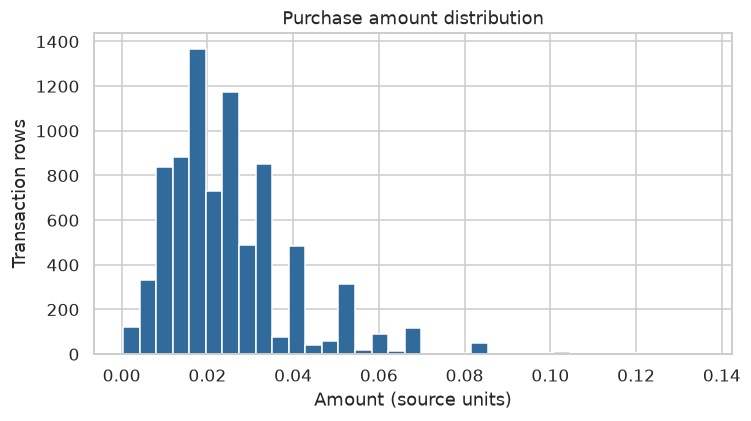

**2. IQR 전후 박스플롯:** 같은 축에서 원값·EDA 사본의 분포를 비교한다. 일반적인 IQR 수염과 실제 이상치 점을 포함해 보정 전후를 같은 축에서 비교한다.

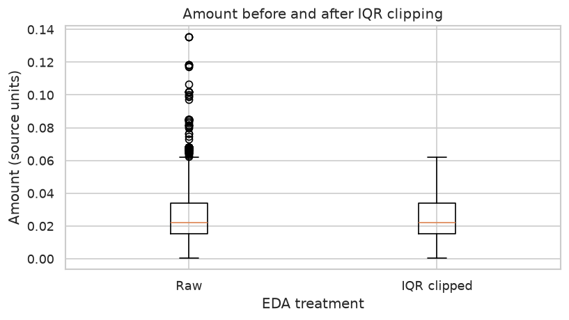

**3. 세그먼트 막대그래프:** 고객 단위 그룹 규모다. 상품 구매 행 수와 구분한다.

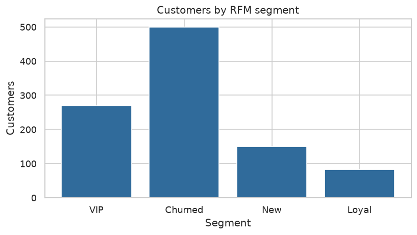

**4. RFM 상관 히트맵:** 고객 지표의 선형 연관을 본다. 상관은 캠페인 효과·인과를 증명하지 않는다.

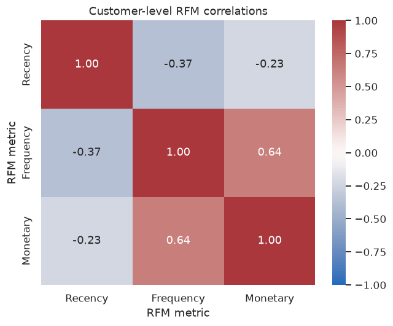

**5. 이미지 통계 산점도:** 이미지를 실제로 읽은 상품 각각의 평균·표준편차를 점으로 표시한다. 임의 구간화나 점 제거를 하지 않는다. 표본에 없는 상품으로 일반화하지 않는다.

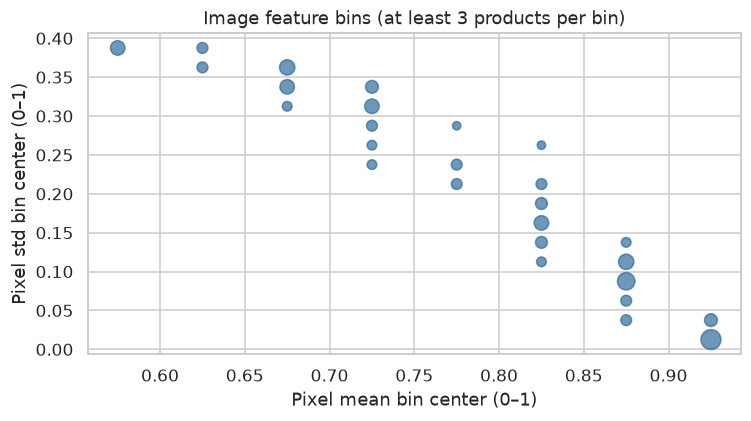

**6. 월별 금액 라인차트:** 관측 범위의 완전한 세 달을 표시하고 거래·RFM 합계와 대조한다.

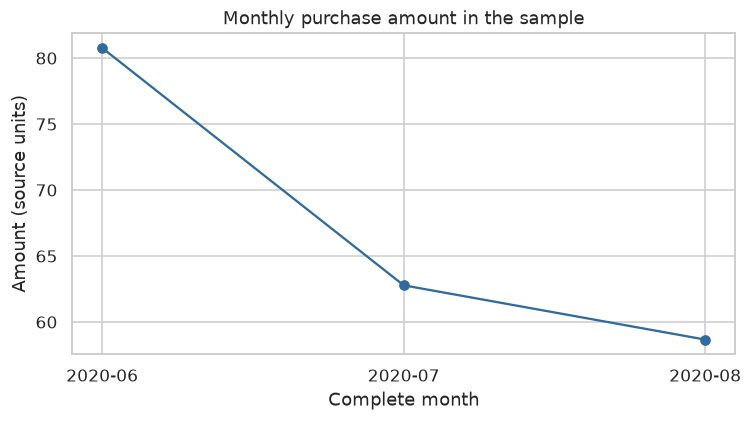

| 월 | 구매금액 합계·원본 단위 |
| --- | ---: |
| 2020-06 | 80.766000 |
| 2020-07 | 62.779373 |
| 2020-08 | 58.667373 |

첫 달 대비 마지막 달의 표본 금액은 -27.4% 변화했다. 선택 고객의 기간 내 관측이며 계절성·표본 선택의 영향을 검토해야 한다. 월별 합계 202.212746는 RFM 입력 원금액 합계와 일치한다.

## 실제 고객 그룹 요약

선택 표본의 그룹 집계다. 금액은 통화를 확인하지 않은 원본 단위다. Frequency는 고유 구매일 수다.

| 그룹 | 고객 수 | 고객 비중 | Recency 중앙값(일) | Frequency 중앙값(구매일) | 고객당 평균 Monetary | 금액 비중 |
| --- | ---: | ---: | ---: | ---: | ---: | ---: |
| VIP | 270 | 27.0% | 12.5 | 3.0 | 0.391468 | 52.3% |
| Churned | 499 | 49.9% | 60.0 | 1.0 | 0.149389 | 36.9% |
| New | 149 | 14.9% | 18.0 | 1.0 | 0.101617 | 7.5% |
| Loyal | 82 | 8.2% | 16.0 | 2.0 | 0.083296 | 3.4% |

## 비즈니스 인사이트

기준일 2020-08-31. 2020년 6~8월의 선택 고객·전체 판매 채널 표본에 한정한 관측이다. 금액은 H&M 원본 단위다. 세 인사이트의 근거는 `NB_RFM`의 VIP·New·Churned 프로파일 행이다. `03_bar.png`는 그룹별 인원, 프로파일 표는 금액 비중과 RFM 중앙값을 보여준다.

### 1. VIP 유지 실험

- **근거:** VIP는 고객의 27.0%이며 관측 구매금액의 52.3%를 차지한다. 고액·반복 구매 그룹의 유지 성과를 따로 관찰할 이유가 있다.
- **실행:** VIP에 재입고·신상품 우선 알림을 시험하고, 불필요한 상시 할인 없이 재구매를 유지할 수 있는지 확인한다. 효과는 가설이다.
- **검증:** 발송군과 무작위 미발송군의 이후 구매율·고객당 마진을 비교한다. 반응 이력·마진·추가 관찰 기간이 필요하며 차이가 없으면 가설을 기각한다.

### 2. 최근 1개 구매일 고객의 다음 구매 유도

- **근거:** New 그룹은 고객의 14.9%이고 고유 구매일 수 중앙값은 1일이다. 관찰 기간 내 한 구매일만 확인된 그룹이며 실제 신규 가입 고객을 뜻하지 않는다.
- **실행:** 이 그룹에 구매 상품군을 고려한 후속 안내를 시험해 두 번째 구매일이 생기는 비율을 높이는 것을 목표로 한다.
- **검증:** 미발송군 대비 30일 내 추가 구매일 발생률과 마진을 비교한다. 연락 동의·상품 반응·향후 거래가 필요하며 자연 재구매와 계절성의 영향을 통제한다.

### 3. 낮은 최근성 그룹의 재활성화 타당성 확인

- **근거:** Churned는 고객의 49.9%이고 최근 구매 이후 일수 중앙값은 60일이다. 표본 내 상대적으로 낮은 최근성 그룹이며 실제 이탈 확정값은 아니다.
- **실행:** 이 그룹의 과거 반복 구매 여부를 나눠 재입고 안내나 제한된 혜택을 소규모로 실험한다. 재활성화 효과와 비용을 함께 확인한다.
- **검증:** 무작위 대조군과 순증 구매율·혜택 비용 차감 후 마진을 비교한다. 비용·상품 재고·후속 거래가 필요하며 수익이 늘지 않으면 확대하지 않는다.

세 인사이트의 우선순위와 ROI는 현재 데이터만으로 확정하지 않는다. 이미지 평균·표준편차는 밝기·배경·색상 요약이며 상품 패턴이나 구매 원인을 직접 설명하지 않는다.

| 실험 대상 | 사전 정의할 30일 KPI | 대조군 | 추가 확보할 데이터 |
| --- | --- | --- | --- |
| VIP | 구매율·고객당 마진 | VIP 내 무작위 미발송 | 배정·발송 시각, 후속 거래, 상품 마진 |
| New | 두 번째 구매일 발생률·고객당 마진 | New 내 무작위 미발송 | 연락 동의, 후속 거래의 고객 ID·날짜, 마진 |
| Churned | 구매율 차이·혜택 비용 차감 마진 | 기존 반복 구매 여부 층별 무작위 미발송 | 배정·발송 시각, 후속 거래, 혜택 비용, 재고 |

30일은 배정 시각부터 관찰하는 실험 설계 예시다. 위 데이터가 확보되면 그룹별 발송군과 대조군을 비교한다.

## 보너스 3개 실제 구현 결과

이슈 #18에서 구현·검증했다. 노트북의 `NB_BONUS_IMAGES`·`NB_BONUS_COHORT`·`NB_BONUS_PLOTLY`에 실제 코드와 출력이 있으며, 보너스를 포함한 코드 셀 12개가 새 커널에서 모두 실행된다.

### 이미지 히스토그램·엣지 피처

`advanced=True, histogram_bins=8`을 지정하면 이미 읽은 상품 이미지 배치에서 8개 정규화 히스토그램 열 `image_hist_0`~`image_hist_7`과 `image_edge_mean`을 추가한다. 가중 밝기 근사는 `0.2126R+0.7152G+0.0722B`이며 sRGB 선형화나 물리적 휘도 측정을 수행하지 않는다. 히스토그램은 0~1을 8등분하고 마지막 구간에 1을 포함하며, 각 이미지에서 합이 1이다. 엣지는 수평·수직 인접 픽셀 절대차의 평균이다.

실제 관측 상품 200개의 합1·상품/거래 매핑을 확인했다. 평균 엣지 값은 **0.045633**, 범위는 **0.004035~0.162338**이다. 실패·미표본 이미지는 피처를 결측으로 유지하며, 기존 mean/std·원본 이미지·거래금액을 바꾸지 않는다. 밝은 배경·리사이즈의 영향을 받으므로 상품 의미나 정교한 질감 검출로 단정하지 않는다.

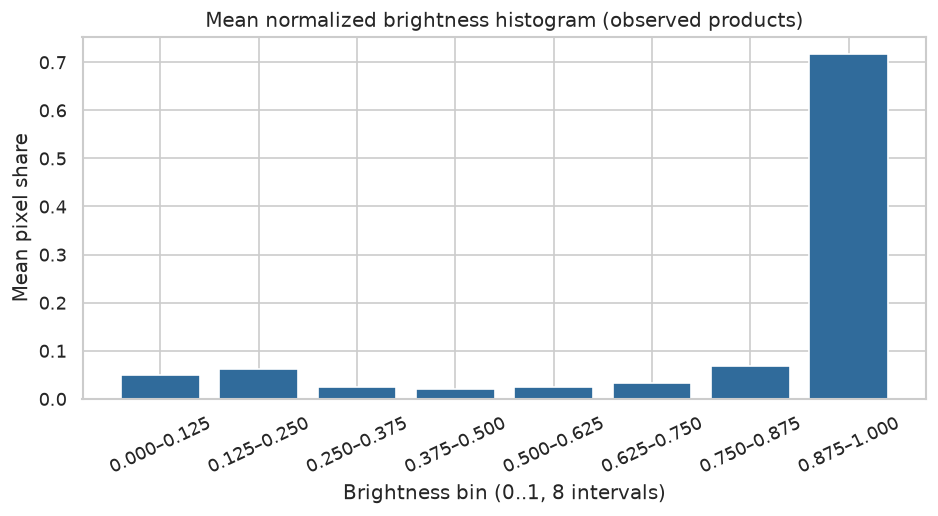

### 첫 관찰 구매월 코호트

가입일이 없어 **관찰 기간 내 첫 구매월**을 기준으로 사용한다. 분모는 각 코호트의 M0 고유 고객 수, 분자는 해당 월에 구매한 코호트 고유 고객 수다. 동일 월의 반복 거래는 한 고객으로 센다. 연속 생존율이 아니라 월별 활동 비율이며, 관측 무구매는 0·미래 미관측은 빈칸/NaN으로 표시한다.

| 첫 관찰 구매월 | 고객 수·분모 | M0 | M1 | M2 |
| --- | ---: | ---: | ---: | ---: |
| 2020-06 | 550 | 100.0% | 40.7% (224명) | 38.7% (213명) |
| 2020-07 | 288 | 100.0% | 28.5% (82명) | 미관측 |
| 2020-08 | 162 | 100.0% | 미관측 | 미관측 |

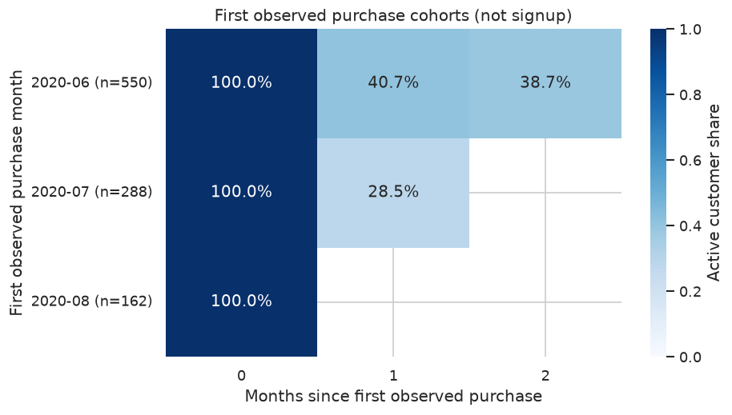

6월 이전 구매 이력을 알 수 없어 실제 신규 가입이나 생애 첫 구매 코호트로 해석하지 않는다. 관찰 길이가 다른 코호트의 미관측 칸을 0으로 채우거나 동기간 없이 직접 비교하지 않는다. 원수·분모·비율 CSV는 `docs/results/bonus/`에 있다.

### Plotly 인터랙티브 RFM

[인터랙티브 RFM HTML](docs/results/bonus/rfm_interactive.html)을 **내려받거나 로컬 파일로 브라우저에서 연다**. GitHub 파일 미리보기는 JavaScript 실행을 지원하지 않는다. 고객 **1,000명·4개 그룹**의 실제 Recency·Frequency·Monetary와 원본 고객 ID를 유지한다. 마우스 드래그로 3D 회전, 스크롤로 확대, 점의 hover로 고객 ID·지표 확인, 범례로 그룹 선택을 할 수 있다. Plotly JS를 내장해 별도 CDN 연결이 필요 없다.

실제 브라우저에서 네트워크를 차단한 채 전체 점 1,000개·범례 필터·3D 카메라 조작을 확인했다. 화면에서 그룹을 선택해도 원본 관측을 삭제하지 않는다. 이미지·코호트·인터랙티브 결과는 앞의 재생성 명령으로 갱신된다. SRC: [이미지 배치](utils/image_features.py), [보너스 함수](utils/bonus.py), [검증 입력](tests/test_bonus.py), [실행 노트북](notebooks/analysis_report.ipynb).

### 실제 실행 화면과 기능 확인

아래는 실제 고객 1,000명으로 실행한 Plotly 화면이다. 위의 히스토그램·코호트 화면과 앞 절의 필수 차트 6종도 실제 분석 결과다.

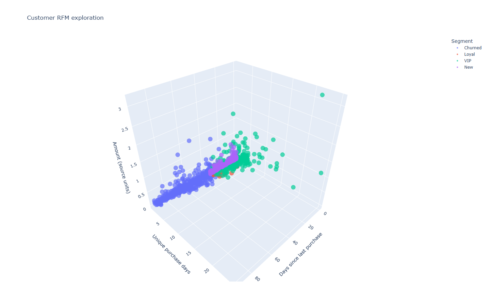

| 구현 기능 | 실행 화면에서 확인할 내용 | 구현 위치 |
| --- | --- | --- |
| 이미지 고급 피처 | 8구간 비중·합1·평균 엣지, 관측200상품의 피처 표 | `utils/image_features.py::advanced_image_statistics`, NB_BONUS_IMAGES |
| 코호트 활동 비율 | 첫 구매월별 분모550/288/162, 관측 비율과 미래 빈칸 | `utils/bonus.py::cohort_retention/cohort_figure`, NB_BONUS_COHORT |
| 인터랙티브 RFM | 드래그 회전·스크롤 확대·범례 선택·고객ID hover | `utils/bonus.py::interactive_rfm`, NB_BONUS_PLOTLY |
| 원본 결과 보존 | 실제 표·ID·사진·분석 출력을 함께 가진 노트북 | `utils/publish_report.py::preserve_execution` |

아래 명령은 저장소 루트에서 실행한다. 마지막 명령은 Windows에서 실제 HTML 화면을 연다. 원본 거래 표·상품 사진·정제·통계·RFM 결과는 실행 노트북에서도 함께 확인할 수 있다.

```powershell
.venv\Scripts\python.exe -B -m utils.run_checks --with-sample
.venv\Scripts\python.exe -B -m utils.publish_report
.venv\Scripts\python.exe -B -m utils.repository_checks
Invoke-Item docs/results/bonus/rfm_interactive.html
```

보너스 포함 검증 결과: 테스트20개 통과, 새 커널 코드12셀 전체 성공, 독립 새 복제본·새 가상환경에서도 보너스를 포함한 분석 JSON 전체 항목 일치. 실제 브라우저에서는 네트워크를 차단하고 점수·필터·카메라 조작을 확인했다.

## 검증을 직접 재현할 작은 입력

- 텍스트 `Blue cotton shirt` → 17자·3단어.
- 픽셀 절반 0·절반 1 → 이미지 평균·표준편차 각각 0.5.
- 그룹 A의 10·30·결측 → 결측20, 그룹 누락 행의 관측50 보존, 전체 관측 평균 fallback30.
- `[1,2,3,4,100]` → IQR 경계−1·7, 100만 탐지. `[-2,1,2,3,6]`의 경계값은 탐지하지 않음.
- A 고객이 1/1에 10·20, 1/3에30, B가1/2에5 구매 → 기준일1/3에서 A=R0/F2/M60, B=R1/F1/M5, 합계65.
- 동일 지표의 점수가 같고 입력 순서를 바꿔도 RFM이 동일함. 고객당 단일 그룹, 네 그룹 이상과 금액 합계도 확인함.
- 월 누락·상수 상관·원본 필드와 실행본 바이트 보존도 가상 입력 테스트로 확인함.

## 원본 실행 보고서와 다시 생성하는 방법

평가용 파일은 [notebooks/analysis_report.ipynb](notebooks/analysis_report.ipynb)이다. 코드와 실행 결과가 함께 저장되어 있어 원본 행·고객 ID·상품 이미지 예시·피처·통계·RFM·차트를 바로 볼 수 있다. 대화나 게시 과정에서 값을 마스킹하거나 출력을 비우지 않았다. 전체 실행본은 `data/processed/analysis_report.executed.ipynb`와 바이트 단위로 동일하게 보존한다.

보조 집계 자료는 `docs/results/analysis_aggregates.json`, `segment_profile.csv`, `monthly_amount.csv`, `analysis_report.md`다. 그림은 원본 분석에서 생성한 PNG를 그대로 복사한다. 원본 CSV·ZIP·전체 JPG 묶음과 개인 인증 설정은 Git에 넣지 않는다.

```powershell
.venv\Scripts\python.exe -B -m utils.run_checks --with-sample
.venv\Scripts\python.exe -B -m utils.publish_report
.venv\Scripts\python.exe -B -m utils.repository_checks
```

SRC `utils/publish_report.py`의 `preserve_execution()`은 성공한 실행본을 바이트 그대로 복사하며 표·ID·이미지를 삭제하지 않는다. 오류가 있거나 실행되지 않은 셀이 있으면 제출본 보존을 중단한다. 검증 도구는 실행 오류·제출 파일·상대 링크·허용 라이브러리와 원본 데이터 파일의 Git 제외를 확인한다.

## 기능별 SRC

| SRC 경로 | 주요 함수·책임 |
| --- | --- |
| [src/pipeline.py](src/pipeline.py) | DataAnalyzer의 load_data·join_products·validate_transactions·handle_missing_values(네이토 호출명 handle_missing)·detect_outliers·calculate_rfm·summarize |
| [utils/analytics.py](utils/analytics.py) | clean_transactions·impute_features·iqr_limits·calculate_customer_rfm·segment_profile |
| [utils/image_features.py](utils/image_features.py) | prepare_image·extract_product_image_features. 픽셀 통계의 NumPy 축 연산 |
| [utils/bonus.py](utils/bonus.py) | cohort_retention·cohort_figure·interactive_rfm. 코호트와 Plotly 보너스 |
| [utils/reporting.py](utils/reporting.py) | pair_correlation·monthly_amount·make_figures·write_insights |
| [utils/run_checks.py](utils/run_checks.py) | 가상 테스트와 현재 Python의 새 커널 실행 |
| [utils/reproducibility.py](utils/reproducibility.py) | 새 복제본·새 환경·표본 복원과 결과 전체 대조 |
| [utils/publish_report.py](utils/publish_report.py) | 원본 실행본·차트·집계 보존과 보조 보고서 생성 |
| [utils/repository_checks.py](utils/repository_checks.py) | 제출 파일·링크·분석 import·데이터 제외·공개 보고서 검사 |
| [scripts/restore_hm_sample.py](scripts/restore_hm_sample.py) | ZIP 구성·기록·경로·충돌·선택적 체크섬 확인 |
| [notebooks/analysis_report.ipynb](notebooks/analysis_report.ipynb) | NB_LOAD~NB_REPRO 실행·해석 |
| [tests/test_pipeline.py](tests/test_pipeline.py) · [tests/test_analytics.py](tests/test_analytics.py) · [tests/test_reporting.py](tests/test_reporting.py) · [tests/test_publication.py](tests/test_publication.py) | 로드·조인·이미지·정제·대치·IQR·RFM·월·상관·원본 출력 보존 검증 |

용어·원리·작은 예제는 [docs/tech_study.md](docs/tech_study.md), 평가 질문·SRC·시연은 [docs/a1_1_evaluation_qa.md](docs/a1_1_evaluation_qa.md), 원본 평가 자료에 대한 의견은 [docs/a1_1_eval_review.md](docs/a1_1_eval_review.md)에 있다. 실행·결과·인사이트의 필수 설명은 이 README 본문에 포함했다.

## 범위와 한계

- 현재 관측 기간과 선택 고객·이미지를 전체 고객·상품의 특성으로 일반화하지 않는다.
- 신규 가입·실제 이탈·주문당 객단가·마진·LTV를 추정 없이 단정하지 않는다.
- 이미지 통계는 촬영 조건을 함께 요약한다. 의미·질감·선호의 직접 측정값이 아니다.
- 데이터에 접근할 수 없는 평가자도 저장된 원본 실행 출력과 집계를 확인할 수 있다. 재실행에는 표본 ZIP이 필요하다.
- 이미지 고급 피처·첫 관찰 구매월 코호트·Plotly 보너스는 실제 구현했다. 가입일 코호트와 실제 모델 학습은 현재 범위에 포함되지 않는다.

## 실제 실행 확인 기록

2026-11-07 실제 검증의 성공 상태를 기록했다. 아래는 테스트 수·종료 성공·검증 상태 요약이며, 전체 분석 출력은 실행 노트북에서 확인할 수 있다. 이 블록은 실행 결과이며 복사 실행할 명령은 앞 절의 PowerShell 블록이다.

```text
Validation status summary, 2026-11-07 Asia/Seoul
> .venv/Scripts/python.exe -B -m utils.run_checks --with-sample
Ran 22 tests
OK
Notebook execution: PASS (12 code cells)
> .venv/Scripts/python.exe -B -m utils.repository_checks
Repository checks: PASS
Original stdout is private. No notebook rows or identifiers are copied here.
```

새 복제본·새 가상환경에서는 표본 203파일을 복원하고 입력 체크섬·설정·버전·정제·이미지·월별·RFM·상관 등 기록한 전체 필드를 비교한다. 성공 시 `Fresh-checkout reproduction matched every recorded field.`를 출력한다. 검증 원문은 `data/processed/reproduction_verification.json`에 남는다.

작업 흐름은 이슈 → 기능 브랜치 → 검증·커밋 → develop PR → 검증한 묶음 main 반영이다. 계획·완료 증거는 통합 계획과 체크표에 유지하며, 마지막 README 작업은 이슈 #11에서 관리한다.

## 소스 구조와 실행 흐름

아래 트리와 Mermaid 차트는 현재 구현의 파일·클래스·호출 순서를 설명한다. 분석을 처음 읽을 때는 **파일 트리 → 모듈 연결 → 클래스 구조 → 분석 순서 → 검증·제출 순서**로 확인한다. 이 문서의 도식 보완은 이슈 #14에서 관리한다.

### 1. SRC 파일 트리 개요

`src/`에는 분석 상태를 관리하는 `pipeline.py`가 있다. 공용 계산은 `utils/`, 분석 호출과 설명은 `notebooks/`, 표본 복원은 `scripts/`가 담당한다.

```text
A1_1/
├── src/
│   └── pipeline.py                 # DataAnalyzer 클래스와 간단한 로드·조인 CLI
├── utils/
│   ├── __init__.py                  # 공용 도구 패키지
│   ├── bonus.py                     # 첫 관찰 구매월 코호트·Plotly 보너스
│   ├── build_eval_presentation.mjs   # 평가 PPT 작성·렌더·파일 검증
│   ├── eval_presentation_content.mjs # 질문별 기술 원고·발표자 노트
│   ├── analytics.py                 # 거래 정제·결측 대치·IQR·RFM·그룹 프로파일
│   ├── image_features.py            # 이미지 정규화·축소·배치 mean/std
│   ├── reporting.py                 # 통계 상관·월별 집계·6종 차트·인사이트
│   ├── run_checks.py                # 회귀 테스트와 선택적 새 커널 실행
│   ├── reproducibility.py           # 새 복제본·새 환경의 전체 결과 대조
│   ├── publish_report.py            # 원본 실행본·차트 보존과 보조 집계 생성
│   └── repository_checks.py         # 제출 파일·링크·실행 오류·Git 제외 검사
├── notebooks/
│   ├── prepare_hm_sample.ipynb       # Kaggle 원격 환경에서 필요한 표본 추출
│   └── analysis_report.ipynb         # 분석 단계·해석과 실제 실행 출력
├── scripts/
│   └── restore_hm_sample.py         # ZIP 검사와 로컬 표본 복원
├── tests/
│   ├── test_pipeline.py             # 로드·상품 조인·이미지·텍스트
│   ├── test_bonus.py                # 히스토그램·엣지·코호트·Plotly
│   ├── test_analytics.py            # 정제·대치·IQR·RFM
│   ├── test_reporting.py            # 상관·월별 합계 경계
│   ├── test_publication.py          # 원본 필드·실행본 보존
│   └── test_repository_checks.py   # 인용 코드·실제 상대 링크 구분
└── docs/
    ├── results/                    # 실제 차트·집계·보너스·실행 상태
    └── presentation/               # 질문별 기술 PPT와 페이지/재생성 안내
```

`data/raw/hm/`은 재실행용 표본, `data/processed/`는 실행 중 생성하는 결과의 로컬 경로다. 파일별 자세한 위치는 [index.md](index.md), 기능을 바꿀 때 함께 확인할 위치는 [reverse_index.md](reverse_index.md)에 있다.

### 2. 클래스와 모듈 연결 구조

현재 분석 핵심 클래스는 `DataAnalyzer` 하나다. 별도 부모·자식 클래스로 나누지 않고 공용 함수 모듈을 호출한다. 아래 화살표는 **호출하는 쪽 → 호출되는 쪽**이며 상속 관계를 의미하지 않는다.

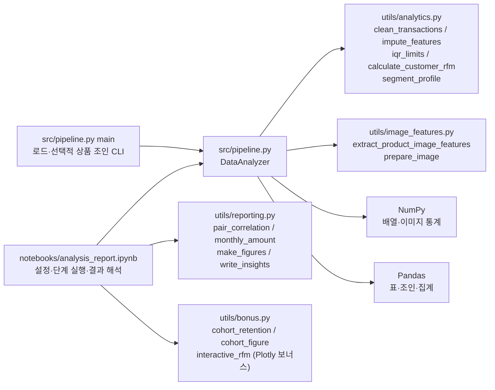

전체 분석의 진입점은 노트북이다. `python src/pipeline.py --data ... --products ...`는 CSV 로드와 선택적 상품 조인을 확인하는 CLI다. SRC: [src/pipeline.py](src/pipeline.py), [utils/analytics.py](utils/analytics.py), [utils/image_features.py](utils/image_features.py), [utils/reporting.py](utils/reporting.py).

### 3. DataAnalyzer 클래스 구조도

속성은 현재 분석 상태와 검증 기록을, 메서드는 수행할 작업을 나타낸다. `df`는 거래 표, `products`는 상품 표이며 로드·조인 전에는 `None`이다. `+`는 공개 인터페이스, `-`는 내부 보조 메서드라는 관례를 표시하며, `$`는 정적 메서드다.

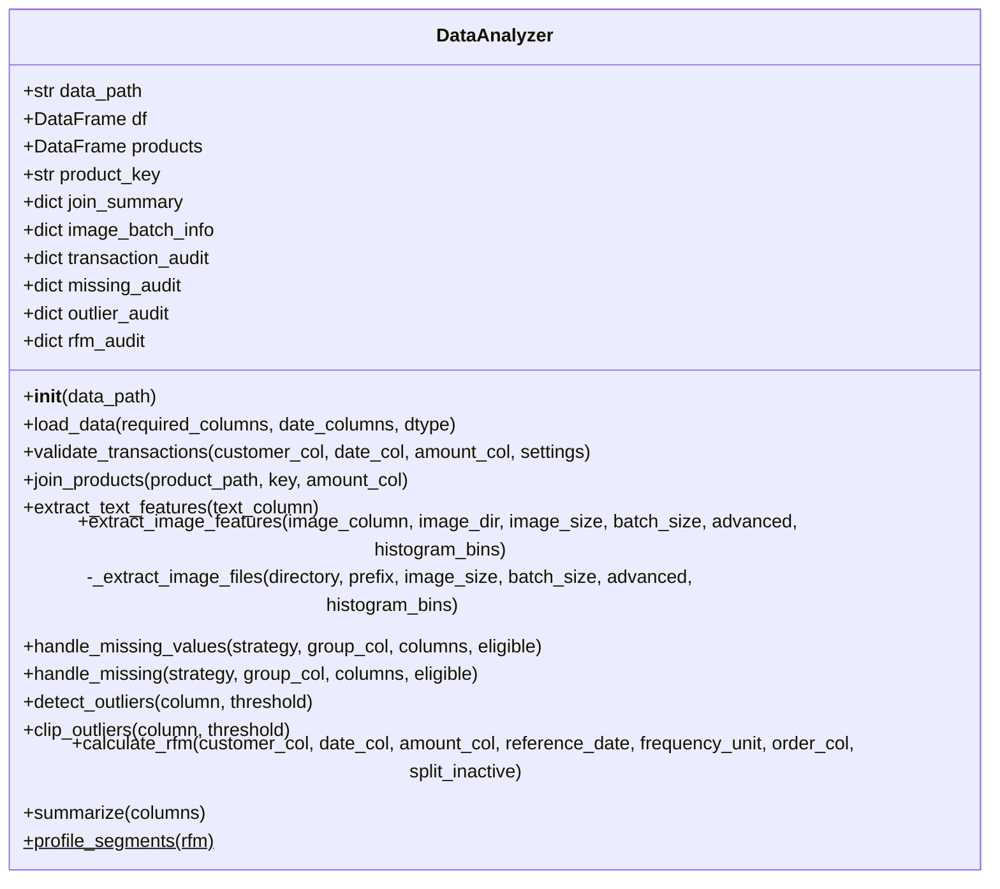

`load_data()`는 분석 상태를 초기화하고, `validate_transactions()`·`join_products()`·피처/대치 메서드는 자신의 인스턴스 표를 갱신한다. `clip_outliers()`는 보정된 별도 Series를, `calculate_rfm()`는 고객별 별도 DataFrame을 반환하므로 거래 원금액은 유지된다. `profile_segments()`는 전달받은 RFM 표를 요약하는 정적 메서드다. 실제 타입·기본값·키워드 전용 인자는 [클래스 원문](src/pipeline.py)에서 확인한다.

### 4. 노트북 분석 실행 차트

노트북에 있는 `NB_*` 제목의 실제 순서다. 상품 이미지 피처의 결측 대치는 별도 `imputer` 인스턴스의 EDA 사본에 적용한다. IQR 보정 금액도 사본으로 반환하며 RFM·월별 합계에는 유효 거래의 원금액을 사용한다.

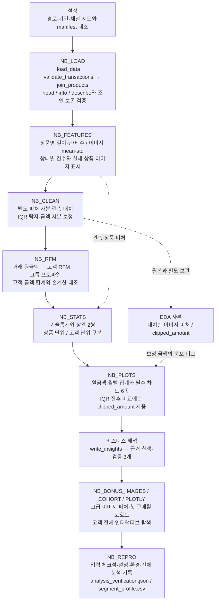

SRC: [실행 노트북](notebooks/analysis_report.ipynb)의 `NB_LOAD`~`NB_REPRO`, [DataAnalyzer](src/pipeline.py), [보고서 공용 함수](utils/reporting.py). `NB_REPRO`는 실행 기록을 저장하는 셀이며, 아래의 새 복제본·새 환경 검증은 별도 명령으로 수행한다.

### 5. 검증·제출 실행 차트

실제 실행·원본 보존·저장소 검사 순서를 보여준다. 각 명령이 성공한 뒤 다음 단계를 진행한다. 새 환경 재현은 분석 결과가 생성된 뒤 별도로 실행하는 검증 경로다.

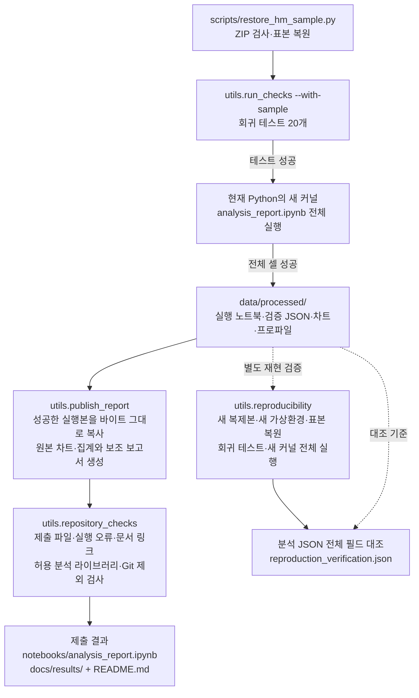

`utils.run_checks`만 실행하면 회귀 테스트까지 수행하며, `--with-sample`을 붙여야 새 커널 분석을 실행한다. `utils.publish_report`는 README 설명과 본문 인사이트를 자동 작성하지 않으며 실행 결과와 보조 집계 파일을 갱신한다. 재실행 후 README의 수치·설명도 결과와 대조한다. 전체 명령은 앞의 **전체 분석과 검증**, **원본 실행 보고서와 다시 생성하는 방법**에 있다.

SRC: [표본 복원](scripts/restore_hm_sample.py) → [검증 실행](utils/run_checks.py) → [원본 결과 보존](utils/publish_report.py) → [저장소 검사](utils/repository_checks.py). 독립 검증: [새 환경 재현](utils/reproducibility.py).

## 평가 기술 발표자료

[질문별 기술 발표 PPT](docs/presentation/a1_1_eval_technical_final.pptx)는 **31장**이며, 평가서 필수 질문 **19개를 각각 최소 한 장**으로 설명한다. 질문 번호1-1~4-3을 표시하고 실제 구현·코드·수식·배열 축·메모리/Stride/SIMD·RFM 손계산·검증값과 한계를 담았다. 보너스3개는 B-1~B-3에서 실제 결과로 설명한다. 각 장의 발표자 노트에는 질문 원문·설명·코드 시연·꼬리 질문·SRC/출처가 있다.

필수 분석과 보너스의 실제 실행 화면, 편집 가능한 표·차트·기술 도식을 함께 사용했다. [질문별 페이지·발표/재생성 안내](docs/presentation/README.md)에서 필요한 질문을 찾을 수 있다. 관련 이슈는 #17이며, 보너스 구현은 별도 #18에서 관리했다.
