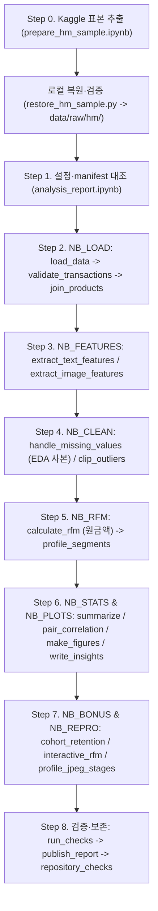
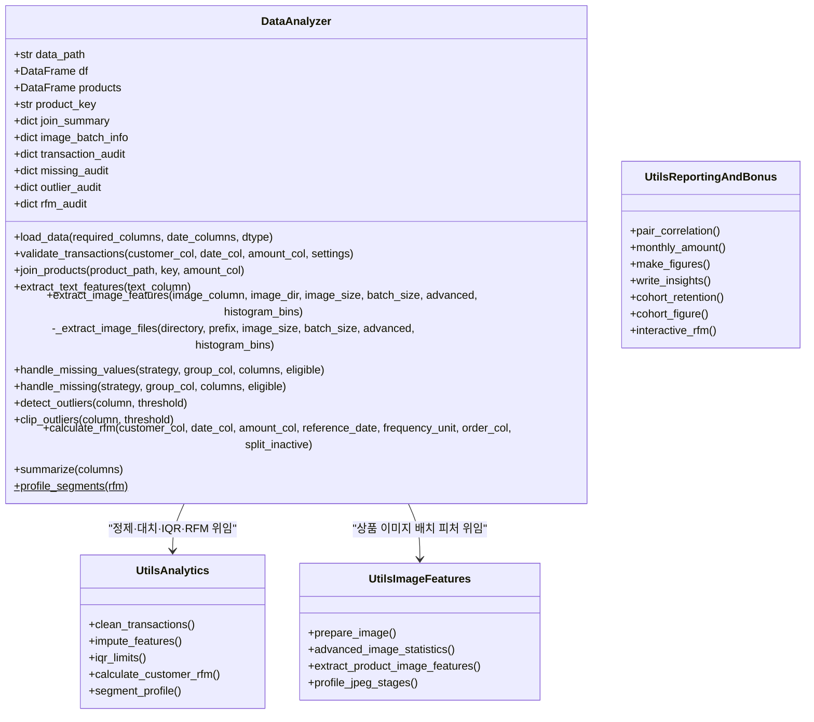
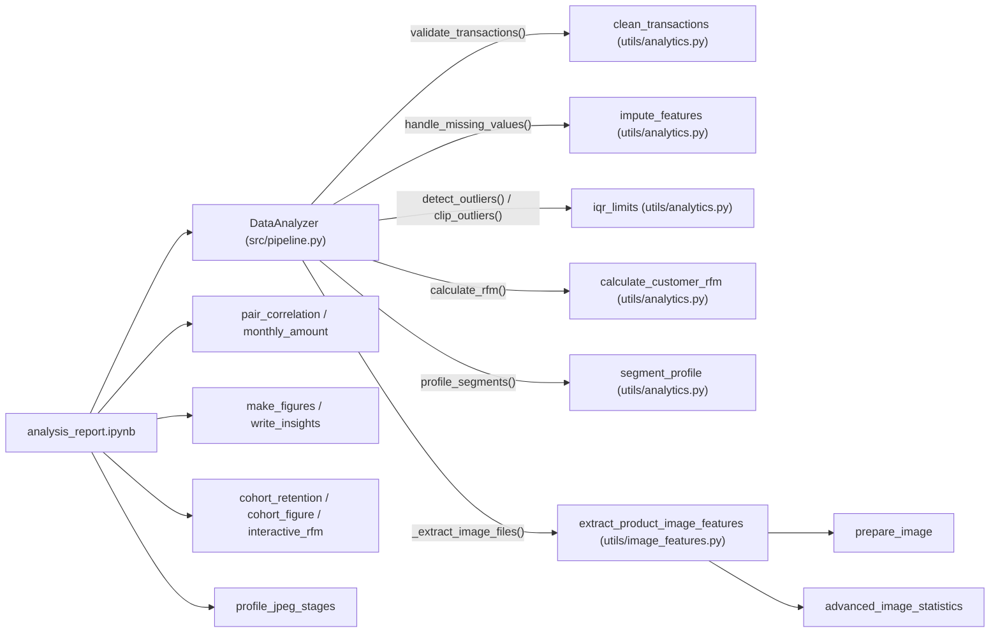

# A1_1 코드 리뷰 및 실행 흐름 안내

이 문서는 `A1_1` 저장소의 전체 코드 구조와 **실행 순서별 호출 흐름**을 정리한 코드 리뷰 문서입니다. 모든 파일·함수 링크는 GitHub 및 로컬 환경에서 바로 이동할 수 있도록 `docs/` 기준 상대 경로로 작성했습니다.

- 용어·수식·배열 원리 해설: [기술 학습서 (tech_study.md)](tech_study.md)
- 프로젝트 실행 및 결과 요약: [README.md](../README.md) · [파일 안내 (index.md)](../index.md) · [평가 Q&A (a1_1_evaluation_qa.md)](a1_1_evaluation_qa.md)

---

## 1. 코드 개요 (아키텍처)

분석 상태와 파이프라인 인터페이스는 [`DataAnalyzer`](../src/pipeline.py#L20) 클래스가 담당하고, 상태에 의존하지 않는 순수 계산·검증 로직은 `utils/` 모듈로 분리되어 있습니다. 노트북은 설정·메서드 호출·결과 해석만 수행합니다.

### 1-1. 전체 실행 순서도 (Flowchart)

### 1-2. DataAnalyzer 클래스 및 유틸리티 연결도 (Class Diagram)

### 1-3. 메서드별 함수 호출 연결도 (Function Call Graph)

### 1-4. `DataAnalyzer` 핵심 메서드별 설계 포인트 요약

실제 [`src/pipeline.py`](../src/pipeline.py#L20)의 구현 기준으로 주요 메서드의 설계 의도는 다음과 같습니다.

| 메서드 (실제 시그니처) | 핵심 설계 포인트 |
| --- | --- |
| [`load_data(*, required_columns=(), date_columns=(), dtype=None)`](../src/pipeline.py#L36) | `customer_id`·`article_id`·`sales_channel_id`를 `string`으로 읽어 선행 `0`을 보존하고, 재로드 시 기존 감사(`*_audit`) 상태를 초기화합니다. |
| [`extract_image_features(image_column="image", *, image_dir=None, ...)`](../src/pipeline.py#L189) | OpenCV·딥러닝 없이 순수 NumPy 축 연산(`axis=(1,2,3)`)으로 `image_mean`, `image_std`를 추출합니다(파일 입력 시 상품별 1회만 계산 후 매핑). |
| [`extract_text_features(text_column)`](../src/pipeline.py#L236) | 원문을 보존한 채 결측만 빈 문자열로 취급해 `{text_column}_length`, `{text_column}_word_count`를 생성합니다. |
| [`handle_missing_values(strategy="group_mean", group_col=None, ...)`](../src/pipeline.py#L129) | 1단계 그룹 평균 → 2단계 전체 평균 fallback 대치를 수행하며, 호환 별칭 [`handle_missing()`](../src/pipeline.py#L141)을 함께 제공합니다. |
| [`detect_outliers(column, threshold=1.5)`](../src/pipeline.py#L145) / [`clip_outliers(...)`](../src/pipeline.py#L156) | `IQR = Q3 - Q1` 기준 불리언 마스크를 반환하고, 원금액(`self.df`)은 보존한 채 보정된 EDA 사본 `Series`만 별도 반환합니다. |
| [`calculate_rfm(customer_col, date_col, amount_col, ...)`](../src/pipeline.py#L162) | 평균 순위 기반 1~4점과 우선순위 규칙(`np.select`)으로 `VIP`, `Loyal`, `New`, `Churned`, `Potential` 5개 세그먼트를 산출합니다. |

| 구분 | 상대 경로 | 핵심 역할 |
| --- | --- | --- |
| 표본 추출 | [notebooks/prepare_hm_sample.ipynb](../notebooks/prepare_hm_sample.ipynb) | Kaggle `/kaggle/input`에서 기간·고객·이미지 표본만 청크 추출해 `hm_sample.zip` 생성 |
| 표본 복원 | [scripts/restore_hm_sample.py](../scripts/restore_hm_sample.py) | ZIP 구성·`sample_manifest.json`·충돌·SHA-256 검증 후 `data/raw/hm/`에 복원 |
| 분석 노트북 | [notebooks/analysis_report.ipynb](../notebooks/analysis_report.ipynb) | 설정 검증, `DataAnalyzer` 호출, 통계·차트·인사이트·보너스·재현 기록 실행 |
| 핵심 클래스 | [src/pipeline.py](../src/pipeline.py) | `DataAnalyzer` 상태(`df`, `products`, `*_audit`) 관리 및 단계별 메서드·CLI 제공 |
| 정제·RFM | [utils/analytics.py](../utils/analytics.py) | 거래 정제, 그룹 평균 대치, IQR 경계 계산, 고객 RFM 및 세그먼트 프로파일 |
| 이미지 처리 | [utils/image_features.py](../utils/image_features.py) | 32×32 RGB 정규화, 배치 `(N,H,W,C)` 통계, 고급 히스토그램·엣지, JPEG 단계별 계측 |
| 보고·차트 | [utils/reporting.py](../utils/reporting.py) | 상관계수, 완전한 월별 합계, 필수 차트 6종, 비즈니스 인사이트 생성 |
| 보너스 | [utils/bonus.py](../utils/bonus.py) | 첫 관찰 구매월 코호트 활동 비율·히트맵, Plotly 3D 인터랙티브 RFM HTML |
| 실행·검증 | [utils/run_checks.py](../utils/run_checks.py) | 단위 테스트 실행 및 `--with-sample` 시 새 커널로 노트북 전체 실행 |
| 결과 보존 | [utils/publish_report.py](../utils/publish_report.py) | 성공 실행본 바이트 보존 복사, 차트·집계 JSON·보조 보고서 생성 |
| 저장소 검사 | [utils/repository_checks.py](../utils/repository_checks.py) | 필수 파일, 상대 링크 유효성, 허용 라이브러리, 비공개 데이터 Git 제외 검사 |
| 재현성 대조 | [utils/reproducibility.py](../utils/reproducibility.py) | 독립 새 복제본·새 가상환경에서 표본 복원 후 분석 JSON 전체 필드 비교 |
| 단위 테스트 | [tests/test_pipeline.py](../tests/test_pipeline.py) 외 5종 | 가상 입력 기반 회귀 테스트([analytics](../tests/test_analytics.py), [reporting](../tests/test_reporting.py), [bonus](../tests/test_bonus.py), [publication](../tests/test_publication.py), [repo](../tests/test_repository_checks.py)) |

---

## 2. 실행 순서별 코드 리뷰

### Step 0. Kaggle 표본 추출 및 로컬 복원

1. **표본 추출** — [notebooks/prepare_hm_sample.ipynb](../notebooks/prepare_hm_sample.ipynb)
   - `find_dataset()`이 `/kaggle/input`에서 `transactions_train.csv`, `articles.csv`, `images/`가 모두 포함된 폴더를 찾습니다.
   - `transaction_chunks()`가 25만 행(`CHUNK_SIZE = 250_000`) 단위로 CSV를 순회하며 결측 고객·잘못된 날짜·`0` 이하 금액을 상호 배타적으로 집계하고 기간(`2020-06-01` ~ `2020-09-01` 미만) 내 유효 거래만 걸러냅니다.
   - `prepare_hm_sample()`이 1차 스캔에서 모수와 RFM 기준일(`reference_date`)을 확정한 뒤, `choose()`(`SEED = 42`)로 최대 1,000명의 고객과 최대 200장의 이미지를 추출해 `hm_sample.zip`으로 묶습니다.
2. **로컬 복원** — [`restore_sample()`](../scripts/restore_hm_sample.py#L30-L72) · [`main()`](../scripts/restore_hm_sample.py#L75-L94)
   - ZIP 내부 파일 목록, `sample_manifest.json`의 이미지 수 일치 여부, 기존 파일과의 내용 충돌, 선택적 SHA-256 체크섬을 검증한 뒤 `data/raw/hm/`에 원자적으로 복원합니다.
   - 관련 학습: [tech_study.md §11. 표본·대용량 데이터·공개 범위](tech_study.md)

---

### Step 1. 환경 초기화 및 설정 검증 (`db7bb992`)

- [notebooks/analysis_report.ipynb](../notebooks/analysis_report.ipynb) 첫 코드 셀(`db7bb992`)에서 저장소 루트(`ROOT`)를 `sys.path`에 추가하고 [`DataAnalyzer`](../src/pipeline.py#L20)와 `utils/` 함수들을 임포트합니다.
- 분석 노트북 상단의 `SETTINGS`는 분석에 쓸 설정값을 모아 둔 딕셔너리입니다. 여기서 시작일(`start_inclusive`), 종료일(`end_exclusive`), 난수 시드(`seed`), 판매 채널(`sales_channel`)을 읽고, 표본을 만들 때 기록한 `data/raw/hm/sample_manifest.json`의 네 항목과 일치하는지 검사합니다. [notebooks/analysis_report.ipynb의 설정 선언과 검사](../notebooks/analysis_report.ipynb?plain=1#L69)

---

### Step 2. 데이터 로드 · 거래 정제 · 상품 조인 (`NB_LOAD`)

1. **CSV 로드** — [`DataAnalyzer.load_data()`](../src/pipeline.py#L36-L69)
   - `customer_id`, `article_id`, `sales_channel_id`를 `string`으로 읽어 선행 `0`을 보존하고, 공백 제거 후 빈 문자열은 `pd.NA`로 변환합니다.
   - `t_dat`는 `YYYY-MM-DD` 형식으로 파싱하며 실패 값은 `NaT`로 남겨 다음 정제 단계에서 건수를 셀 수 있게 합니다. 새 로드 시 이전 `products` 및 `*_audit` 상태를 모두 초기화합니다.
2. **거래 정제** — [`DataAnalyzer.validate_transactions()`](../src/pipeline.py#L121-L127) → [`clean_transactions()`](../utils/analytics.py#L7)
   - 고객 누락 → 날짜 오류 → (주문 모드 시 주문/취소 오류) → 금액 오류(`<= 0` 또는 비유한) 순으로 상호 배타적으로 제외 건수를 집계해 `transaction_audit`에 기록합니다.
3. **상품 조인** — [`DataAnalyzer.join_products()`](../src/pipeline.py#L71-L119)
   - Pandas가 `NA` 키끼리 조인하는 것을 막기 위해 상품 표의 `null` 키를 먼저 제거하고, 중복 상품 키와 열 이름 충돌을 검사합니다.
   - `validate="many_to_one"`, `sort=False`로 왼쪽 조인을 수행한 뒤 **조인 전후 거래 행 수와 거래 금액 합계 보존**을 검증해 `join_summary`에 남깁니다.
   - 관련 학습: [tech_study.md §2~3·§16](tech_study.md)

---

### Step 3. 텍스트 및 이미지 멀티모달 피처 추출 (`NB_FEATURES`)

1. **텍스트 피처** — [`DataAnalyzer.extract_text_features()`](../src/pipeline.py#L236-L258)
   - `prod_name` 원문은 보존한 채 결측만 빈 문자열로 취급해 문자 수(`prod_name_length`)와 공백 기준 단어 수(`prod_name_word_count`)를 계산합니다. 상품 조인 후에는 고유 상품별로 한 번만 계산해 거래에 매핑합니다.
2. **이미지 배치 피처** — [`DataAnalyzer.extract_image_features()`](../src/pipeline.py#L189-L218) → [`_extract_image_files()`](../src/pipeline.py#L220-L234) → [`extract_product_image_features()`](../utils/image_features.py#L64)
   - [`prepare_image()`](../utils/image_features.py#L11)로 각 상품 이미지를 `32×32` RGB `float32`(0~1 범위)로 정규화하고, `batch_size=32` 단위로 쌓아 `(N, H, W, C)`의 `axis=(1, 2, 3)` 기준 평균(`image_mean`)과 표준편차(`image_std`, `ddof=0`)를 계산합니다.
   - `NB_FEATURES`에서 고급 피처를 켜고 밝기 구간을 8개로 지정하면(`advanced=True, histogram_bins=8`) [`advanced_image_statistics()`](../utils/image_features.py#L38)가 동일 배치에서 8구간 정규화 밝기 히스토그램(`image_hist_0`~`7`)과 인접 픽셀 절대차 평균(`image_edge_mean`)을 함께 계산합니다. [notebooks/analysis_report.ipynb의 피처 호출](../notebooks/analysis_report.ipynb?plain=1#L1036)
   - 관련 학습: [tech_study.md §4~5·§16](tech_study.md)

---

### Step 4. 결측 대치 및 IQR 이상치 보정 (`NB_CLEAN`)

1. **결측 대치** — [`DataAnalyzer.handle_missing_values()`](../src/pipeline.py#L129-L139) / [`handle_missing()`](../src/pipeline.py#L141-L143) → [`impute_features()`](../utils/analytics.py#L71)
   - 노트북에서는 별도 `imputer` 인스턴스의 EDA 사본(`image_mean_eda`, `image_std_eda`)에만 적용합니다.
   - `eligible=False`(`not_sampled`) 상품과 기존 관측값은 건드리지 않고, 결측 행만 `product_type_name` 그룹 평균 → 대치 전 전체 관측 평균 순으로 채운 뒤 `missing_audit`에 기록합니다.
2. **IQR 이상치 탐지·보정** — [`DataAnalyzer.detect_outliers()`](../src/pipeline.py#L145-L154) · [`clip_outliers()`](../src/pipeline.py#L156-L160) → [`iqr_limits()`](../utils/analytics.py#L117)
   - `Q1 - 1.5×IQR`, `Q3 + 1.5×IQR` 경계 밖 행을 탐지하고 `outlier_audit`에 기록합니다. `clip_outliers()`는 `self.df["price"]` 원금액을 그대로 보존한 채 EDA 분포 비교용 `clipped_amount` Series만 반환합니다.
   - 관련 학습: [tech_study.md §6~7·§16](tech_study.md)

---

### Step 5. 고객 RFM 계산 및 세그먼트 분류 (`NB_RFM`)

- [`DataAnalyzer.calculate_rfm()`](../src/pipeline.py#L162-L175) → [`calculate_customer_rfm()`](../utils/analytics.py#L128)
  - 보정되지 않은 **유효 거래 원금액**과 `manifest["reference_date"]`(`2020-08-31`) 기준으로 고객별 Recency(경과일), Frequency(고유 구매일 수), Monetary(원금액 합계)를 계산합니다.
  - R은 내림차순, F·M은 오름차순 평균 순위 비율 `(평균 순위 - 0.5) / 고객 수`로 1~4점을 부여하고, `VIP → Loyal → New → Churned → Potential` 순서로 세그먼트를 배정합니다.
- [`DataAnalyzer.profile_segments()`](../src/pipeline.py#L184-L187) → [`segment_profile()`](../utils/analytics.py#L171)로 세그먼트별 고객 수·비중·중앙값·금액 비중을 요약합니다.
- 관련 학습: [tech_study.md §9](tech_study.md)

---

### Step 6. 기술통계 · 상관 · 시각화 6종 · 인사이트 (`NB_STATS`, `NB_PLOTS`)

1. **기술통계·상관** — [`DataAnalyzer.summarize()`](../src/pipeline.py#L177-L182) · [`pair_correlation()`](../utils/reporting.py#L8)
   - 상품 단위(`image_mean`–`image_std`, 관측 200상품)와 고객 단위(`Frequency`–`Monetary`, 1,000명)를 분리해 Pearson 상관계수를 계산합니다.
2. **월별 집계·차트 6종·인사이트** — [`monthly_amount()`](../utils/reporting.py#L19) · [`make_figures()`](../utils/reporting.py#L35) · [`write_insights()`](../utils/reporting.py#L73)
   - 완전한 세 달(`2020-06`, `2020-07`, `2020-08`) 금액 합계가 RFM 입력 총액과 일치하는지 확인하고, 히스토그램·IQR 전후 박스플롯·세그먼트 막대·RFM 히트맵·이미지 산점도·월별 라인차트를 출력·저장합니다.
   - 관련 학습: [tech_study.md §8·§10·§16](tech_study.md)

---

### Step 7. 보너스 3종 및 JPEG 병목 계측 (`NB_BONUS_*`, `NB_REPRO`, `NB_TIMING`)

- **코호트·Plotly 보너스**: [`cohort_retention()`](../utils/bonus.py#L9) · [`cohort_figure()`](../utils/bonus.py#L44) · [`interactive_rfm()`](../utils/bonus.py#L59)로 첫 관찰 구매월 코호트 활동 비율과 1,000명 3D 인터랙티브 HTML(`docs/results/bonus/rfm_interactive.html`)을 생성합니다.
- **재현 요약 저장**(`a19e8edf`): 입력 SHA-256, 패키지 버전, 모든 감사 로그를 `data/processed/analysis_verification.json`에 저장합니다.
- **단계별 병목 계측**(`image-timing`): [`profile_jpeg_stages()`](../utils/image_features.py#L144)로 관측 이미지 12장의 파일 읽기·JPEG 디코딩·픽셀 전처리 소요 시간을 분리 계측합니다.
- 관련 학습: [tech_study.md §14~15](tech_study.md)

---

### Step 8. 자동 검증 · 실행본 보존 · 저장소 검사

1. **회귀 테스트 및 새 커널 실행** — [`run_notebook()`](../utils/run_checks.py#L17-L52) · [`main()`](../utils/run_checks.py#L55-L66)
   - `unittest`로 `tests/` 전체를 검증하고, `--with-sample` 시 현재 가상환경의 새 커널로 노트북을 재실행해 `data/processed/analysis_report.executed.ipynb`에 저장합니다.
2. **원본 실행본 보존** — [`preserve_execution()`](../utils/publish_report.py#L17-L29) · [`publish_report()`](../utils/publish_report.py#L32-L59)
   - 셀 오류가 없는지 확인한 뒤 실행본을 `notebooks/analysis_report.ipynb`에 바이트 단위로 복사하고, `docs/results/`의 차트·집계 JSON·보조 보고서를 갱신합니다.
3. **저장소 무결성 검사** — [`check_local_links()`](../utils/repository_checks.py#L13-L36) · [`check_repository()`](../utils/repository_checks.py#L39)
   - 제출 필수 파일, 모든 Markdown 문서의 상대 링크 유효성, 허용 라이브러리 외 import 여부, `data/` 파일의 Git 제외를 검사합니다.
4. **새 환경 재현** — [utils/reproducibility.py](../utils/reproducibility.py)
   - 독립 새 복제본·새 가상환경에서 표본 복원부터 노트북 실행까지 다시 수행해 기록된 JSON 전체 필드가 일치하는지 대조합니다.
