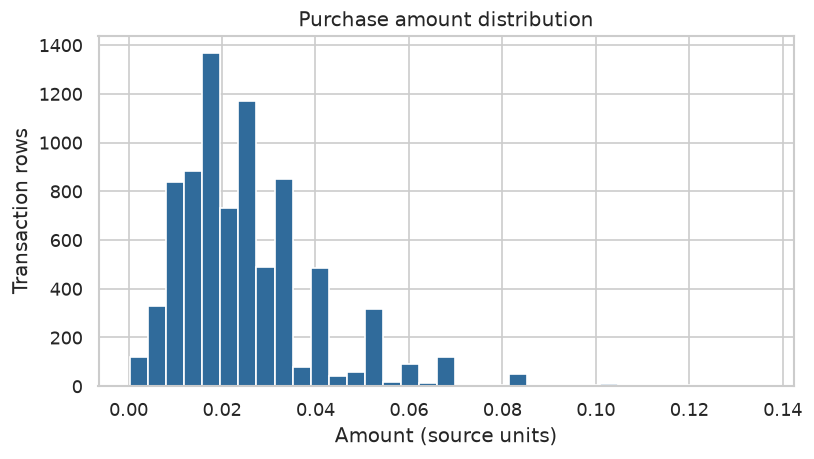
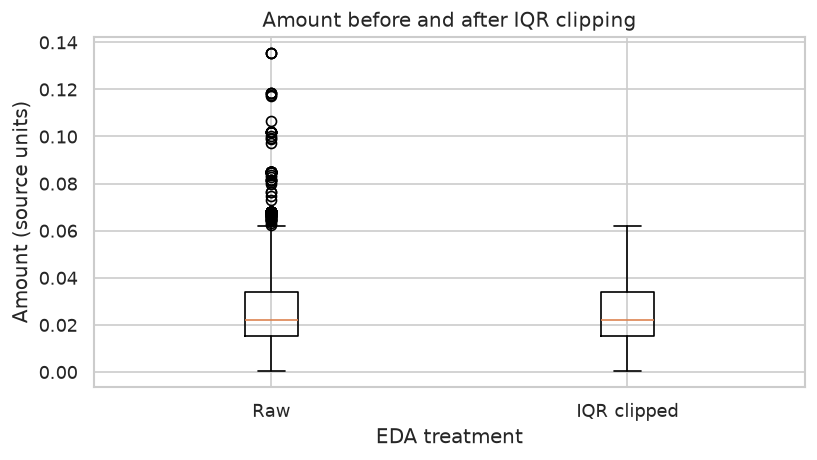
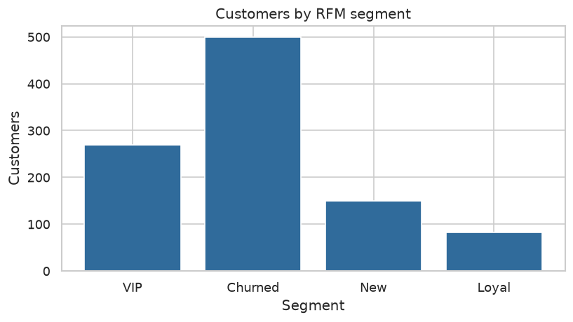
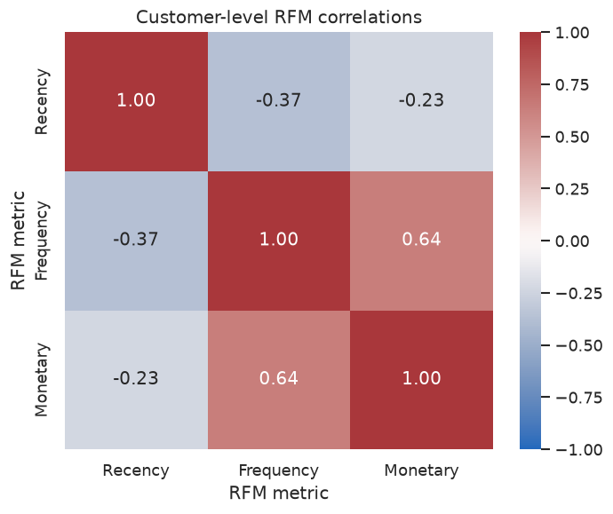
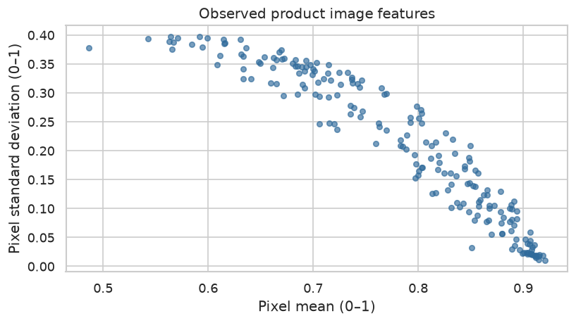
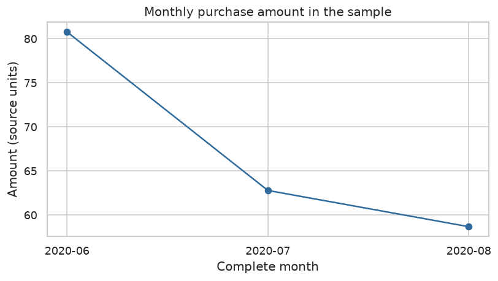

# 공개 집계 분석 보고서

실제 분석 집계를 정리한 보조 보고서다. 실제 행·고객 ID·상품 이미지와 실행 출력은 notebooks/analysis_report.ipynb에 원본 그대로 보존한다.

## 자료 범위

| 기준일 | 유효 거래 | 고객 | 상품 |
| --- | --- | --- | --- |
| 2020-08-31 | 8084 | 1000 | 4705 |

## 기술통계

| 변수 | count | mean | std | min | Q1 | median | Q3 | max |
| --- | --- | --- | --- | --- | --- | --- | --- | --- |
| price | 8084.0 | 0.025013946779157827 | 0.01491216098205857 | 0.0003220338983050848 | 0.01523728813559322 | 0.022016949152542376 | 0.033881355932203386 | 0.13557627118644067 |
| prod_name_length | 8084.0 | 16.088570014844137 | 6.2071401526067245 | 2.0 | 11.0 | 16.0 | 21.0 | 30.0 |
| prod_name_word_count | 8084.0 | 2.8406729341909944 | 1.1054053161320827 | 1.0 | 2.0 | 3.0 | 4.0 | 7.0 |

## 상관관계

| left | right | n | pearson |
| --- | --- | --- | --- |
| image_mean | image_std | 200 | -0.9435457970388688 |
| Frequency | Monetary | 1000 | 0.6396637341139406 |

유효 완전 관측 쌍의 Pearson 계수다. 이미지 관계는 관측 상품, 빈도–금액 관계는 고객 단위이며 인과로 해석하지 않는다.

## 고객 프로파일

| 그룹 | Customers | Recency_median | Frequency_median | Monetary_mean | Monetary_total | Customer_share | Monetary_share |
| --- | --- | --- | --- | --- | --- | --- | --- |
| VIP | 270 | 12.5 | 3.0 | 0.39146773383553046 | 105.69628813559322 | 0.27 | 0.5226984468111786 |
| Churned | 499 | 60.0 | 1.0 | 0.14938918514996094 | 74.5452033898305 | 0.499 | 0.3686474020648835 |
| New | 149 | 18.0 | 1.0 | 0.10161710840632465 | 15.140949152542373 | 0.149 | 0.07487633430540348 |
| Loyal | 82 | 16.0 | 2.0 | 0.0832964034725093 | 6.8303050847457625 | 0.082 | 0.033777816818534465 |

## 월별 합계

| 월 | 원본 단위 금액 |
| --- | --- |
| 2020-06 | 80.76599999999999 |
| 2020-07 | 62.77937288135593 |
| 2020-08 | 58.667372881355924 |

## 정제·대치·IQR

| source_rows | missing_customer_rows | invalid_date_rows | invalid_order_rows | invalid_amount_rows | valid_before_scope | out_of_scope_rows | output_rows | amount_sum |
| --- | --- | --- | --- | --- | --- | --- | --- | --- |
| 8084 | 0 | 0 | 0 | 0 | 8084 | 0 | 8084 | 202.21274576271188 |

| 피처 | missing_before | group_filled | global_filled | missing_after | variance_before | variance_after |
| --- | --- | --- | --- | --- | --- | --- |
| image_mean_eda | 4505 | 9 | 0 | 4496 | 0.010424100859843282 | 0.010130025199517102 |
| image_std_eda | 4505 | 9 | 0 | 4496 | 0.015366862442239771 | 0.014955134682343146 |

| 변수 | lower | upper | count | threshold |
| --- | --- | --- | --- | --- |
| price | -0.01272881355932203 | 0.061847457627118636 | 212 | 1.5 |

## 차트 6종

실제 분석의 원본 박스플롯과 상품별 관측 산점도를 그대로 사용한다.

## 해석과 재현

금액은 원본 단위이고 전체 고객을 대표하지 않는다. 현재 원본 접근권한 없이도 집계 결과를 확인할 수 있다. 실행·SRC·인사이트는 [README](../../README.md)에 본문으로 정리했다. 같은 입력·설정의 전체 분석과 새 환경 재현은 README의 명령을 사용한다.
